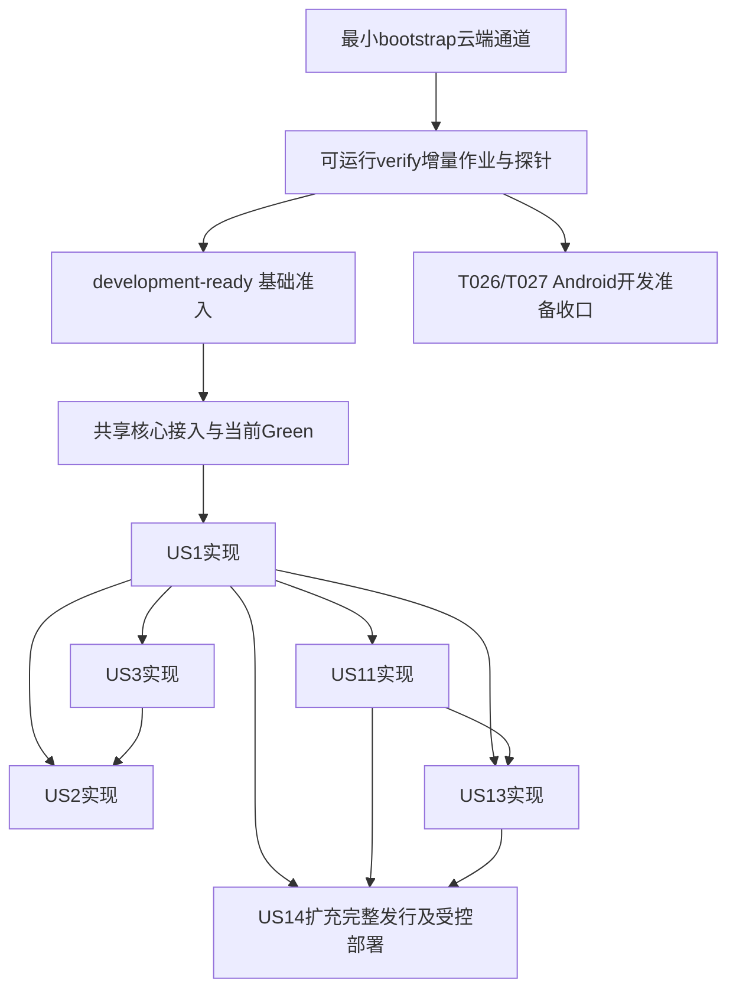

# Implementation Plan: AgoraWeave 首版通用社交与完整插件平台

**Branch**: `main`（实际Git分支；setup-plan返回`001-agoraweave-v1`为功能标识，未创建分支） | **Date**: 2026-10-14 | **Spec**: [spec.md](spec.md)

**Input**: `specs/001-agoraweave-v1/spec.md`；获批[PRD v0.10](../../docs/product/PRD.md)、[UI-SPEC v1.0](../../docs/design/UI-SPEC.md)、[追溯表](traceability.md)、[独立规格复检](reviews/independent-spec-review-2026-10-14.md)、[宪法 v3.1.0](../../.specify/memory/constitution.md)。读取Git HEAD `739e4068947e7e54b9ded691763e2885959e93c7`；输入文件hash与traceability及独立复检一致。名称及换号限制以spec最新明确决定为准。

**Status**: 工程实现与云端基础验证已建立；当前按ED-20收口Phase1，仅在真实Android development-ready证据满足后更新现有tasks，不重生成清单。下一批业务尚未实现，本轮工程交接后暂停。全部17故事、173 FR、10 QR、18 SC、55原AC及AS-01–04保留，优先级不授权延期首版。

**本次补充依据**：2026-10-14六项开发验证规划保留；2026-10-15用户明确批准[分层验证决定](../../docs/engineering/validation-tiering-decision.md)及宪法v3.1.0，取代“完整ci-ready先于任何业务开发”：真实基础通道development-ready后可做业务TDD，CI证据问题按依赖并行修复；Phase1按ED-20开发准备要求收口；后续产品验收、合并／发行同SHA完整适用验证继续强制。具体合同见[cloud-validation.md](contracts/cloud-validation.md)。既有产品／设计输入、追溯、285任务ID与未完成状态保留，不冒称实际通过。

**最新决定**：用户已对18项问题明确答复，见[规划决定登记](reviews/planning-decisions-2026-10-14.md)。公开仓库、当前Codex审查方式（ED-11取代旧路线）、必要开发资料经核验境外处理、用户本人基准确认、阿里云短信已确认。预算／资源／设计确认／部署上线运营由用户处理，工程仅在实际需要时索取；恢复和申诉参数由工程授权细化。该记录更新候选／待决状态，不表述资源已供给或验证已通过。

**独立复检补齐**：用户已授权直接补齐[独立计划复检](reviews/independent-plan-review-2026-10-14.md)发现的三项缺口。当前模型／HTTP／授权／配置／AI帮助来源及验证指南同步分享白名单和有权受限读取、作者收录状态与接口、正式资料版本／发布／适用记录；依据及方案见RD-14和ED-08。未修改获批需求，不进入tasks或产品实现。

**先前独立复检结论（历史）**：原审阅agent针对当时分享／收录／正式资料三项P2确认关闭；该结论不覆盖随后tasks分析提出的C1／I1／I2／G1，也不代表当前任务清单通过。实际实现、资源及云端验证仍在原节点，不以规划复检代验收。

**本次analyze修订**：用户明确要求按四项建议更新plan。C1恢复FR-065无向pair唯一pending；I1将可运行的增量验证作业／调用链前置到共享核心Green之前，US14只扩充完整发行与受控部署；I2明确US1／US3实现均前置US2；G1将FR-113分配到播放器、设置与实际消费入口并细化真实行为矩阵。落点见TD-03／07A／07D／07E、配套契约及[修订核对记录](reviews/plan-analyze-revision-2026-10-14.md)。旧任务编号仅作缺口定位，下一轮speckit-tasks须同步模型原文、断言、DAG／表／故事前置、追溯和必需交接；重新analyze前不得声称四项跨产物问题已关闭。

**后续I3／I4状态**：I3按现有HTTP契约补全GET/PATCH部分更新／CAS／幂等及错误PUT拒绝。I4用户明确选A：匿名和登录分享页均使用默认播放策略及页面内操作，不读取或同步账号偏好；账号设置由App管理。TD-07D与HTTP／授权／配置／验证同步该决定。旧tasks的T192／T198及T228／T233等受影响任务和ready快照仍待下一轮同步，跨产物analyze尚未重跑。

**ED-20 当前执行更新**：2026-10-15 最新执行决定 ED-20：用户明确要求先按 Android 可开发条件收口 Phase1、完成任务清单并进入正式开发；当前不做 iOS 验证，后续跨平台阶段再验证。Phase1 的完成口径改为真实 development-ready 与已实现工程能力可供 Android 业务 TDD，T026/T027 的原完整跨平台正式验收前置后置。详见 [Android 优先与阶段一收口决定](../../docs/engineering/android-first-development-decision.md)。该决定不设置全平台 ci-ready、feature complete、合并或生产批准；Android 当前业务行为仍须目标云端 Red/Green、必要回归及其正式产品验收。

## Summary

完整交付通用社交、只读AI、只读分享、真实治理后台、统一配置、可运行三端插件、正式开发者工具及隔离云端开发验证。移动采用Expo/RN/Expo UI原生，后台固定Kiranism/Next/shadcn，服务端Supabase官方Compose自托管。核心统一身份、当前授权、配置、审计、插件生命周期和数据义务；官方业务全部默认启用且可受控停用。

严格撤权由核心访问网关、主库当前策略与有界输出协调落实；Storage签名和Realtime连接缓存不作授权。受邀插件采用声明式UI及独立受限后端容器，能力代理逐次检查授权。生产消费同版产物／证据，任何生产部署／迁移／权限／版本生效前确认具体版本和范围；指定名单灰度、扩大再确认，旧端兼容功能继续。

## Technical Context

**Language/Version**: TypeScript/SQL/JSON Schema；Node22.23.3 LTS；移动React19.2.3＋RN0.86.3，后台React19.2.4＋TS5.7.2。移动TS按固定Expo官方模板依赖云端锁定，不强行跨端统一React。独立插件Deno2.9.6；核心Edge Runtime1.76.2随Supabase。

**Primary Dependencies**: Expo57.0.28及其关联Expo UI~57.0.23、Router~57.0.26、image~57.0.5、image-picker~57.0.20、video~57.0.5、updates~57.0.26；Kiranism commit `7705dfc0d13889e45c26a55ad5908da6a7a9a605`（Next16.2.12/Tailwind4.2.2范围/shadcn源码）；Supabase self-hosted/v0.8.2 commit `564eab8ad7840b13324f68b1bfac074ef8d51c21`。核验依据见[research.md](research.md)。npm workspaces组织包，各端独立依赖；首个Actions冻结步骤解析精确lockfile与镜像digest，此后immutable install；当前不声称已存在锁文件。

**Storage**: 官方Postgres17.6.1.136、私有Storage对象；PG全文/trigram、关系与依赖索引、事务outbox、配置bundle、审计／独立安全恢复账本。不预置独立搜索／队列集群。主库判授权，DB与对象分别备份。

**Testing**: SP本地编写代码／测试，全部编译、静态检查、测试、UI交互、图像／差异／无障碍采集及回归在GitHub Actions云端；当前 Codex 读取真实证据完成代码与视觉语义审查。独立类型/lint/schema、Node原生与组件检查、真实PG/Compose/Auth/RLS/Storage/Realtime/Edge接口、并发／安全／生命周期／恢复、Playwright网页、XCTest iOS、UIAutomator/Espresso Android、k6性能、合格真实产品AI及自动评估。保存当前 Codex 代码／图像审查记录、Actions实际红绿TDD链和当前提交聚合门禁。工具精确版本在云端冻结前查官方并锁定。按ED-14仅使用Actions云端模拟器，必需能力及硬件排除范围见 `contracts/simulator-validation.md`；原生语义／焦点／键盘／媒体／推送在支持范围内实际执行，缺必需证据仍阻塞。基础development-ready真实核验后完成Phase1工程准备并准入业务TDD；后续产品正式验收仍须全部适用证据。

**Target Platform**: iOS≥16.4、Android≥7、compile/target SDK36；macos-26选择Xcode26.4.1，Linux运行Android emulator/Compose/browser。最低OS与当前OS模拟器资源须Q-16准入，不把编译下限当实际覆盖。中国大陆独立服务器生产，实际环境Q-02核验。

**Project Type**: 原生移动＋后台＋只读网页＋自托管服务＋插件开发平台工作区；逻辑模块化，不新增多租户／社区空间／产品编排。

**Performance Goals**: API P95≤800ms、首屏≤2.5s、在线私信≤3s、AI首有效≤8s／完成≤30s、10k注册/1kDAU/200在线、普通AI有用≥90%继续为暂定测量基线。授权／来源100%和失权读取0为硬门槛，未实测不承诺SLA。

**Constraints**: 禁止本地产品运行／测试／验收；当前逐次授权、产品AI只读、大陆处理/不训练、无客户端秘密、核心不变量、真实原生证据、生产具体确认、同版digest、回滚不复活安全状态。供应商／费用／资源未准入不得实际调用或购买。

**Scale/Scope**: 全部首版17旅程、55原AC和AS；两个通用跨端样例用于正式工具和隔离验收，不作为新生产业务。容量只是测量夹具规模。

## Constitution Check

GATE：研究前核输入与授权，设计后复查。下表“通过”为设计合规结论，不能代替实际产品通过。

| 宪法门禁 | 研究前 | 设计后依据 | 实际交付条件 |
| --- | --- | --- | --- |
| 一 质量/维护 | 通过 | 模块/契约清晰，PG/outbox及成熟框架，必要新增复杂性有依据 | 代码审查＋云端接口/回归 |
| 二 架构/扩展 | 通过 | 核心持续，manifest/隔离容器/有限DB角色/迁移与历史限制 | AC-43–50真实生命周期/隔离 |
| 三 安全/隐私/AI | 通过 | 主库逐次授权，旧URL/Range/实时无旁路，只读MCP/用途闭包/准入 | AC-06/21–26/30–32/42/50，撤权后新读取0 |
| 四 真实验证 | 通过 | 真实红绿、清单聚合、开始／完成门禁等待并读取全必需报告；当前Codex代码／视觉审查 | 全55AC＋AS同版证据，未处置缺陷／缺证据拒完成 |
| 五 云端 | 通过 | 全部项目验证仅Actions；开发准入与正式验收分层，未适用不计通过，生产独立 | development-ready后业务TDD；正式验收仍需完整平台／当前Codex审查与资源证据 |
| 六 原生UX | 通过 | UI-SPEC/token、双端原生、大字/焦点/读屏；首次基准明确审查确认且禁止自动更新 | AC-35/52/55真实各端＋基准审批／差异／交互／AI报告 |
| 七 性能/资源 | 通过 | 暂定值/资源估算/全部尝试分母/成本公式 | Q-03/08实际资源和可复现测量 |
| 八 生产内容 | 通过 | 工程资料独立，替换模板演示，保留必要维护/测试证据 | 最终产物与运行UI/日志检查 |
| 九 决策 | 设计已按明确决定处理 | 保全范围，RD/TD据§21.3/22.2及明确修订授权；C1按原FR-065恢复；I4用户明确A、原分享白名单保留 | tasks及交接重生成复查；新实质冲突先用户决定 |
| 长期技术约束 | 通过 | Expo/RN/UI、官方Compose、Kiranism，查官方固定来源 | AC-36锁定和真实兼容 |

本次受影响规划已按用户明确授权修正，无降低范围或验收的豁免；旧tasks中C1及其他分析发现仍待重生成与跨产物复查，不宣称整个仓库已无违规。真实兼容、准入、性能和产品验收尚未执行。宪法首次批准日期TODO为已有历史缺口，保留不代填。

后续I4已由用户明确A解决设计方向，分享默认／页面内操作与账号偏好来源分开，没有新增读取权限。I3及I4设计落点已同步，旧任务清单和交接仍待刷新与复查；实际产品实现、云端验证、基准及资源节点不因用户决定而通过。

## Project Structure

### Documentation (this feature)

```text
specs/001-agoraweave-v1/
├── spec.md、traceability.md                 # 已有基线不改历史
├── plan.md、research.md、data-model.md、quickstart.md
├── contracts/
│   ├── README.md、http-api.md、authorization-events.md
│   ├── configuration.md、ai-tools.md、plugin-sdk.md
│   ├── plugin-manifest.schema.json、release-evidence.md
│   └── cloud-validation.md                  # 初始化／桥接／TDD／视觉／AI审查
└── reviews/plan-design-check-2026-10-14.md
    reviews/planning-decisions-2026-10-14.md  # 最新答复／责任及授权细化
    reviews/independent-plan-review-2026-10-14.md  # 发现／修订与针对性复检
    reviews/plan-analyze-revision-2026-10-14.md  # C1／I1／I2／G1修订与任务再生成要求
```

tasks.md仅由speckit-tasks维护；本轮保留既有清单，等待用户在下一轮按本修订重生成并更新交接快照。

### Source Code (repository root，拟建布局，本轮不创建)

```text
apps/mobile/                     # 原生五入口/host renderer
apps/admin/                      # Kiranism真实业务
apps/share/                      # 只读分享/登录读取
packages/{contracts,policy,config,design,plugin-sdk}/
tools/plugin-cli/                # 生成文件/提交/调度Actions
supabase/upstream/               # 官方固定Compose与差异说明
supabase/migrations/              # 受控核心/官方模块迁移
supabase/functions/core/         # API/认证/媒体/实时/AI/能力broker
services/core-worker/            # outbox/保留/恢复/归档
services/plugin-runner/          # 每插件受限Deno容器
modules/{content,discussion,social,interaction,discovery,messaging,ai,sharing}/
plugins/examples/{sample-a,sample-b}/
docs/developer/                  # 正式版本化完整开发文档
tests/{contract,integration,security,concurrency,e2e,visual,performance,recovery}/
.github/workflows/               # 全云端验证/预览/受控发布
```

**Structure Decision**: 共享无React公共DTO/schema/字符计数；端内UI保留各端依赖；核心服务与插件容器分开。工程资料不进生产包。已有superpowers-v7是工具资料，不是产品源码。

## TD-01 — 运行拓扑与当前授权

公网仅产品API/分享/后台/获准更新入口，TLS和反向代理限定路由/大小/超时。DB、Auth底层、Storage、Realtime、Studio和对象源站内网。Auth必需协议受控代理，关闭未批准认证方式，Auth hook和业务核心资格同时阻止绕邀请注册。后台Secure/HttpOnly/SameSite cookie与CSRF，移动安全存储；分享会话audience=`share-read`永无社区写权限，客户端channel字段不作资格。

分享用途进一步按HTTP契约逐路由／方法／投影白名单限制，未列GET也拒绝，本人或管理员身份不能放行私人管理入口。当前有权登录用户可读followers／self等合法分享目标及关联媒体，非公开响应no-store/noindex、匿名源码／预览不含正文；未登录或真正无权、已删除分别给不泄漏存在性的登录提示／占位／统一404，不能把受限本身当作有权用户的404。

API、媒体、实时逐新请求和输出单元核当前session_id/账号/角色/操作/环境/插件、通过版、删除/治理、关系/拉黑/依赖/用途；不使用JWT角色快照或TTL正授权。主库授权＋最小grants/RLS二道边界；必要service_role只在窄基础设施适配器，无插件/AI/通用查询高权。一次性首管理员初始化关入口，TOTP MFA和近期动作绑定challenge逐敏感操作核验；DEC-001精确清单不扩大不绕过。

撤权提交为线性化点，策略epoch与耐久拒绝事实统一，访问/撤权使用一致锁顺序和输出admission协调。媒体每GET/HEAD/Range/条件请求/缓存HIT重核，无Storage签名或源站重定向，失权不304。对外no-store，Next正文缓存/图像优化、应用磁盘缓存不服务撤权旧副本；内部字节缓存命中仍授权。流/实时/AI后续单元再核并取消，已交付字节不能收回；新导航/复制/前台恢复/离线重开必须重核。机制实际不达SC-002/AC-31则缺陷，不降到60秒。

生产和dev/test真实独立Compose/database/bucket/账号/密钥/网络/日志/副作用，sandbox按环境/插件隔离，无tenant业务字段。额外broker、隔离runner、安全日志解决明确安全缺口，复用既定Supabase服务网络。

## TD-02 — 官方模块依赖及可停用清单

核心identity/authorization/config/audit/governance obligations/media gate/retention-recovery/registry-lifecycle/release不可普通停卸。必要撤权/证据/删除不是可停的增值业务。

| 默认启用模块 | 新业务运行依赖 | 停用后 | 核心历史义务 |
| --- | --- | --- | --- |
| social资料/关系/请求/偏好 | 核心 | 停新业务变更 | 关注/拉黑事实继续授权，安全撤权仍可执行 |
| content帖子/草稿/串/编辑 | 核心 | 停新发布/编辑/草稿API | 当前有权通过版只读，恢复/清理 |
| discussion评论/回复 | content | 停新评论/编辑 | 合法子回复/占位/原帖依赖 |
| interaction互动/引用/收藏/投票 | content | 停新互动业务 | 合法记录/私密必要移除/到期关闭和清理 |
| discovery流/搜索/趋势/精选 | content、social | 停发现入口/排名job | 直接有权路径不因停用授额外资格 |
| messaging私信/请求/业务通知 | social | 停新发送/接受/业务事件 | 逐消息资格；必要安全通知/删除/证据 |
| ai问答/历史 | content、discussion、discovery | 停新生成/工具/job | 有权历史核来源，删除/撤回/清理 |
| sharing网页/索引 | content、social | 停新业务分享入口 | 安全旧链接投影或占位，撤权/noindex |

运行停用不删除授权事实。停content默认列出依赖并阻止，只有明确选定实际安全闭包才联动停用；停用不等于卸载/清理。历史授权需要的核心事实不构成运行依赖循环。第三方版本依赖有向无环、求闭包、拒冲突，实际组合云端验证。

## TD-03 — 数据与业务事务

[data-model.md](data-model.md)定义字段/关系/唯一/授权/状态，不含迁移实现。通过版revision、串批次、独立删除/治理/依赖隐藏/物理清理分别建模。主库资格过滤后检索/排序/分页，输出前再核；索引不是授权源，摘要/建议/count同权，收藏/草稿/私信不进公共索引。

真实参与与时间衰减排名、偏好过滤、运营标签，无复杂ML；游标签查询/scope/版本，不授权限。聚合来自权威有效事实，过滤名单不等于总数。唯一operation_id＋payload hash、主键/部分唯一索引、短事务行锁处理邀请码/用户名/首票/请求/唯一pair；outbox/inbox effect_key防重，不声称网络exactly-once。审核绑revision_id，整批就绪事务公开，不公开半串。草稿CAS冲突明确选择。

请求初始消息在独立request域；新直接消息进入唯一pair会话，正常分页不读初始消息。显式接受重核时间/拉黑/关闭全部/处罚，原消息ID和时间仅合入一次，阅读/未读迁移不新增提醒。每方message_access独立，删会话只改列表，删单条撤其资格不误删对方。引用传递依赖、评论中间占位、串首帖依赖和恢复影响集不能用统一级联删除代替。

FR-065的pending唯一性按`(min(account_a,account_b),max(account_a,account_b))`规范化无向账号pair执行；sender/recipient只表达方向与操作权限，不能进入pending唯一键形成两份请求。account_pair唯一行锁＋dm_request按pair的pending部分唯一约束共同保证；创建、接受、到期与直接发送使用一致锁顺序并重核当前资格／时间。Actions并发断言须包含A→B与B→A同时提交，最多一pending、一初始消息及对应通知效果，另一竞争不覆盖／追加／自动接受；重试／过期／接受／发送交错仍不复活或重复。FR-067允许的合法直接消息与尚未接受initial继续独立，关注请求规则不随本修订改变。

作者收录由author_index_policy及post/thread的target_index_policy持久化：账号控制本人公开主页／帖子／串，逐目标inherit/allow/deny与账号、当前公开状态及实际展示依赖取交集；与AI用途和阅读权限分离。本人App接口CAS修改，主库epoch／outbox驱动sitemap／主动收录／预览投影，各响应同步当前核；陈旧作业、重新允许或配置回滚不复活旧拒绝／删除。

正式制度／隐私／条款／处理告知／帮助使用managed_document、不可变revision/release及必要receipt，后台录入／预览／受控发布／撤下、各端合法版本读取和历史标识形成闭环。terms_version／notice_version／approved_help_version均有真实版本源；注册同意、必要告知展示和规格要求的主动确认分别记录，不以展示或沉默当同意、不新增老用户登录或公开AI逐次重同意。正式正文用户提供，合成内容仅CI；发布不替代真实供应商／数据处理准入，生产影响仍先按具体版本／范围确认。

## TD-04 — 配置与数据恢复

[configuration.md](contracts/configuration.md)定义注册/bundle/覆盖/consumer/旧对象；全局→环境→该模块/插件→显式授权用户组，同层冲突无唯一优先级拒绝。业务固定一个兼容bundle，当前撤权事实独立实时核。需要重载的consumer全部就绪才激活，失败保旧完整版；普通配置不可关核心不变量。

spec所有初值/ED-02及RD-10均注册。媒体MB工程口径为十进制1,000,000字节；视频合法边界200,000,000字节，Auth/代理/Storage等部署投影联动同配置，官方默认约50MiB不能照抄。期限默认新对象生效，现有expiry/恢复截止/投票原截止/保留起点固化，专门迁移须预览且不复活终态/权限或早毁恢复副本。回滚新bundle不回滚安全事实。

核心保留/清理作业插件缺席仍执行。安全日志独立于业务备份回退，收紧前耐久拒绝意图，未知保守拒绝并对账。恢复隔离，追至最新security watermark、重放删除/注销/撤权/处罚/隐私/AI用途、重建派生物再开读取；日志缺口不开放。DB和Storage分别备份；90天轮转、RPO/RTO仍Q-02/03/08确认与实测。

用户授权恢复目标工程决定后，ED-05明确完整业务数据集RPO≤1小时、RTO≤4小时为初始验证目标；安全账本仍追至当前事实，不容许丢失1小时撤权。目标／实际实测／用户负责的部署运维分别登记，原90天轮转目标继续核验。上段的历史待确认已转为该授权工程决定及实际条件。

## TD-05 — 插件隔离与正式开发者产品

[plugin-sdk.md](contracts/plugin-sdk.md)及manifest schema定义三端位置/组件/事件/权限/兼容/生命周期。UI声明式由Expo UI/shadcn host渲染，插件不运行任意客户端JS/DOM、不取核心token；正式能力支持页面/表单/列表/详情/受控事件，新host/native能力版本化契约和云端构建。插件后端任意业务逻辑独立受限Deno容器，无DB口令/service_role/供应商秘密/host socket；网络仅capability broker，每调用当前授权，不让隔离只停留在SDK约定。

受控迁移限定插件schema临时角色和强制权限模板；运行DB角色非owner/NOBYPASSRLS，运行API不收原SQL。DB extension/跨边界特权单独审摘要，禁止自带高权SECURITY DEFINER。每实例CPU/memory/PID/并发/timeout/日志限额、非root/只读/no-new-privileges/seccomp/有限tmpfs；不使用Deno -A/allow-run/FFI。容器不是绝对安全保证，逃逸/资源负向实测必需。

停用提升lifecycle epoch关闭admission、撤任务lease，在途最终副作用/输出重核；已提交未知查operation，超过排空期限终止并记未知。依赖默认阻止，仅明确集合停用，不自动卸载。历史经审projection当前有权只读，否则无正文占位。卸载分代码/配置/结构/数据结果，原期限不重算、额外永久清理另确认，兼容重装重审权限不恢复tombstone。

正式SDK1.0.0、aw-plugin CLI、manifest/UI schema1.0、契约v1、模板及通用sample-a/sample-b首版交付。A本人合成记录贯通原生/后台/API/权限/升级/恢复；B独立数据与显式只读共享验证跨插件/用户/环境。样例只测试，不新增生产业务。CLI包括生成器在Actions云端执行，本地仅编辑/阅读生成文件、Git及调度/读取Actions，编译/打包/运行/测试/预览均云端。

正式文档完整创建/单端与集成调试/API/事件/迁移RLS/配置权限/生命周期/故障/日志/兼容恢复，SDK/doc/schema/平台同发行。契约v1向后兼容追加，维护当前＋前一兼容minor；breaking major并行适配直到安全迁移，不凭支持时长到期强更安全旧功能。受邀文档按当前身份访问，限时云端预览仅合成数据。

## TD-06 — 生产、灰度、旧端与证据

[release-evidence.md](contracts/release-evidence.md)定义同发行digest、权限/迁移/环境/名单摘要、当前超级管理员/MFA/近期challenge/DEC-001及一次性Actions OIDC租约。任何生产影响动作均先确认，摘要/范围改变使旧确认失效；扩灰新确认。GitHubEnvironment为附加锁，不取代产品管理员身份，套餐不具required reviewers也不能放开核心门禁。

四类更新按最高实际要求：现有配置、服务/后台/结构、匹配native runtime兼容OTA、新native或不兼容App重建。显式runtime ID＋Actions原生指纹门禁，不使用experimental策略作保证；自托管expo-updates受签名/名单/兼容约束。名单与数据权限相交，百分比rollout不代指定名单。旧端安全兼容功能保留，仅局部扩展提示更新；核心确实不安全兼容才全App强更，安全/申诉路径可达。

灰度工程观察起点24小时且至少100核心操作/20扩展操作，无越权/复活/严重缺陷/必需缺证据，技术失败率≤1%作为暂定保护阈值；样本不足继续观察，性能候选偏差同时报告。Q-03/08启用前核资源/阈值，非生产SLA。泄露立即关闭admission，恢复不扩名单不回滚安全日志。

同发行构建一次、实际测试和发布同digest；签名后如变化登记派生关系并验证实际最终包。每条证据含SHA/版本/config/runtime/artifact_id/raw digest/archive digest（分开）/run-attempt/toolchain/AC-AS-FR/状态/报告截图轨迹。fail/skipped/cancelled/timed_out/missing/unavailable全不通过；失败也上传，无文件上传error，不能手改通过或沿用其他提交。

证据还绑定阶段／必需检查清单、TDD红绿链、设计／基准确认、开发AI代码与视觉报告／处置、桥接报告读取与完成记录。GitHub本身接受skipped／neutral的保护语义不能替代项目规则；当前最终SHA全必需结果及原报告满足后才能标记完成。初始化只证明CI条件，不证明业务或产品视觉已经通过。

正式摘要和必要原证据持久受控归档，普通测试90天、正式发行证据初始1年为工程分类；费用/权限Q-03/16，敏感原文服从更短业务分类（AI调试最长7天），不把Actions run URL当永久记录。Actions retention当前也覆盖run/check。所有部署身份验证实际repository_id/workflow_sha/ref/environment/run，不假定旧OIDC sub。

## TD-07 — 云端执行层

[quickstart.md](quickstart.md)为验证指南，所列工作流名/项目命令是未来实施契约，当前没有创建。

| 层 | 实际运行和证据 |
| --- | --- |
| Linux服务 | 官方Compose/核心Edge/媒体实时broker/A-B容器，真实Auth/DB/RLS/对象/并发/生命周期/恢复 |
| Web | 真Kiranism/分享Next，Playwright逐角色/只读/CSRF/源码/视觉焦点；Next build另跑lint |
| iOS | macos-26/Xcode26.4.1构建安装原生，XCTest/截图/语义焦点与适用审计；最低/当前OS独立模拟器层，VoiceOver限制按ED-14明示 |
| Android | 云端加速emulator原生UI/媒体/权限/视觉/语义与可用辅助服务；推送/省电的可验证范围和硬件排除按ED-14 |
| 外部与AI | 获准测试通道合成数据，真实合格模型来源/授权/质量评估，mock不代替 |
| 性能/恢复 | 固定设备网络/负载/样本、故障注入、旧备份+最新安全日志、对象完整和轮转 |
| 开发者 | 正式资料从零样例，云端单端/跨端预览/打包/生命周期，不改核心 |

核验Actions checkout7.0.1 SHA `3d3c42e5aac5ba805825da76410c181273ba90b1`、upload-artifact7.0.2 SHA `cf430e030ddbb5b0abf93d22962f4752f3646cd9`，内置Node24/runner≥2.327.1；可选attest4.2.2 SHA `1e69f48acb82d1966a394da916b4c1698aa569d6`须实际套餐。其他action首次选择查官方锁SHA；下载采用官方artifacts REST按ID校hash，不猜未核验download-action。

### TD-07A — 初始化与业务衔接

采用bootstrap／TDD／verify工作流及真实聚合check，清单、影响和完成目标决定必需集合。bootstrap-only仍只编写无业务基础设施；固定安装／构建、非空测试通道及所需真实隔离服务健康并取得独立development-ready后，可沿原DAG做业务TDD。不影响目标行为的完整CI证据问题并行修复；基础通道、目标结果或安全前置缺失暂停依赖工作。T026／T027以当前真实development-ready收口Android工程准备；最低／当前双端壳、完整采集归档与全图审查的正式ci-ready责任登记后续，不再阻塞Phase1。未实现业务在初始化not_yet_applicable，不计通过；首版全量验收不留未适用。基础准入绑定源与目标祖先关系及稳定foundation输入，锁／工具／门禁／契约漂移重新核验。

**2026-10-15验证效率局部修订**：在当前安全检查点先完成调度、缓存及证据读取的工程行为TDD，再沿现有任务继续；不新增通用调度平台、不重排任务ID／依赖或缩减产品验收。真实运行基线及实施顺序见[验证效率执行说明](../../docs/engineering/validation-efficiency.md)。同一目标提交按事件／实际checkout／profile／check_set／环境／产物身份确定唯一必需执行链，优先消除独立原生流水线与共享完整流水线重复启动、push与PR双事件；不同HTTPS输入等实际环境不得直接互代。保留真实分支保护check与准确PR head／merge绑定，不能通过关闭保护、skip或空check省算力。

中间反馈、正式开发S_G与完成验收分开调度；反馈明确`readiness=not_evaluated`，不能充Green、任务验收或ci-ready。开发S_G使用同oracle／fixture、受影响套件及必要回归，不每提交无条件启动完整平台矩阵；以整个实际diff、依赖、任务／契约和风险冻结范围，未知影响用完整适用集合。工程门禁、调度、缓存和取证也先真实云端Red→Green。Phase1 T026／T027执行ED-20五项基础集合；后续产品验收、合并与发行仍同最终SHA执行其完整适用OS／服务／网页／安全交互／审查／归档清理／拒绝探针；不能借分类删正式集合。

确认被替代或重复且不承担唯一未读Red／当前必要验证的旧运行才可取消，保留原状态、日志及取消依据，保护归档清理。依赖按lock／工具链／平台缓存，构建输入另含源码／配置摘要，命中仍校验并真实执行；独立job在已证明前置满足后并行，保留真实安装／健康／发现及报告依赖。详细身份、取消保护、缓存拒绝与实测口径见cloud-validation §2.2。

**I1前置调用链**：ci-ready必须同时证明`verify-release.yml`的business-increment编排已可调用，真实执行初始化已适用的安装／健康／非空目标发现／静态与壳交互探针、报告归档和当前Codex审查记录，再由聚合读取原报告。可复用`ci-bootstrap.yml`或独立可复用作业，必须有实际调用与同SHA证据；不能只创建check／转发空结果。共享核心编写阶段先将当前迁移／seed／接口／安全／并发／恢复／各端组件与必要审查逐一接入同一已存在的增量调用链，取得每行为Red后实现；执行核心Green（旧T048）前所有已激活入口／脚本／发现规则均已实现且在Actions可运行，不依赖US14。US14的旧T167只能在此基础上扩充已实现业务的全量发行覆盖、最终产物冻结及独立受控部署。各阶段具体产出／拒绝探针见cloud-validation §2.1；聚合始终运行不能代替这些作业。

初始化先以bootstrap清单／bootstrap-only范围调用共享编排，证明实际构建／所需服务健康／非空目标执行及报告认证；不等待尚未产生的完整ci-ready。独立development-ready认证后可用business-increment接入核心和故事；当前基础集合由T026／T027闭合；完整跨平台正式证据后置，避免执行入口与正式验收循环。

### TD-07B — 桥接强制检查与云端TDD

当前guard只管职责，handoff快照／checkbox不能校Actions；before／after_implement已注册非bridge命名空间mandatory的agoraweave.ci.start／complete。项目验证适配与单一状态转换入口仍须真实云端receipt：start区分bootstrap-only和business，complete冻结当前SHA／清单，枚举、等待全部必需云端结果，下载校摘要并读取报告后才可勾任务／设complete，并在转换处再次强制核验；已注册不等已经通过，只打印／过滤钩子或直接旧脚本不能绕开。桥接6.4.2描述与安装SP7的实际兼容由初始化云端探针核验，本轮不改技能或脚本。

TDD先提交只含目标测试的S_R，Actions实际失败且读取报告确认原因是缺行为／真实缺陷后才写实现；环境／编译／缺凭据不算red。开发S_G执行相同测试、受影响套件与必要回归，正式验收的最终SHA另执行完整适用集合。数量由真实需求、边界、异常和风险决定，测试／oracle实质变化重建red链。Red原failed状态保留，不算业务passed。

上述调度／去重／取消保护／缓存／证据复用也是新增或修改的工程行为，先按T008–T013取得合格云端Red并读因果，再修改T014–T023对应实现。final完整验证前一次整理代码、测试、canonical任务与工程资料并冻结目标SHA、契约和必需集合；所有最终必需结果、审查绑定和读取记录仍指向该SHA，外部私有证据库接收completion record，不为补写通过记录再提交。冻结后任何仓库输入改动均产生新SHA并重新执行必需验收，不能借文档分类继承旧通过。

### TD-07C — 视觉基准与当前 Codex 审查

Actions分别运行后台／分享网页、iOS、Android和插件，按UI-SPEC页面状态／主题／字号／键盘／设备矩阵保全图、差异与交互证据。首个baseline-candidate按已确认原型／视觉规范和最新业务审查，附AI视觉／交互报告，由用户或其明确授权的设计验收人确认具体摘要；尚未发生的确认不能记已批准。后续差异必须修复或按设计变更审查批准新候选，保留旧图／失败，不自动接受差异或重拍基准。

按用户明确确认的 ED-11，由当前 Codex 审查当前 SHA 的代码／测试／契约／真实报告和各端实际图像／基准／设计／交互报告，分别保存有输入摘要、覆盖、findings、处置和未知项的代码及视觉记录；取消额外独立云端 AI 作业与专用 API 凭据。所有静态检查、构建、测试、运行、图像／差异／交互采集及自动门禁计算仍只在 Actions。审查不能代替真实测试，未读图／漏范围／未处置缺陷／无法判断不通过，首基准仍由用户确认。详见 cloud-validation §6 与最新执行决定。

同一artifact仅在repository／run／attempt／artifact ID／目标与checkout SHA／workflow／环境身份及raw archive、解包文件摘要全部校验相同时复用已下载字节，减少传输和重复轮询；新attempt、内容变化或身份不符重新取证，缓存不是passed证据。每次最终判断仍枚举最新必需终态，当前Codex实际读取全部必需报告、失败明细和原图，审查记录重新核当前SHA／覆盖／处置。ED-14模拟器范围与ED-18 Android7系统警示栏的受限例外原样保留，不扩大not_applicable。

### TD-07D — 媒体播放偏好与消费入口

**I3方法一致性修订**：本人偏好接口统一`GET/PATCH /me/preferences`，PATCH是明确字段的部分更新，保留其他已保存偏好，沿用base_version／operation_id、当前本人资格及幂等／CAS规则；PUT不注册。下一轮任务须将旧T192／T198的GET/PUT同步为GET/PATCH，并覆盖PUT拒绝、部分更新不重置未列字段、非法／错版无半保存、同operation重试及不同payload冲突；客户端方法与服务注册表也同源核对。不能让测试和实现同时偏离HTTP契约。

**I4用户明确A（ED-10）**：匿名与已登录分享页都从合法分享UI固定默认策略和当前页面操作求播放状态。初始视频仍wifi_only／静音、蜂窝点击，浏览器不允许自动播放或不能可靠确认所需网络条件时使用真实点击回退；GIF遵守视区／省流量／减少动效。页面可显式播放／暂停／静音／开声、调整当前页面自动播放及关闭预加载，动作只改变页面状态，不保存为账号偏好、不宣称已同步App或跨端。没有本人播放偏好接口，也不从私人`/me`、`/config/effective`、SSR高权查询、HTML hydration、共享缓存或身份登录返回中取得账号preferences。分享登录仅改变当前内容读取资格，不改变播放偏好来源；App继续以GET/PATCH管理账号设置。下一轮旧T228／T233及相关配置、授权、安全／回归任务按此改写，不能只删除“本人preferences”字样而漏默认／页面控件和不读取账号数据的实际断言。

FR-113／PRD MEDIA-06由独立播放策略与真实播放器承担：移动`apps/mobile/src/features/media/`提供视频／GIF组件及网络、视区、前后台／焦点、省流量、减少动效适配；`packages/contracts/`声明偏好DTO，`modules/social/`和本人preferences接口持久化三值自动播放策略及preload选择，移动设置页提供真实读写／失败反馈。默认视频wifi_only且静音，蜂窝由本人点击；always允许Wi-Fi／蜂窝自动播放、never均点击。用户主动开声与静音控件可用，不能因重用列表播放器把上一条开声自动带给下一条。关闭preload停止未触发播放的推测性下载／离屏预取，主动播放所需缓冲不算预加载；不额外确认此前未指定的preload初始布尔值。

GIF可视时才可自动动起来，省流量／减少动效时用静态预览与显式播放控制；移出视区或页面失焦暂停／释放或采取可测的降耗方式。视频也由当前可视／活跃状态控制，网络从Wi-Fi变蜂窝时wifi_only不继续自动启动／预取未主动选择的媒体。客户端偏好和系统条件不授予读取资格，后续GET／Range／缓存命中仍经当前授权，受限媒体不为预加载另开绕行路径。

US3负责共享视频／GIF播放能力及发布预览接入，US2负责App个人播放设置及主页消费，US6负责流／搜索／收藏和详情入口，US4／US7负责各自合法GIF。US9分享按ED-10只用默认与页面内操作；US10后台和US12插件host只消费其audience已有合法来源的实际播放输入，不能从“同语义”推导额外偏好读取权限。浏览器或系统不允许自动播放时提供真实点击回退。没有视频权限的评论／私信不因此新增视频功能。每入口登记实际组件／播放输入来源／适用用例，编辑器或上传成功不能代消费侧播放通过。US16负责跨端／原生可访问性／模拟器媒体／全入口汇总，不承接全部播放实现或充当通用播放探针。各端Actions行为断言与实际下载／播放器状态／交互证据见quickstart V19A，不以截图推断网络或播放行为。

### TD-07E — 实现前置与任务再生成约束

下图仅展开本次受影响前置，箭头表示“已实现并完成该增量当前适用Green”，不要求上游整个故事的全部consumer已完成。所有故事仍要求共享核心Green，其他依赖和全部17故事首版范围继续保留。



| 节点 | 必需前置／产出 | 完整验收边界 |
| --- | --- | --- |
| 初始化／核心Green | 核心行为前真实非空增量执行链与development-ready；当前核心目标及受影响回归在Green前接入执行 | 后续完整正式验收责任保留；不能等US14建立首链，探针不代业务AC |
| US2实现 | 共享核心、US1-implementation、US3-implementation；身份和通过内容实际接口已验证 | US5及后续真实关系消费者／通知仍需完整回归，不以fixture代消费者 |
| US14实现 | 共享核心及US1／US11／US13实现；消费既有增量验证链 | 扩充所有已激活发行检查和生产拒绝／同版产物验证；完整AC待全部consumer，不阻塞早期核心验证 |
| FR-113 | US3共享播放器、US2偏好、各故事真实消费接入均明确实现／测试责任 | US16及最终门禁汇总各实际端和入口的行为／网络／读屏／视觉证据 |

下一轮speckit-tasks须同步：C1模型逐字约束及双向并发断言；I1前置真实作业实现／调用／探针与后续扩充职责；I2的US1→US2及US3→US2边同时出现在完整DAG、前置表、故事前置说明；G1播放器／设置／消费入口及每项行为的Red／Green／回归和FR-113追溯。编号可重排，不以旧T号固定范围。按同一依赖集合核图／表／正文，发现缺边、额外边或环须先修正再交接；刷新mandatory handoff的契约摘要／快照，旧ready不授权执行修订后的任务。

## TD-08 — 全范围定位

原traceability的202条逐项映射和55AC完整前置/异常/直接访问持续有效；此表仅连到设计，不能代验收全文。

| 领域 | 完整规格 | 模型/契约定位 | AC/AS |
| --- | --- | --- | --- |
| 账号 | FR-001–008 | 身份/HTTP认证/会话挑战 | AC-01–03/30/32；AS-03 |
| 资料/关系 | FR-009–017 | social事实/请求/名单/策略 | AC-04–07 |
| 内容/草稿/串 | FR-018–027 | revision/batch/CAS/media/operation | AC-08–10/17；AS-01 |
| 投票/讨论 | FR-028–040 | poll锁/更正/comment占位 | AC-11–13；AS-01 |
| 编辑/可见/恢复 | FR-041–052 | 通过版/依赖/删除影响集 | AC-06/10/14–15/25/31–32/37 |
| 互动/发现 | FR-053–060 | 私密收藏/真实聚合/检索排名 | AC-07–08/16/18 |
| 私信 | FR-061–072 | 无向pair一pending／反向并发、独立请求/唯一会话/逐消息资格 | AC-19–21/54；AS-01–02 |
| AI | FR-073–089 | 只读MCP/用途/来源/quota/准入 | AC-22–26/42 |
| 分享 | FR-090–094 | share-read逐路由／投影、合法受限200、author/target收录状态与接口、无缓存SSR/noindex | AC-27/31 |
| 治理后台 | FR-095–107；最新答复16 | 最小证据/独立申诉/逐操作MFA；正式制度／条款／告知／帮助版本与适用记录 | AC-01/22–23/28–30/37/42；AS-03；用户答复16功能场景 |
| 媒体数据通知 | FR-108–124 | Range gate、TD-07D播放器／偏好／全部消费入口、保留恢复/outbox/投递 | AC-03/08/20–21/25/31–35/46/50；V19A |
| UI原生 | FR-125–129 | token/state/模拟器语义焦点及适用辅助技术 | AC-35/52/55 |
| 配置 | FR-130–141 | 注册/bundle/旧对象/consumer | AC-38–42；AS-04 |
| 核心扩展生命 | FR-142–159 | SDK/schema/broker/容器 | AC-43–46/48/50；AS-03 |
| 交付开发环境 | FR-160–173 | 版本/名单/确认/evidence/云端 | AC-47–53 |
| 质量 | QR-001–010/SC-001–018 | 全宪法门禁＋同发行证据 | AC-01–55、AS-01–04 |

## TD-09 — 可复现测量与成本

工程夹具10k合成账号/100k帖/300k评论/1m私信/200连接；混合70%读/20%写/10%媒体，AI独立注明模型/并发。预热5分钟、稳定30分钟、每类至少1000请求，端任务各至少100次；记设备/OS/网络/资源/数据分布、冷热、p50/p95/p99和全部有效尝试成功/失败/超时/未知分布。API往返与服务端分别计，私信至对端render，AI心跳不算首有效；不筛快速成功。可用性实际任务窗口比例，未批准不定SLA。

资源估算起点：独立Compose核心4vCPU/8GiB/80GiB；插件0.5CPU/256MiB/PID64/并发8/单调用5秒/临时32MiB/日志1MiB每小时。仅费用/测量起点，非生产已批规格；媒体流式不全200MB读内存。每完整候选发行至少服务/安全恢复、网页、iOS模拟器、Android模拟器、真实AI五类作业（设备范围按ED-14），修复回归另计。完整首版七个技术域：核心授权、完整社交、AI来源、治理配置、SDK隔离、三端UI、交付证据；分组不生成实施任务或授权延期。

成本=各OS runner分钟×实际价格＋设备会话分钟＋sandbox实例/存储/网络＋独立生产主机/对象/备份/安全日志＋短信/审核调用＋AI token实际/待对账账单＋推送渠道＋artifact/正式档案。Q-03无预算/日期、Q-04无服务，当前不能给虚构报价、采购或降范围。纯AI开发不假设人工团队；实际排期须预算和资源确认。

另计初始化探针、TDD多次红绿／修复、当前Codex代码／图像阅读与重审、基准候选和差异证据存储、门禁／归档读取费用；不把开发审查费用计入产品用户20次额度。费用待确认不授权跳过审查或先写业务后补CI。

用户最新明确自行处理预算／日期／费用，以上仅为资源分类和既有估算口径，不再作为规划前提要求用户给金额。工程优先public标准GitHub-hosted runner，实际缺外部账号／设备／服务／存储时按ED-07具体索取，不自行采购或改变完整验收。产品AI金额控制通过后台统一配置交付，真实运营金额由用户设置。

## TD-10 — 剩余条件

| 登记 | 当前决定／责任与所需依据 | 需要时的节点 |
| --- | --- | --- |
| Q-02 | 用户已有服务器，部署上线用户负责；实际需要隔离环境／连接参数／数据路径时索取，安全边界仍核 | 真实环境或生产节点，不在本轮连接 |
| Q-03 | 日期预算费用用户负责；public标准runner免费依据已核，准确账户套餐未返回；缺资源具体索取 | 实际资源使用前，不再泛问预算 |
| Q-04 | 阿里云短信已选，测试前用户供签名／模板／凭据／接收对象；审核／推送／产品AI按需提供，既有政策不变 | 相应真实集成测试前 |
| Q-08 | 工程参数／tokenizer／撤权／恢复实测；性能保持暂定；ED-05已确定RPO/RTO，后台金额用户设置 | 配置启用和真实验收 |
| Q-11 | 公司运营；做内容管理／版本／发布／展示与适用流程，真实制度／告知／条款／帮助由用户提供；ED-06申诉参数由工程决定，复核账号用户配置 | 真实内容／治理节点，不造运营文件 |
| Q-16 | 设备／最低OS／签名渠道／预览／测试资源用户处理，工程实际需用时索取；工具锁与证据验真工程负责 | 必需原生／集成验证前，缺资源仍未通过 |
| Q-10 | AI附件/语音/外联网/完整认证新明确批准 | 后续范围；首版默认不启用 |
| CV-D01 | ED-11已确认当前Codex审查代码和实际云端图像报告，取消额外审查API账号；受审输入、覆盖、findings和未知项分项存证 | ci-ready前核记录／图像绑定，缺审查或真实证据仍拒绝 |
| CV-D02 | 用户本人确认具体首个基准及需要批准的变更；确认人已定，候选实际未产生 | 候选可审阅后具体确认，未确认不宣称视觉通过 |
| CV-V01（新增核验） | Actions首次事件／必需check和套餐、工具锁／报告链、桥接版本适配／强制拒绝探针、审查通道／资源 | 基础development-ready准入业务TDD；正式ci-ready与合并／阶段验收仍完整核验 |

已确认S21/S23/DEC-001/栈/首版不重问。条件待核验不减AI或原生验收；云端实测不能满足现有要求则按宪法九报告冲突影响/选项并等待明确决定，只暂停依赖部分。

本表已将18项答复转为确认／工程职责／用户供给，不把“用户处理”保留成当前待选问题或宣称实际已完成。新的超出授权的数据类别、实质行为冲突仍按宪法九处理。具体生产版本／范围仍需原规则的操作前确认，未自动授权上线。

## Complexity Tracking

本次无新增架构复杂性或宪法豁免；旧任务中的已知违规待重生成复查。媒体/实时broker解决严格撤权，声明式SDK/独立容器解决受邀隔离，安全日志解决旧备份复活，生产broker解决管理员确认，证据档案解决云端保留。均对应明确需求，复用既定栈并列维护/费用，不能凭复杂性绕门禁。

## 技能流程记录

extensions.yml解析成功；before_plan唯一enabled/condition为空mandatory guard已实际执行且allow，setup-plan -Json成功。Phase0三项研究完成，工程未知已选择；Phase1模型/契约/quickstart完成并复核宪法。after_plan无注册项。本轮止于技术计划，没有tasks/实现/生产自动推进。

本次补充再次读取宪法及输入／既有计划，解析hooks并执行before_plan guard允许；只读核验现有桥接及官方AI／Actions能力，补RD-11–13、cloud-validation、quickstart与证据字段。当前必需实现前／完成后验证适配均只是规划，未安装；不把这次规划guard允许或文档检查当实现门禁已满足。after_plan在结束前再次读取，无注册项。

本次analyze修订再次读取AGENTS／宪法、规格／PRD／UI依据和现有tasks／ready交接；before_plan guard实际allow，setup-plan定位原文件且不覆盖。本轮仅更新规划及配套设计／核对记录，未改tasks、交接JSON／快照、技能、脚本或工作流；guard自然追加真实事件。没有新外部工具／版本选择或研究未知，RD-15依据既有资料闭环；不新建研究任务或触发Actions。结束再次解析after_plan，实际结果记入修订核对记录。

最新执行决定见 [ED-11／ED-12](reviews/execution-decisions-2026-10-15.md)：当前 Codex 负责代码及真实云端图像审阅，用户服务器保存私有证据；历史路线按该记录取代。
