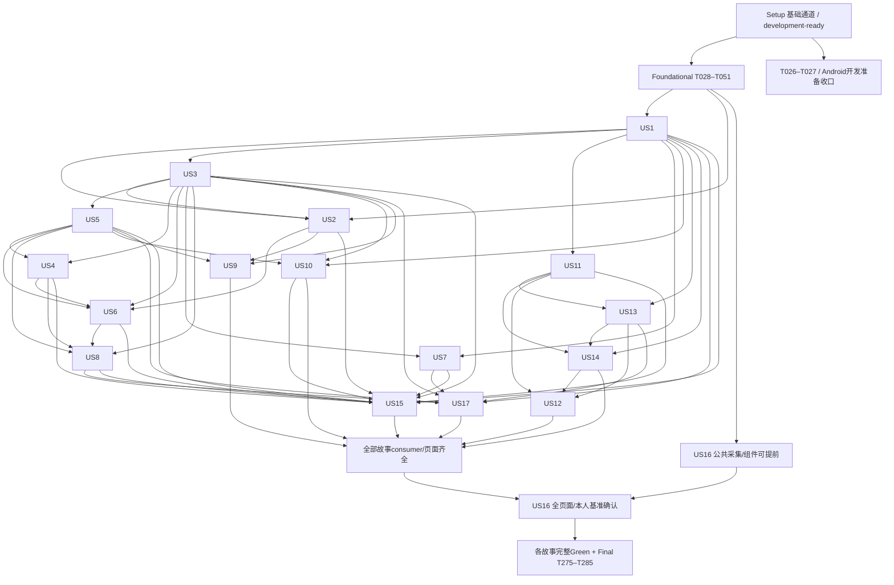

# Tasks: AgoraWeave v1 — 完整首版

**当前执行口径**：2026-10-15 最新执行决定 ED-20：用户明确要求先按 Android 可开发条件收口 Phase1、完成任务清单并进入正式开发；当前不做 iOS 验证，后续跨平台阶段再验证。Phase1 的完成口径改为真实 development-ready 与已实现工程能力可供 Android 业务 TDD，T026/T027 的原完整跨平台正式验收前置后置。详见 [Android 优先与阶段一收口决定](../../docs/engineering/android-first-development-decision.md)。该决定不设置全平台 ci-ready、feature complete、合并或生产批准；Android 当前业务行为仍须目标云端 Red/Green、必要回归及其正式产品验收。

**更新日期**：2026-10-15。当前工程工作树为`C:/Users/by970/.codex/worktrees/tdd-rebuild/my-project`，分支`codex/agoraweave-tdd-rebuild-clean`。历史规划起点为`665fffada2dd4fb908b53ad7ca16159ce5e263d8`。

**Input / Prerequisites**：已完整读取 [AGENTS.md](../../AGENTS.md)、[宪法 v3.1.0](../../.specify/memory/constitution.md)、[spec](spec.md)、[plan](plan.md)、[research](research.md)、[data-model](data-model.md)、[quickstart](quickstart.md)、[traceability](traceability.md)、[PRD](../../docs/product/PRD.md)、[UI-SPEC](../../docs/design/UI-SPEC.md)、[token](../../docs/design/design-tokens.json) 及其草稿档案；以 [最新18项决定与ED-05–08](reviews/planning-decisions-2026-10-14.md)、[计划设计检查](reviews/plan-design-check-2026-10-14.md)、[独立计划复检](reviews/independent-plan-review-2026-10-14.md)、[独立规格复检](reviews/independent-spec-review-2026-10-14.md)、[质量清单](checklists/requirements.md) 及 [规划修订核对（含I3/I4与ED-10）](reviews/plan-analyze-revision-2026-10-14.md) 为最新依据；ED-10的用户明确A与最新plan TD-07D／HTTP／授权／配置／V12B／V19A约束本次任务更新。

**Contracts**：[HTTP](contracts/http-api.md)、[授权／事件](contracts/authorization-events.md)、[AI](contracts/ai-tools.md)、[配置](contracts/configuration.md)、[SDK](contracts/plugin-sdk.md)、[manifest schema](contracts/plugin-manifest.schema.json)、[发行证据](contracts/release-evidence.md)、[云端验证](contracts/cloud-validation.md) 与 [目录](contracts/README.md)。

**阶段一进度**：T001–T027按ED-20现行要求完成；其余258项保持未勾选。本次勾选依据工程实现及目标Red/Green、`eb9daaa`的真实五项development-ready原报告（run38749332496/1，已核ZIP并读取）。本检查点提交后对其最终SHA再核同集合，最终外部记录以该SHA为准，未取得时不宣称最终核验通过。详细边界见[交接](../../docs/engineering/bridge-next-window.md)。

**本次 I3/I4**：App本人偏好统一`GET/PATCH /me/preferences`，PATCH部分更新保未列字段及CAS／幂等，错误PUT拒绝。ED-10明确匿名／登录分享仅取合法平台默认与当前页面操作，账号设置仍由App管理；不新增账号偏好投影、读取或同步路径。现有285个任务ID和全部故事／首版范围保留，T001–T027按ED-20工程口径更新；其余为后续Actions实现/验证责任，未实现业务不计通过。

**Tests**：用户明确要求CI先行与Actions云端TDD。功能、契约、授权安全、并发、集成、真实端到端、视觉／原生／读屏、回归、恢复及测量均按适用范围强制执行。每行为先测试，S_R云端真实缺行为／缺陷断言失败并读因果后才实现；开发S_G同oracle/fixture、受影响套件及必要回归，正式验收最终SHA再执行完整适用集合。编译、导入、环境、网络、凭据失败不算Red；不能删断言或改oracle换绿。

**Organization**：Setup → Foundational → 17故事（P1再P2，各组按US编号）→全量封口。编号是清单引用顺序；执行服从下方实现依赖DAG。P2作为P1真实依赖须提前实施，优先级不删减首版。

**最新执行决定**：按[ED-11／ED-12](reviews/execution-decisions-2026-10-15.md)同步当前Codex代码和真实云端图像审查、用户服务器私有存储；285个任务ID、真实Actions执行／TDD／基准确认要求不变。

**历史生成边界**：初始生成本清单时全部任务未勾选，路径均为拟实施目标。当前进度按真实证据及最新ED-20维护；`ready`仅表示交接资料齐全，任务勾选范围以所在阶段现行条款为准，不表示未实现业务、全平台正式验收或生产批准。

**2026-10-15早期局部效率修订（历史）**：按用户授权仅补充现有编排、缓存、取证、审查及T026／T027的执行要求；不重生成清单，285个ID、依赖DAG／表、故事／需求追溯与勾选状态均保留。实现顺序、真实基线与无可比数据限制见[验证效率执行说明](../../docs/engineering/validation-efficiency.md)，合同见cloud-validation §2.2；本文修改不是优化实现或云验收已通过。

**2026-10-15分层验证批准**：依据[用户决定与迁移记录](../../docs/engineering/validation-tiering-decision.md)及宪法v3.1.0，基础构建／非空测试通道／所需隔离服务健康取得独立development-ready后，可按原故事DAG做业务TDD；不影响该行为的完整CI证据问题并行修复。开发S_G用同oracle／fixture、受影响套件及必要回归，未知影响用完整适用集合；后续完整正式ci-ready、任务验收、合并／阶段验收／发行同最终SHA完整适用验证仍强制。全部285个任务ID保留；最新ED-20已进一步调整本轮Phase1收口口径。历史工程移交未冒称Setup或T027完成，当前勾选另须实际development-ready证据。

## Format: `[ID] [P?] [Story] Description`

- 每任务格式为`- [ ] Tnnn [P?] [USn?] 动作＋具体路径`，已完成用`[x]`；Setup/Foundational/Final无US标签，故事任务必有。
- `[P]`只表示同一波前置全部满足后的不同文件任务可并行；不能跨Red／Green并行，也不要求自动委派。
- 本地仅编辑／阅读文件、Git及调度／等待／下载读取Actions。项目静态检查、编译构建测试运行和验收全部Actions；“通过工作流”是未来云端调度任务，不在本地执行npm／工具脚本。
- 一个汇总Red任务须为每个实现行为分别记录红链，不代表阶段内任意实现可以共用无关Red。每个行为的开发S_G须同oracle／fixture、受影响套件及必要回归；实现任务勾选前另须该任务当前适用必需集合、报告读取与审查，不能最后才补TDD或以开发Green代验收。
- 缺资源按ED-07在实际需用时说明用途、最小权限及对象后索取。public仓库、当前Codex审查方式（ED-11）、阿里云短信、本人基准确认人及用户负责预算资源运营的决定不重问。
- 新实质冲突或既定目标实测不满足按宪法九说明影响与选项并等明确决定；仅暂停依赖工作，不降范围、暗换服务、放宽权限或改本地验收。

## Path Conventions 与公共模型约束

`apps/mobile/`用Expo/RN/Expo UI，`apps/admin/`用Kiranism Next/shadcn，`apps/share/`为只读网页；公共包`packages/{contracts,policy,config,design,plugin-sdk}/`，官方Compose为`supabase/upstream/docker/`，迁移与核心API为`supabase/{migrations,functions/core}/`，worker/隔离runner为`services/{core-worker,plugin-runner}/`。八官方模块为`modules/{social,content,discussion,interaction,discovery,messaging,ai,sharing}/`。

`tools/ci/`和`.github/workflows/`承担未来验证，`tools/plugin-cli/`与`docs/developer/`承担正式开发工具；`tests/`只用隔离合成数据。`ci/`、`completion-records/`、`release-archives/`是未来私有证据库逻辑路径，不把敏感原证据提交公开仓库。

89个模型行的必要字段与约束逐项原文放入对应任务；以下公共模型原文同样适用：

> 主键UUID；时间为服务端UTC timestamptz，展示按用户／配置时区。一般实体含id、created_at、updated_at、row_version（CAS整型）。环境通过独立数据库／网络／凭据实际隔离；控制面记录environment_id，不能仅靠行字段隔离生产。无tenant/community/product业务实体。plugin_id表示代码／数据归属，不是用户资格。

> 权威资源记录author_id、kind、visibility(public/followers/self)、current_revision_id、policy_epoch、publication_state、deleted_at、moderation_ref和data_class；输出DTO不默认包含隐藏字段／私人原文。正文按spec ED-01与RD-10字符口径，schema载荷有大小和类型约束。secret只存核心可用secret_ref，绝不随DTO输出；手机号在Auth保管，业务稳定account_id不以手机号作主键。

> 按数据用途分别建索引：稳定ID、(author,created_at,id)、关系pair、消息访问、依赖反向索引、到期(due_at,state)、outbox(effect_key)、全文候选。所有索引／缓存都是派生物，不单独授权。JSONB仅用于已注册schema的配置／插件声明，不存任意动态权限或任意可执行代码。

## Phase 1: Setup — CI 先行与初始化就绪

**Goal / Purpose（ED-20现行）**：建立可供Android业务开发的真实Actions基础通道及工程能力，在当前foundation与原报告绑定的development-ready后收口本阶段；完整跨平台ci-ready与产品正式验收后置。未满足本阶段现行必需条件的任务保持未完成。

**Independent Test（ED-20现行）**：固定依赖实际安装/构建、非空工程测试与必要回归、隔离dev/test官方Compose、Web基础交互及当前foundation摘要真实通过；既有Android壳证据保留，受后续行为影响时执行其Android目标测试。工程审查/归档/拒绝能力已实现并有目标测试；完整跨平台正式链、iOS实际运行与全图审查当前后置，不计passed。未实现业务记not_yet_applicable。

### 初始化边界与最小可运行通道

- [x] T001 编写 bootstrap-only 路径白名单、资源请求台账和执行边界于 `docs/engineering/execution-policy.md`、`docs/engineering/resource-admission.md`；读取根 AGENTS／宪法，锁定本 tasks 与完整规划输入；沿 ED-07 只在实际需用时向用户索取最小资源，禁止业务混入初始化（QR-002,QR-008,QR-009）。
- [x] T002 创建独立可运行的最小 `.github/workflows/ci-bootstrap.yml`，以 push／pull_request 建首个 run，已有默认分支入口后才允许 workflow_dispatch；校 target_sha／实际 checkout／事件身份，采集健康、日志与原始退出状态，不调用尚不存在的业务脚本；按cloud-validation §2.2登记push／PR实际head与merge、checkout和保护check，和T021共享执行链去重；只合并等价输入，保持真实必需check而非skip／占位（QR-002,QR-006）。
- [x] T003 [P] 在 `package.json`、`apps/mobile/package.json`、`apps/mobile/app/_layout.tsx`、`apps/admin/package.json`、`apps/share/package.json` 建 npm workspaces 和无业务原生／Web 壳；按 plan 固定 Node22.23.3、Expo57关联组及 Kiranism commit，移除 Clerk 假身份／演示业务；公共包不依赖跨端 React；所有拟npm ci:*入口在首次使用前明确登记，缺脚本保失败；环境壳初始不引入业务（QR-001）。
- [x] T004 [P] 取得固定官方 Supabase self-hosted/v0.8.2 commit 于 `supabase/upstream/docker/docker-compose.yml`，在 `infra/ci/compose.yml`、`infra/ci/network-policy.yml` 定义独立 dev/test DB／Storage／账号／网络／秘密／日志；底层服务仅内网，凭据用 Actions secrets，保官方差异说明（QR-001,FR-170,FR-172）。
- [x] T005 扩充 `.github/workflows/ci-bootstrap.yml` 的首次云端冻结步骤并产出 `package-lock.json`、`infra/ci/toolchain-lock.json`、`infra/ci/images.lock.json`；用 research 固定来源，首次核官方工具／action SHA与 digest，回传受审形成新提交后 immutable install 重跑；移动与后台 React 补丁分别锁定；依赖缓存键含lock、Node／包管理器／工具链、OS／架构；原生构建另含源码／配置及SDK／Xcode／Gradle／目标平台输入，错误命中拒绝，仍immutable install及真实测试（QR-001,QR-006）。
- [x] T006 在 `tools/ci/test-harness.ts`、`tests/fixtures/bootstrap/health.json` 只建立目标发现／可调用接口壳／健康与报告通道，云端安装选定测试工具并记录版本；零用例、导入／编译／缺凭据等故障单列，不用 --if-present 或总成功壳掩盖缺行为（QR-003,QR-004,QR-007）。
- [x] T007 在 `.github/workflows/ci-bootstrap.yml`、`tests/e2e/bootstrap/web-shell.spec.ts`、`tests/e2e/ios/BootstrapShellTests.swift`、`tests/e2e/android/BootstrapShellTest.kt` 建立后台与分享真实页面及加速Android壳安装／运行／服务联通／交互探针，保留已有实际壳证据；iOS探针实现保留、当前不再执行，后续跨平台验证；最低OS后续产品验收仍独立覆盖，无业务截图不作基准（QR-001,QR-004,QR-005）。
### Tests — 先写目标断言

- [x] T008 [P] 编写 `tests/contract/ci/evidence.spec.ts`、`tests/integration/ci/aggregate.spec.ts`，先断言证据状态／摘要／全必需集合／全部attempt与始终聚合；覆盖缺脚本、零用例、skip／neutral、前置失败、错误 SHA／artifact、只等一个 run、清单缩减和取消／超时；额外断言冻结Node/Expo关联组/平台React隔离/官方Compose及action-image-tool摘要一致，当前开发基础集合与完整正式三端集合分层，错误或缺其适用真实运行报告拒绝；新增错锁／工具链／平台构建缓存、跨run／attempt／SHA artifact复用、损坏archive或raw索引及缺收据的语义拒绝断言；缓存不能产生passed（QR-006,QR-007,QR-001,QR-004）。
- [x] T009 [P] 编写 `tests/integration/ci/verify-orchestration.spec.ts`，断言实际verify事件／dispatch与共享job的SHA/profile/check_set、安装→真实服务→非空发现→各端执行→原报告→当前Codex代码／视觉审查记录→始终聚合调用边；注入聚合存在而服务/端job缺失、调用依赖缺边、空矩阵、缺npm脚本、零用例、报告缺失和核心激活未接线均拒绝，绿路径必须真实非空运行；按cloud-validation §2.2断言独立原生与共享链、push／PR同目标去重及不同HTTPS／head／merge不可混用；覆盖feedback冒充正式Green／完成、未知或清单／门禁／依赖／测试改动误分类、并行缺健康前置和受保护Red／必要验收／归档被误取消（QR-002–007,QR-010）。
- [x] T010 [P] 编写 `tests/integration/ci/tdd-cycle.spec.ts`，断言 S_R 先于实现、真实缺行为断言失败／报告读取、S_G同 oracle 和适用回归、final新Green；环境故障假Red、删断言换绿和oracle实质变化未重建链均拒绝；断言中间feedback即使通过也不可记S_G、task done或ci-ready，正式S_G仍同oracle及当前全部适用激活套件／必要回归，取消／缺失／旧SHA不得晋级（QR-003,QR-007）。
- [x] T011 [P] 编写 `tests/security/ci/bridge-gate.spec.ts`，覆盖 bootstrap-only含业务、缺真实development-ready开始业务、开发准入冒充ci-ready／formal complete及foundation漂移、hook未执行／被过滤、旧SHA／未读报告／未提交修改／直接旧脚本complete／task-done exit0假完成；检查 raw桥接状态不能充有效完成证据；拒绝本地项目执行／本地runner代验标记和未获准的业务执行，云端调度身份与实际environment来源一致；新增取消前身份／替代关系／取证状态核验、唯一未读Red及归档清理保护和取消仍阻塞的拒绝探针，禁止按所有push无条件自动取消（QR-007,QR-008,QR-002）。
- [x] T012 [P] 编写 `tests/security/ci/review-baseline.spec.ts`，断言当前Codex审查记录与实际代码／图像／报告摘要、当前SHA、覆盖／处置绑定，拒绝假报告、截断、漏图、秘密外发、未确认首基准／自批／自动更新基准及低像素差异掩盖交互错误；全部执行和采集仍只在Actions，审查只用必要工程／合成截图，无生产用户或秘密；断言命中已下载图像仅复用校验字节，不继承旧SHA审查结论；最终漏读必需报告／失败明细／原图继续拒绝，ED-14与ED-18边界不扩大（QR-005,QR-007,QR-010,QR-009）。
### Actions Red — 读取真实失败后才实现

- [x] T013 通过 `.github/workflows/ci-bootstrap.yml` 将以上工程行为逐项只提交目标测试 S_R，在 Actions 实际执行并读取缺行为断言与前置健康；按 `contracts/cloud-validation.md` §4 将 red_observed 及完整红链登记到受控证据库 `ci/tdd-cycles/`，每个对应实现前均须有合格Red（QR-003,QR-006）。
### Implementation — 服务、接口与真实客户端

- [x] T014 在 `tools/ci/validation-manifest.json`、`tools/ci/schemas/evidence.schema.json` 维护 bootstrap／business-increment／full-release 的受审必需集合、激活节点、原55AC全文用例及AS-01–04／FR／QR／SC映射；阶段适用性与实际状态分开，full-release禁止用未适用缩范围；模型 `evidence_index`：必要字段原文「release、SHA/checkout、run/attempt、artifact ID/digests、config/env/toolchain、profile/check_set、required_cases/applicability/actual_states、reports、TDD/基准/AI审查/完成记录refs」；约束原文「不可改成功；缺失/失败/跳过/超时/取消阻止通过；未适用不计通过；工程记录独立私有存储，原证据脱敏/分类到期」（QR-003,QR-006,QR-007）。
- [x] T015 实现 `tools/ci/collect-evidence.ts`、`tools/ci/archive-evidence.ts`：失败也上传，按 artifact_id经官方REST下载校 raw与archive不同摘要，存 run/attempt/checkout/config/runtime/tools；私有档案普通90天、正式初始1年、敏感服从短期限，撤临时凭据与sandbox并记录清理失败；相同repository／run／attempt／artifact／SHA／workflow／环境身份及archive／raw索引摘要复用已验字节，重校来源／过期／权限及本地摘要；合并同身份在途下载、有界退避轮询，存复用收据、下载次数／字节／耗时，最终仍读全部报告／原图（QR-006,QR-009）。
- [x] T016 实现 `tools/ci/aggregate.ts` 并在 `.github/workflows/ci-bootstrap.yml`、`.github/workflows/verify-release.yml` 始终运行 `agoraweave/ci-gate`；枚举冻结集合及全部attempt／原报告，最终指定有效attempt须真实通过，未解决 failed/skipped/cancelled/timed_out/missing/unavailable/unknown 或摘要／版本错配均拒绝；预期Red／拒绝探针原failed保留，只记观察事实不计业务passed，不能择绿隐藏失败或只看GitHub图标；实际verify业务job与调用链由T021建立，聚合读取各job原报告，聚合存在不证明执行器已可运行；先接bootstrap的真实聚合，verify聚合在T021建立实际job时接入；不可提前调用未建立的工作流；按canonical execution与反馈／正式Green／完成意图核事件／SHA及冻结集合，feedback不满足门禁；旧取消／失败不隐藏，重复顶层check不得各自启动完整矩阵，真正必需check保留（QR-003,QR-007）。
- [x] T017 实现 `.github/workflows/tdd-cycle.yml`、`tools/ci/tdd-cycle.ts` 和 `package.json` 的 ci:tdd：记录 behavior/cases/oracle/fixture/test摘要、S_R/S_G/final、红失败因果和回归；预期Red保原failed只确认观察，不计业务passed，不触发合并／生产；同T021的真实发现／执行／报告接口接线，工程Red从最小bootstrap入口执行，业务Red/Green复用已就绪增量job；每个尚未实现的npm入口在实际使用前建立，不允许仅登记名字；T021前工程迭代使用已可运行bootstrap/harness接口，T021建立后再接其发现/执行器；不为创建共享编排自身形成T017↔T021就绪循环；记录validation_intent并分开中间反馈、正式S_G与完成证据，调度变化本身先取得合格云端Red再实现；不以快速反馈代替受影响套件及必要回归，不以开发Green代正式验收（QR-003,QR-006,QR-007）。
- [x] T018 在 `docs/engineering/development-ai-admission.md`、`infra/ci/review-policy.json` 登记ED-11当前Codex代码／图像审查、覆盖与证据绑定协议；取消额外审查API账号与独立云端模型，记录必要工程／合成输入、排除真实用户／生产／秘密，缺实际输入或审查仍不ci-ready（QR-008,QR-009,QR-010）。
- [x] T019 创建 `tools/ci/review/code-review.md`、`tools/ci/schemas/ai-code-review.schema.json` 和仅Actions执行的记录验证接口；当前Codex读取final diff／必要上下文／契约／实际报告，私有保存执行者／会话／SHA／输入摘要／覆盖／findings／处置／未判断；Actions校记录绑定，不伪造独立模型调用，不执行不可信受审脚本或给审查生产权限；按身份和摘要复用已验原报告字节，实际审阅当前必需内容并重新核当前SHA／输入／覆盖／处置，审查及测量记录写外部私库避免补记提交（QR-007,QR-010）。
- [x] T020 创建 `tools/ci/review/visual-review.md`、`tools/ci/schemas/ai-visual-review.schema.json` 和仅Actions执行的记录验证接口；当前Codex实际读取各端全图／必要裁图、设计／基准／页面矩阵／差异／交互报告，按图像摘要与当前SHA逐状态记录，漏范围／截断／unknown拒绝，不可编辑基准或批准发行；相同artifact按完整收据复用原图传输，仍实际读取全部必需端／状态图像和失败明细；ED-14能力范围及ED-18系统警示栏受限例外不得扩大（QR-005,QR-007,QR-010）。
- [x] T021 实现 `.github/workflows/verify-release.yml`、`.github/workflows/verify-increment.yml`、`tools/ci/discover-targets.ts`、`tools/ci/run-check-set.ts` 及 `package.json` 的实际ci:install/health/discover/contracts/lint/typecheck/run/e2e/evidence入口；在最小bootstrap通道与T013逐行为有效工程Red之后调用已有T003–T020真实安装、Compose健康、初始化schema/seed探针、静态契约、网页交互及报告认证；保留双端壳、完整采集归档和代码／视觉审查能力，其完整正式执行后置，显式job依赖与始终聚合；初始化同SHA使用bootstrap清单及bootstrap-only范围，不等待ci-ready/business-start，不实现业务、不把壳当业务通过；受审激活清单接business-increment，未实现项保后续激活点，缺脚本／发现为空／缺job／调用缺边真实拒绝，禁止只转发聚合check；按cloud-validation §2.2以共享编排为唯一正式矩阵调用链，局部消除独立native及push／PR同目标重复；区分feedback／green／completion并保准确事件保护check，未知／工程行为变更不按普通文档跳过；仅确认冗余／替代后取消且保护未读唯一Red／必要验收／清理，锁与平台正确缓存、独立job在前置满足后并行，不另造调度平台（QR-001–010）。
- [x] T022 实现仅Actions执行的 `tools/ci/bridge-gate.ts` 与结果schema，绑定actor/feature/mode/current SHA/contract/check_set；start核独立development-ready原报告、源与目标祖先及稳定foundation摘要；完整ci-ready不可由开发准入代替，complete冻结当前SHA等待全集合并校下载报告／TDD／AI／基准／回归／read_by/read_at后生成私有 `completion-records/`，新提交或受审输入变化失效；冻结前一次整理代码／测试／tasks／工程资料，完成记录只写外部私库；枚举最新终态并读取全部必需报告／失败／原图，缓存或feedback不授完成，新仓库提交仍重新验真（QR-006,QR-007,QR-008）。
- [x] T023 在 `tools/ci/bridge-transition.ps1`、`.specify/extensions.yml` 注册非bridge命名空间、mandatory且无condition的 before_implement／after_implement，并对 `.specify/extensions/speckit-superpowers-bridge/scripts/powershell/update-handoff.ps1` 的complete建立项目兼容拒绝入口；本地只读取可信当前云端结果后转换元数据，旧脚本／手填字段／被过滤钩子不得绕过，ready不等业务准入（QR-007,QR-008）。
- [x] T024 编写 `docs/engineering/superpowers-execution.md`、`tools/ci/superpowers-adapter.md`，云端探针核当前SK1.0.12／SP7／桥接的任务提取、ID→Task N、真实远端task-done与Expected/接口/整体回归字段；测试命令仅调度读取Actions，临时adapter派生canonical tasks，不另做brainstorm／writing-plans；不兼容如实阻塞不暗升级（QR-008）。
- [x] T025 在 `infra/ci/device-matrix.json`、`docs/engineering/resource-admission.md` 保留Android7/API24与当前API36模拟器准入和实际壳运行证据、辅助能力及最小临时服务凭据；按ED-20当前Android优先，iOS资源/构建/测试/图像审查后置到跨平台阶段，不再阻塞本轮工程开发准备；硬件能力与ED-14/18/19边界仍见 `contracts/simulator-validation.md`，业务激活时执行适用Android目标测试（QR-004,QR-005,QR-008）。
### Actions Green / Checkpoint — 当前版本证据与回归

- [x] T026 按ED-20通过 `.github/workflows/ci-bootstrap.yml` 与T021共享的 `verify-development.yml` 在当前目标SHA执行固定依赖/类型/lint、非空工程测试及必要回归、隔离dev/test服务与Web基础交互，读取实际原报告并核当前foundation；工程拒绝探针保原失败与观察事实。当前开发请求显式 `development_platform=android`，不启动iOS或全平台原生验收矩阵；已实现的完整审查/归档/门禁能力保留，原完整跨平台验收链后置，未执行项不计passed（QR-001,QR-003,QR-007）。
- [x] T027 依据ED-20等待当前Android开发准备必需结果，下载校验读取原报告，核对同目标SHA/attempt/清单/当前foundation及真实 `development-ready`，将完成依据写外部私有工程记录，维护T001–T027勾选和干净工作区/交接；本轮Phase1完成只准入Phase2与Android业务TDD，不设置全平台ci-ready、feature complete或生产批准。iOS验证与完整跨平台正式验收后置；新增业务仍沿原DAG执行目标Red/Green、必要回归及正式Android产品验收（QR-006,QR-007）。

**Checkpoint（ED-20）**：T001–T027只在当前SHA的固定安装/类型/lint、非空工程回归、dev/test隔离服务、Web基础交互及foundation认证全部通过并读原报告后收口。已有工程能力按实现及目标Red/Green核对；完整全平台正式链另列后续，不计已执行。

## Phase 2: Foundational — 持续有效核心

**Goal / Purpose**：取得development-ready后以云端TDD完成全部故事共享的身份／当前授权、基础配置、最小审计、可靠效果、媒体／数据义务和原生组件能力；业务管理流程仍在相应故事。完整初始化证据可并行闭合，不能以开发准入替任务验收。

**Independent Test**：真实 Compose 中以合成账号／资源检验主库资格、RLS、旧JWT与字节／实时输出、耐久拒绝事实和同版配置。基础完备只允许故事开始，不替任何尚未实施页面的验收。

**CRITICAL**：本阶段开始须真实development-ready及目标所需服务／执行器健康，不要求先完成完整正式ci-ready；T051及下表原故事实现依赖暂保留，局部拆分提案见[下一批Android交接](../../docs/engineering/android-next-batch.md)，本轮不执行。后续产品完整验收、合并仍须当时全部适用证据；T027仅按ED-20工程收口勾选。

### Tests — 先写目标断言

- [ ] T028 [P] 编写 `tests/contract/core/http.spec.ts`、`tests/contract/core/events.spec.ts`，锁HTTP DTO/错误/CAS/operation/cursor、完整事件白名单/schema、audience默认拒绝与无秘密投影；含管理/恢复/证据不授普通阅读或AI的约束；偏好API激活时锁定HTTP契约与实际路由／客户端DTO的GET/PATCH、base_version／operation_id，错误PUT不得因测试与实现同时漂移而获准；分享用途仍先判白名单（FR-021,FR-044–047,FR-102,FR-106,FR-108–110,QR-003,FR-113,FR-091–092）。
- [ ] T029 [P] 编写 `tests/security/core/current-policy.spec.ts`、`tests/concurrency/core/admission.spec.ts`，在健康真实DB上测试旧JWT／会话撤销、角色变化、撤权提交与后续新访问/Range/cache-hit/304/WS/SSE竞争及固定锁顺序，未经授权输出为0（FR-004,FR-044–047,FR-108–110,FR-122,QR-010）。
- [ ] T030 [P] 编写 `tests/integration/core/schema-config.spec.ts`，对核心表UUID/UTC/CAS、唯一与状态、配置同层冲突／完整bundle／当前权限不被冻结／各consumer、审计最小字段和outbox/inbox去重做真实断言，依据data-model每行原约束（FR-021,FR-106,FR-130–139）。
- [ ] T031 [P] 编写 `tests/recovery/core/security-journal.spec.ts`、`tests/security/core/internal-boundaries.spec.ts`，注入拒绝意图持久化失败、结果未知／日志缺口、直连Storage/PostgREST/Realtime/Studio、秘密暴露及环境串用；安全未知保守拒绝（FR-108–110,FR-114–118,FR-139,FR-170,QR-010）。
- [ ] T032 [P] 编写 `tests/contract/design/components.spec.ts`、`tests/contract/contracts/graphemes.spec.ts`，覆盖UAX29 rev47/Unicode17组合Emoji与换行，平台合法状态、图标文字、字体／触区／焦点／减少动效语义；各端实际断言接入已就绪云端壳（FR-125–129,QR-005）。

### Implementation — 核心真实验证接线（先工程Red，业务目标Red前就绪）

- [ ] T033 在既有 `.github/workflows/verify-release.yml`、`.github/workflows/verify-increment.yml`、`.github/workflows/tdd-cycle.yml`、`tools/ci/validation-manifest.json`、`tools/ci/discover-targets.ts`、`package.json` 接入当前核心ci:migrate/seed/contracts/service/security/concurrency/recovery及各端组件实际入口、健康前置／非空发现／产物报告与独立审查；每个接线行为先沿已就绪通道取得有效工程S_R并读后实现，业务目标缺实现以可调用接口的语义断言取得Red，不能导入不存在实现或用环境故障作Red；当前核心套件写入即激活、缺脚本／缺job／漏用例保拒绝，T034前实际目标Red调用链就绪，T051前全部已激活Green链完整可运行，不等待US14（QR-002–007,QR-010）。
### Actions Red — 读取真实失败后才实现

- [ ] T034 通过 `.github/workflows/tdd-cycle.yml` 为以上每个核心行为取得健康真实服务上的 S_R断言失败并读取原因，关联测试／fixture／oracle摘要和需求到私有 `ci/tdd-cycles/`；缺表/接口以行为断言证明，编译/导入失败先修环境而不计Red；依赖T033已接线真实核心目标发现／调用，按相同check_set/oracle保Red原失败，工程接线先Red的链与业务行为链分别可查（QR-003,QR-006）。
### Models — 原字段与约束

- [ ] T035 创建核心身份与操作范围表／最小RLS于 `supabase/migrations/0001_identity.sql`，禁止业务行直接授管理员或过期会话；索引和CAS按原模型逐字段落实；模型 `account`：必要字段原文「id→auth.users；status(active/cancelled)、phone_changed_at、sensitive_until、identity_epoch、registered_at」；约束原文「注销立即拒登录；临时/永久处罚单独建模，非等同注销；DEC-001时间权威计算」；模型 `session_registry`：必要字段原文「session_id→auth.sessions、account_id、device_label、trusted_at、revoked_at、epoch」；约束原文「当前有效Auth会话＋核心撤销两者核验，JWT历史有效不够；本人仅见必要会话信息」；模型 `admin_grant`：必要字段原文「account_id、role、operation_scopes、resource_scope、environment、expires_at、revoked_at」；约束原文「五类PRD角色；无角色自授，无默认私人原文权」；模型 `stepup_challenge`：必要字段原文「id、account/session、action_digest、aal、verified_at、expires_at、consumed_at」；约束原文「敏感动作一次使用，当前MFA/权限/DEC-001再核；不储可用验证码」（FR-004,FR-102–107）。
- [ ] T036 创建跨故事共享资格事实表于 `supabase/migrations/0002_policy_facts.sql`，只建关系／偏好／屏蔽的权威字段和边界，关系变更API由US2完成；合法既有关系可作US7/US8合成前置而非mock资格；模型 `follow`：必要字段原文「follower_id、followed_id、created_at、state」；约束原文「有效有向pair唯一，无自己关注；移除/取消立即撤该关系资格」；模型 `block`：必要字段原文「blocker/blocked、active、created_at、revoked_at」；约束原文「任一方向有效均断双向关注/新联系；解除不恢复关系或请求」；模型 `user_preferences`：必要字段原文「account_id、follow_approval、dm_policy、read_receipt、typing、push/notification_categories、video_policy(always/wifi_only/never，初始wifi_only)、preload(boolean)、local_theme」；约束原文「视频初始静音，蜂窝默认点击；preload=false关闭推测性媒体预取，不禁止本人主动播放所需缓冲；GIF再取当前可视区／省流量／减少动效条件；个人设置不授媒体读权，平台不能强开私信/回执；主题本机选择不新增账号同步」；模型 `mute_rule`：必要字段原文「owner、kind(account/keyword/topic)、target、active」；约束原文「默认流/通知/主动AI过滤；显式搜索show_muted仍须当前读取资格」；FR-113媒体字段与三态video_policy/preload原约束供后续真实偏好/播放消费者使用；ED-10规定账号偏好由本人App管理，share-read无全部或部分字段读写资格；默认／页面操作仅为分享页面状态，不新增账号实体或私人DTO（FR-014–017,FR-062,FR-071,FR-113,FR-091–092）。
- [ ] T037 创建审计／可靠逻辑操作／事务outbox及consumer inbox于 `supabase/migrations/0003_effects.sql`；唯一、状态及lease用于后续所有写行为，不承诺网络exactly-once；模型 `audit_event`：必要字段原文「actor/session、operation、object/environment/plugin、reason、before/after_digest、result、request_id」；约束原文「追加受控、普通API无改删，不记录秘密/无关完整正文」；模型 `operation`：必要字段原文「actor/session、environment、action、operation_id、payload_hash、result_ref、state」；约束原文「唯一主体/动作/ID，同ID不同payload冲突；pending/succeeded/failed/unknown，查询结果当前授权」；模型 `outbox/inbox`：必要字段原文「event_id、aggregate_id/version、owner_plugin、lifecycle_epoch、effect_key、lease、attempt/result」；约束原文「事务outbox，消费者effect唯一；重复可发生但效果不重复，停用/撤权后lease失效」（FR-021,FR-106,FR-119,FR-122）。
- [ ] T038 创建共享资源、依赖、所属媒体和派生表于 `supabase/migrations/0004_resources_media.sql`；投影默认无私人字段，字节源站key与secret_ref不外发，各实体沿原模型字段／类型／状态约束；模型 `resource`：必要字段原文「公共资源字段；kind(post/comment/repost/quote)、root_post、thread_id、source_id」；约束原文「来源可见交集；quote链依赖任一失效整条含附加文字隐藏，不复制永久可读原文」；模型 `resource_dependency`：必要字段原文「dependent、source、kind(quote/thread_head/comment_post/media/ai)、source_revision、purposes」；约束原文「有向依赖闭包/反向索引；评论中间父占位非级联全文隐藏，具体kind分别计算」；模型 `media_object`：必要字段原文「owner/plugin、bucket/object_internal_key、sha256、detected_mime/codec、size_bytes/duration_ms、state、data_class」；约束原文「allocated→uploading→uploaded→validated→reviewed→bound；failed/quarantined/orphan/cleaned独立；源站key不输出」；模型 `media_derivative`：必要字段原文「parent_media、kind(thumbnail/preview/segment)、hash、size、state」；约束原文「继承原资源全部资格，独立清理责任；无匿名派生旁路」（FR-044–047,FR-108–112）。
- [ ] T039 创建核心删除、当次影响、保留需求与不可回退安全日志表于 `supabase/migrations/0005_obligations.sql`；保护唯一恢复副本与共同合法需求，完整purge／备份流程由US17执行；模型 `deletion`：必要字段原文「target、actor、kind(user/moderation/account)、deleted_at、undo_until、restore_until、state、epoch」；约束原文「真实删除时钟；10秒撤销/30天恢复当前核，管理处置无普通恢复；physical_removed终态」；模型 `dependency_hide`：必要字段原文「cause_deletion、affected_resource、previous_validity、hidden_at」；约束原文「记录当次影响集，不新起删除期限；恢复head只恢复仍合法且当次连带对象」；模型 `retention_record`：必要字段原文「target/storage_ref、class、owner_plugin、trigger_at、due_at、rule_version、purge_state」；约束原文「原时钟不随停卸/重装改；到期job主库判断，失败重试和责任可查」；模型 `retention_interest`：必要字段原文「target、subject/purpose、allowed_scope、expires_at、reason、grant/audit」；约束原文「私信各方/恢复/案件合法需求分别保留，不授普通访问」；模型 `security_journal`：必要字段原文「seq、deny_intent_id、target/subject、action、policy_epoch、committed_result、timestamp、hash_chain」；约束原文「独立耐久归档，普通写不可篡改；恢复不得回退，缺watermark不开放」（FR-048–052,FR-114–118）。
- [ ] T040 创建核心注册与不可变bundle基础于 `supabase/migrations/0006_configuration.sql`、`packages/config/src/definitions.ts`；登记configuration全部namespace／spec初值和分类期限／ED-02／DEC-001／RD-10及confirmed/engineering/provisional效力，普通参数不可关安全；模型 `config_definition`：必要字段原文「key/owner、schema/default/range、scopes/priority、permissions、dependencies、effect_mode、existing_policy、evidence_refs」；约束原文「全域唯一key，安全不变量非普通开关」；模型 `config_bundle/activation`：必要字段原文「version、scoped_values、schema/compat、state、effective_at、preview_digest、actor/audit、active_ptr」；约束原文「完整不可变；draft→validated→ready→active/rejected；回滚新bundle，原子指针」（FR-130–139）。
- [ ] T041 创建核心正式资料对象于 `supabase/migrations/0007_documents.sql`，作为US1 terms与US8 notice/help可信来源；后台编辑发布流程归US10，CI仅受控合成版本，绝不虚构正式政策；模型 `managed_document`：必要字段原文「id、stable_key、kind(community_rules/privacy/terms/processing_notice/help)、locale、owner、public_surfaces、active_release_id、row_version」；约束原文「核心受控内容；环境／适用入口分别登记，不新增社区空间；正文由用户／获权公司人员提供，无模型虚构正式制度」；模型 `document_revision`：必要字段原文「document_id、version、title/body、content_digest、linked_release_refs、state(draft/ready)、row_version、editor、created_at」；约束原文「版本唯一；draft编辑CAS，ready及已发布内容不可原地替换，修改产生新revision；渲染不得执行脚本或泄漏秘密」；模型 `document_release`：必要字段原文「id、document/revision_ref、content_digest、scope(environment/surfaces/purposes)、state、publisher、published_at、confirmation/audit_ref」；约束原文「绑定正文／范围不可变；prepared→published→superseded或withdrawn留真实状态审计；权限／MFA／必要生产具体确认满足后原子切active指针；无自动回退旧制度，重新发布另建记录」；模型 `document_receipt`：必要字段原文「subject(account或注册verified_challenge)、release_id/revision_digest、presentation_ref、purpose、decision(presented/acknowledged/consented/declined)、occurred_at、request_id」；约束原文「presented仅记录展示版本、不授同意；acknowledged/consented仅来自本人明确动作，不把访问／展示／沉默当同意；注册成功原子绑定account/admission；本人查询，后台无通用全量原文入口」（FR-002,FR-078–079,FR-101,FR-106）。
### Implementation — 服务、接口与真实客户端

- [ ] T042 实现 `packages/contracts/src/http.ts`、`packages/contracts/src/events.ts`、`packages/contracts/src/graphemes.ts`，有界DTO/返回20最大50游标/统一错误／CAS／幂等及事件schema；共享字符计数按Unicode17 UAX29 rev47，CRLF/CR→LF，组合Emoji1、空白计入、不裁剪正文，云端跨Hermes/Node/Deno同向量（FR-018,FR-021,FR-034,FR-061,FR-065,FR-028,QR-003）。
- [ ] T043 实现 `supabase/functions/core/identity/session.ts`、`packages/policy/src/context.ts`：核签名/issuer/audience/expiry/session_id与主库账号／会话／权限／环境／插件当前事实；受控Auth代理关闭未批准认证方式，分享audience不靠客户端字段升级，业务角色最小grants/RLS二道边界（FR-004,FR-044–047,FR-102–107,FR-139）。
- [ ] T044 实现 `packages/policy/src/authorize.ts`、`packages/policy/src/output-admission.ts`，逐action/resource/通过版/关系拉黑/删除治理/依赖/purpose/lifecycle重核并最小投影；统一撤权线性化与固定锁顺序、后续有界输出重新admission，无TTL正授权／副本判权；ED-10按audience拒绝share-read读取完整或部分preferences及伪装config查询，SSR高权服务调用也按实际用途投影，不以本人／管理员身份扩权（FR-044–047,FR-052,FR-076,FR-108–110,FR-145,FR-091–092,FR-113）。
- [ ] T045 实现 `services/core-worker/src/security-journal.ts`、`supabase/functions/core/audit.ts`，收紧先耐久登记拒绝意图再主库结果，未知拒绝并对账；追加最小审计、秘密不记录、必要义务业务模块缺席仍运行，恢复缺最新watermark维持closed（FR-106,FR-114–118,FR-139）。
- [ ] T046 实现 `supabase/functions/core/router.ts`、`supabase/functions/core/media/gateway.ts`、`supabase/functions/core/realtime/gateway.ts`：逐方法audience注册、每GET/HEAD/Range/conditional/cache-hit/流与事件当前核，拒绝不304／不重定向源站；游标只定位不授权，底层服务不公开；App偏好路由激活后注册GET/PATCH、不注册PUT；share-read对私人/me在方法结果前先用途拒绝，允许的config/effective仅分享UI／获准平台默认，不附账号选择（FR-044–047,FR-108–110,FR-122,FR-145,FR-091–092,FR-113）。
- [ ] T047 实现 `supabase/functions/core/operations.ts`、`services/core-worker/src/outbox.ts`、`services/core-worker/src/inbox.ts`，同主体/动作/ID payload不同409、unknown当前查询、effect_key唯一与lease末端资格校验；重连/重试不重复业务或通知（FR-021,FR-068–069,FR-119,FR-122,FR-151）。
- [ ] T048 实现 `packages/config/src/resolve.ts`、`supabase/functions/core/config/effective.ts`、`supabase/functions/core/documents/read.ts`，基础兼容bundle唯一解析与非敏感投影、当前发布资料及document_set_digest；同层冲突拒绝、个人选择不放宽、文档展示不构成consent；完整配置发布UI归US11（FR-130–135,FR-139,FR-002,FR-078）。
- [ ] T049 实现 `tests/fixtures/core/seed.sql`、`tools/ci/seed.ts`：只在隔离Actions以受控身份建立A/B/C/D/访客／五角色、有效关系／通过资源／合成terms-notice-help版本和可控时钟；使用真实DB／对象／Auth，记录fixture版本，不造业务调用结果或复制生产私密数据；迁移目录按实际已实现依赖做云端干净库与增量库双验证，数值文件名只是规划标识，禁止用文件排序跳过schema依赖（QR-004,QR-009,FR-170）。
- [ ] T050 实现 `packages/design/src/tokens.ts`、`packages/design/src/states.ts`、`apps/mobile/src/components/Screen.tsx`、`apps/admin/src/components/business-state.tsx`、`apps/share/src/components/ReadingState.tsx`，保UI-SPEC语义并记录原生适配；中文动态字／44pt/48dp／4.5:1／键盘焦点与图标名、真实错误保输入，必要跨端细节不硬统一React（FR-125–129）。
### Actions Green / Checkpoint — 当前版本证据与回归

- [ ] T051 通过 `.github/workflows/verify-release.yml` 执行核心同目标 S_G、当前已激活套件／接口／安全并发／恢复与各端组件交互、实际AI代码／视觉审查；读完原报告且findings闭环后写私有 `completion-records/foundation/`，新SHA重验，不把基础fixture或壳当后续全业务通过；前置T033已提供全部已激活迁移／seed／真实套件／各端组件入口和非空执行证据，依赖失败／缺脚本或调用边拒绝；不依赖US14首次创建验证器（QR-003–007,QR-010）。

**Checkpoint**：匹配当前SHA的全部适用证据、TDD链、报告读取、当前Codex代码／视觉审查记录及必要具体基准确认齐全才确认相应增量；缺真实consumer的完整故事验收仍未完成。

## Phase 3: User Story 1 — 安全加入和管理账号 (Priority: P1)

**Goal / Purpose**：邀请码＋手机号OTP＋18岁主动声明准入，真实会话、安全换号／恢复／注销及独立管理员MFA。

**Independent Test**：V01；AC-01–03/30/32，AS-03，SC-003/017。有效、无效／过期／撤销／已用码并发至多一个准入；旧会话拒新访问；T、T+24h之前与恰到期精准DEC-001，合法退出／撤会话／举报／申诉不受冷却；短信真实通道、恢复不足与注销任务真状态。

**实现前置**：foundation（见依赖表）。**完整验收前置**：US17分类清理及本人页面基准；注销即时拒绝先验，30天物理清理不能在US1记已完成。

### Tests — 先写目标断言

- [ ] T052 [P] [US1] 编写 `tests/contract/auth/routes.spec.ts`，覆盖 /auth/challenges-verify-refresh-logout 与 /me/sessions、phone-change、cancellation、recovery-cases；注册匹配当前terms版本且显式同意、invite/OTP/age三条件，已有登录不追加条款同意、无邮箱／密码入口（FR-001–008）。
- [ ] T053 [P] [US1] 编写 `tests/security/auth/mfa-dec001.spec.ts`，覆盖初始化入口一次关闭／MFA恢复／五角色逐操作／旧会话与AS-03全部列明操作及合法例外；动作摘要一次stepup、24h跨会话／插件／回滚无旁路，未列操作不扩大限制（FR-004–006,FR-103–107）。
- [ ] T054 [P] [US1] 编写 `tests/concurrency/auth/invitation-otp.spec.ts`、`tests/integration/auth/aliyun.spec.ts`，同码双兑换与条款版本切换保持原子准入，OTP有效期/重发/错误/手机号与IP限流／短信故障无假成功；真实阿里云测试前依ED-07索取签名模板凭据及获准接收对象（FR-001–003,FR-008）。
- [ ] T055 [P] [US1] 编写 `tests/e2e/ios/AccountJourneyTests.swift`、`tests/e2e/android/AccountJourneyTest.kt`、`tests/e2e/web/admin-auth.spec.ts`，登记注册／登录／会话撤销／换号／受控恢复／注销与后台MFA页面状态、输入保留和真实结果（FR-001–008,FR-103–105）。
### Actions Red — 读取真实失败后才实现

- [ ] T056 [US1] 通过 `.github/workflows/tdd-cycle.yml` 为US1各行为取得并读取真实 S_R断言失败与健康前置，登记原测试／fixture／oracle摘要于私有 `ci/tdd-cycles/us1/`；外部凭据不可用阻塞相应真实验证，不充Red（FR-001–008,FR-103–107）。
### Models — 原字段与约束

- [ ] T057 [US1] 创建邀请兑换、准入／真实条款证明与恢复案件表于 `supabase/migrations/0101_admission_recovery.sql`；复用核心account/session/grants，事务失败无伪admission／consent，未注册临时资料沿认证期限清理；模型 `admission`：必要字段原文「account_id、invitation_id、phone_verified_at、age_declaration、terms_version→document_release、terms_receipt_id、admitted_at」；约束原文「新注册三条件同时成立；条款关联实际发布版本及本人明确同意记录；未准入Auth主体不成为社区账号；主动声明不冒称年龄核验」；模型 `invitation`：必要字段原文「token_hash、creator_id、expires_at、state、used_account_id/used_at、revoke_reason」；约束原文「unused→used或revoked/expired；锁定单次兑换，used不能再分配」；模型 `recovery_case`：必要字段原文「account_ref、mode(trusted/manual/mfa_emergency)、state、minimal_evidence_ref、reviewer、result、audit_ref」；约束原文「received→reviewing→approved/rejected/need_evidence；受控一次执行，核验不足不保证成功」（FR-002–003,FR-006）。
### Implementation — 服务、接口与真实客户端

- [ ] T058 [US1] 实现 `supabase/functions/core/identity/otp.ts`、`supabase/functions/core/adapters/aliyun-sms.ts`：手机号唯一官方短信测试来源、challenge绑定用途／当前条款集合／age版本，OTP5分钟／重发60秒／5次错／手机号5每小时10每日及IP30每小时为RD-10工程初值，客户端不获OTP或secret，服务故障无旁路（FR-001–003,FR-008）。
- [ ] T059 [US1] 实现 `supabase/functions/core/identity/account-security.ts`，邀请单次锁定兑换与login分开；换号核旧新号／可信恢复，写权威24h sensitive_until、撤其他会话并记安全outbox；注销显式验证后立即拒登录/内容并登记个人关系／索引／数据清理义务，不把清理排队说全部删除（FR-002–007）。
- [ ] T060 [US1] 实现 `supabase/functions/core/identity/admin-mfa.ts`、`supabase/functions/core/identity/recovery.ts`：受保护首超管一次初始化关入口、当前TOTP aal2及5分钟动作绑定一次挑战、额外验证／理由／DEC-001；可信／人工／MFA紧急恢复核证与一次执行，公开资料或单OTP不恢复全权（FR-006,FR-103–107）。
- [ ] T061 [US1] 实现 `supabase/functions/core/routes/auth.ts`、`supabase/functions/core/routes/account-security.ts`、`supabase/functions/core/routes/admin-identity.ts` 的契约全部认证／会话／换号预览执行／恢复／注销及邀请码／角色／stepup动作，敏感permission逐action且无原秘密DTO，幂等真实unknown可查（FR-001–008,FR-102–107）。
- [ ] T062 [P] [US1] 实现 `apps/mobile/app/(auth)/index.tsx`、`apps/mobile/src/features/account/AccountSecurityScreen.tsx`，手机号/邀请/age声明/真实terms展示同意／倒计时／多会话撤销／换号冷却／恢复申请／注销影响确认；secure storage、退出清受限缓存，失败保输入与合法重试（FR-001–008）。
- [ ] T063 [P] [US1] 实现 `apps/admin/src/features/auth/AdminLogin.tsx`、`apps/admin/src/features/security/IdentityManagement.tsx`，替换模板假登录，真实手机号＋MFA、邀请／当前授权与恢复结果、敏感理由/挑战；普通OTP或过期角色不能显示为管理员成功（FR-003,FR-103–107）。
### Actions Green / Checkpoint — 当前版本证据与回归

- [ ] T064 [US1] 通过 `.github/workflows/verify-release.yml` 在真实Auth/阿里云合格测试通道／DB／双端App及后台运行US1全部独立用例、当前目标Green／安全回归／AI代码视觉审查；读取同最终SHA报告并满足适用基准确认后存私有 `completion-records/us1/`，US17实际物理清理继续必需、不以注销UI代清理AC（FR-001–008,FR-103–107,QR-003–007）。

**Checkpoint**：匹配当前SHA的全部适用证据、TDD链、报告读取、当前Codex代码／视觉审查记录及必要具体基准确认齐全才确认相应增量；缺真实consumer的完整故事验收仍未完成。

## Phase 4: User Story 3 — 发布内容并恢复草稿 (Priority: P1)

**Goal / Purpose**：完整类型发布、分块附件／真实审核和串原子批次、私人多端草稿及响应未知恢复；共享视频/GIF策略、真实播放器及发布预览/正文详情。

**Independent Test**：V03–04；AC-08–10/17，AS-01，SC-003–005。各类正文与媒体N/N+1/时长／非法组合正确接受拒绝且保输入；200MB合法视频不被约50MiB默认挡；整批公开无半串、未知逻辑请求仅一效果、草稿CAS本人选择。 V19A三态网络/静音开声/preload关闭/视区系统条件/失焦及模拟器媒体，保存下载与播放器原报告。

**实现前置**：foundation、US1-implementation（见依赖表）。**完整验收前置**：US4/US5/US10审核管理及后续消费者/US16；所有帖子组合首版必需。

### Tests — 先写目标断言

- [ ] T065 [P] [US3] 编写 `tests/contract/content/publish.spec.ts`、`tests/contract/content/drafts.spec.ts`，全部帖子类型/组合、2000/10000字符与AS-01、私人草稿CAS与访客显式导入、operation未知查询、当前权限和已成功附件复用，不支持类型明确拒绝（FR-018–025）。
- [ ] T066 [P] [US3] 编写 `tests/concurrency/content/thread-batch.spec.ts`，首发／续写部分审核／附件失败、通过revision与后来编辑竞争、强关／丢响应／重复提交；仅作者、整体范围、head依赖／中间保序，不以旧串等待隐藏已通过批（FR-021–022,FR-026–027）。
- [ ] T067 [P] [US3] 编写 `tests/security/content/uploads-preview.spec.ts`，JPEG/PNG/动态GIF/MP4 H264-AAC真实文件／伪格式／归属／图9×10MB视频1×200MB×300秒GIF1×15MB／不混排，SSRFi每跳DNS核私网metadata／5秒2MiB3跳，最多一预览卡失败不损普通链接（FR-018–019,FR-022,FR-112）。
- [ ] T068 [P] [US3] 编写 `tests/e2e/ios/ComposerDraftTests.swift`、`tests/e2e/android/ComposerDraftTest.kt`，双端所有发布／草稿状态、媒体选择包括GIF不降首帧／HEIC成熟转换失败、断网输入／部分重试／串批次与真实后台结果（FR-018–027,FR-112–113）。
- [ ] T069 [P] [US3] 编写 `tests/contract/media/playback-policy.spec.ts`、`tests/e2e/ios/MediaPlaybackTests.swift`、`tests/e2e/android/MediaPlaybackTest.kt`，Actions真实发布预览／内容详情视频与GIF按V19A逐项断言wifi_only默认且静音、Wi-Fi/蜂窝及always/wifi_only/never、明确开声再静音与列表复用、preload关闭无推测请求/取消在途预取而主动缓冲可用、Wi-Fi转蜂窝／视区／失焦／前后台、GIF可视播放与省流量/减少动效显式回退；保存真实网络、Range/字节、播放器/音频/帧/取消释放及交互时间线，关联当前授权撤回与离线拒绝；策略用例/截图不代双端原生模拟器实际播放（FR-113,FR-108–110,FR-125–129）。
### Actions Red — 读取真实失败后才实现

- [ ] T070 [US3] 通过 `.github/workflows/tdd-cycle.yml` 按行为取得US3真实 S_R失败并阅读原因，绑定健康真实DB/Storage/上传夹具及oracle于私有 `ci/tdd-cycles/us3/`；对未完成投票／收录端到端消费保激活节点，不能假通过；包含T069全部V19A播放／预取／网络／声音行为，各项先真实S_R并读因果，缺设备或播放器环境不是Red；首次US2尚未实现设置时使用受控真实preferences事实，设置完成后完整消费者回归（FR-018–027,FR-112,FR-113）。
### Models — 原字段与约束

- [ ] T071 [US3] 创建内容revision与审核、draft及回复范围表于 `supabase/migrations/0301_content_revisions_drafts.sql`；审核只切指定revision，私人CAS不静默覆盖；模型 `content_revision`：必要字段原文「resource_id、revision_no、body、tags/mentions、alt_text、author、review_state、submitted_at」；约束原文「(resource,revision_no)唯一；编辑仅允许字段，媒体/引用关系不可替换；旧版当前权＋本人/具体治理权」；模型 `revision_review`：必要字段原文「revision_id、decision、reason、reviewer、decided_at、request_id」；约束原文「决定只作用具体revision，不能批准后来未审版本；独立整条处置优先」；模型 `draft`：必要字段原文「owner、body/metadata、local_origin、cloud_version、attachment_refs、last_saved」；约束原文「私人；CAS base_version不符返回冲突，本人选择版本；访客本机→云端需显式import」；模型 `reply_policy`：必要字段原文「post_id、scope(all_readers/author_follows/mentioned/closed)、epoch」；约束原文「每新回复取当前阅读＋回复交集；关闭不清历史」（FR-020,FR-023–025,FR-038,FR-043）。
- [ ] T072 [US3] 创建串／批次／顺序和媒体绑定／分块上传表于 `supabase/migrations/0302_threads_uploads.sql`；准备与审核完成后同事务公开，绑定和孤立清理可辨；模型 `thread`：必要字段原文「author、head_resource、visibility、policy_epoch」；约束原文「同作者，串统一范围，修改不可单条放宽」；模型 `thread_item`：必要字段原文「thread_id、resource_id、position、batch_id」；约束原文「(thread,position)唯一；中间删除保序占位；head无效整串不可用」；模型 `publication_batch`：必要字段原文「thread_id/operation_id、expected_items、state、published_at、config_version」；约束原文「preparing→awaiting_review→ready→published或rejected/failed/cancelled；全部准备/审核/资格满足才事务公开」；模型 `media_binding`：必要字段原文「resource/revision/draft/message/evidence_ref、media_id、position、alt_text」；约束原文「归属明确、有效上传和审核，不借其他主体媒体；编辑alt不换媒体」；模型 `upload_session`：必要字段原文「owner、target_intent、media、received_parts、expires_at、operation_id」；约束原文「分块复用成功部分，私有暂存，结束不等正式发布；有效草稿/已绑资源不被孤立清理」（FR-021–022,FR-026–027,FR-112）。
- [ ] T073 [US3] 创建发布所需投票／选项和默认作者／目标收录状态于 `supabase/migrations/0303_publish_options.sql`，供US4投票动作与US9本人设置后续消费；创建post/thread的indexing_mode持久化并不越过账号false，投票不混媒体；模型 `poll`：必要字段原文「post_id、question_revision、original_closes_at、first_vote_at、ended_at、end_reason/correction」；约束原文「首票后问题/选项/原截止锁；现在≥截止拒票，即使job未跑；提前结束保原截止不能重开」；模型 `poll_option`：必要字段原文「poll_id、ordinal、label」；约束原文「初始2–4、label≤100可见字符；无媒体混附」；模型 `author_index_policy`：必要字段原文「account_id唯一、allow_indexing(boolean)、policy_epoch、row_version、updated_at」；约束原文「已确认有效公开默认允许收录；账号设置覆盖本人公开主页、帖子及串，false不关闭人的合法阅读；与ai_use_policy独立」；模型 `target_index_policy`：必要字段原文「target_kind(post/thread)、stable_target_id、author_id、mode(inherit/allow/deny)、policy_epoch、row_version」；约束原文「每稳定目标唯一，默认inherit；发布页／编辑页承接逐目标设置，allow不能越过账号false、资源非公开或展示依赖的拒绝」（FR-018,FR-028,FR-093）。
### Implementation — 服务、接口与真实客户端

- [ ] T074 [US3] 实现 `supabase/functions/core/media/uploads.ts`、`modules/content/src/validate-content.ts`，按十进制MB流式验大小／真实mime-codec／时长／归属／必要审核，分块及成功部分复用，孤立清理不误删草稿／已绑；联动 `infra/ci/compose.yml` Auth/代理/Storage上传限制支持200,000,000字节（FR-018,FR-022,FR-112）。
- [ ] T075 [US3] 实现 `modules/content/src/publish.ts`、`modules/content/src/thread-batch.ts`、`modules/content/src/link-preview.ts`：正文/链接标签稳定提及/投票创建/文字引用验证、发布/审核分开，整批准备审核资格原子切published、旧串不因续写隐藏；预览受控抓取失败仍保链接，source依赖当前重核（FR-018–022,FR-026–027）。
- [ ] T076 [US3] 实现 `modules/content/src/drafts.ts`、`apps/mobile/src/features/composer/local-draft.ts`，仅本人云端文字／元数据、附件上传状态、cloud_version/CAS冲突双方引用和本人选版、访客选择导入、本机未上传文件不承诺跨设备；不进公共/AI默认索引（FR-023–025）。
- [ ] T077 [US3] 实现 `supabase/functions/core/routes/content.ts`、`supabase/functions/core/routes/uploads.ts`、`supabase/functions/core/routes/drafts.ts` 的uploads/operations/posts/threads-batches/drafts路径、管理状态与当前读取投影，当前配置错配保输入，保存成功不等published（FR-018–027,FR-112）。
- [ ] T078 [US3] 实现 `apps/mobile/src/features/media/playback-policy.ts`、`apps/mobile/src/features/media/useMediaConditions.ts`，读取当前合法个人video_policy/preload与真实网络/可视区/页面焦点/前后台/系统省流量和减少动效；默认wifi_only、always两网自动、never两网点击、自动视频静音，Wi-Fi转蜂窝不再自动启动或预取未主动选择媒体；GIF仅可视自动且系统限制时静态预览/明确播放，失焦或离屏暂停释放或可测降耗，个人选择不授媒体资格；不新增未经指定的preload初始布尔决定；US2设置API尚未完成时组件接受当前合法偏好DTO，行为测试用真实preferences数据/受控fixture传入，不造假API；T201接口hook就绪后接入并复验当前保存值，不将fixture当全设置验收（FR-113,FR-108–110）。
- [ ] T079 [US3] 实现 `apps/mobile/src/features/media/VideoMedia.tsx`、`apps/mobile/src/features/media/GifMedia.tsx`、`apps/mobile/src/features/content/ContentDetailScreen.tsx`，按T078策略用既定Expo/RN成熟媒体能力接入当前获权媒体、发布预览及正文详情；提供可读屏播放/暂停/开声/静音，新条目不继承上一条开声，关闭preload停止推测下载和在途预取、显式播放缓冲单列，视区/失焦/背景释放或量化降耗；所有新GET/Range/cache-hit走core当前媒体gate，撤权/退出/注销/断网真实状态，不用GIF静默首帧冒充播放（FR-113,FR-108–110,FR-125–129）。
- [ ] T080 [US3] 实现 `apps/mobile/src/features/composer/ComposerScreen.tsx`、`apps/mobile/src/features/composer/ThreadEditor.tsx`、`apps/mobile/src/features/drafts/DraftsScreen.tsx`，全屏大输入/范围回复/媒体投票/AI用途和收录入口的合法创建值、链接/批次/上传/结果未知/审核/冲突选择真实反馈，无新增复杂文章编辑或多作者续串；发布预览实际接入T079视频/GIF组件及T078播放策略，预览成功／上传成功不代消费播放验证（FR-018–027,FR-112–113,FR-113）。
### Actions Green / Checkpoint — 当前版本证据与回归

- [ ] T081 [US3] 通过 `.github/workflows/verify-release.yml` 执行US3真实接口/对象/并发/双端发布草稿与既有回归，同目标S_G及final新Green、当前AI审查与适用基准；读报告存私有 `completion-records/us3/`，US4完整投票与US9收录消费就绪后重跑关联AC，原AC摘要不替全文；对T069在双端原生产物的模拟器按V19A读实际网络/Range字节/播放音量/帧/视区/预取取消报告；US2偏好和各消费入口就绪后重跑同oracle及当前权限回归（FR-018–027,FR-112–113,QR-003–007,FR-113）。

**Checkpoint**：匹配当前SHA的全部适用证据、TDD链、报告读取、当前Codex代码／视觉审查记录及必要具体基准确认齐全才确认相应增量；缺真实consumer的完整故事验收仍未完成。

## Phase 5: User Story 5 — 控制可见性、编辑、删除与恢复 (Priority: P1)

**Goal / Purpose**：最后通过版、安全历史、跨入口即时撤权／引用闭包、10秒撤销及30天当前合法恢复。

**Independent Test**：V06–07；AC-06/10/14–16/25/31–32/37，SC-002/005/006。A/B/C/D/访客经所有已激活真实入口／媒体／缓存／旧版本测试；撤权提交后新输出0，恢复只当次合法影响、独立失效不复活，外部已存字节如实区分。

**实现前置**：US3-implementation、foundation（见依赖表）。**完整验收前置**：US2/4/6/7/8/9/12/13/15/17所有实际入口；完整跨入口验收最后闭合。

### Tests — 先写目标断言

- [ ] T082 [P] [US5] 编写 `tests/contract/content/edit-visibility-delete.spec.ts`，编辑字段及媒体/引用关系不可换、作者/本案治理历史与普通读分开、新revision待审/驳回最后通过版、visibility/reply policy、最近删除和10秒/30天精确边界（FR-041–045,FR-048–052）。
- [ ] T083 [P] [US5] 编写 `tests/security/content/dependency-closure.spec.ts`、`tests/concurrency/content/revocation.spec.ts`，引用传递失效含附加文字、原帖评论／串head与中间占位分别判；撤权vs旧JWT/URL/Range/cache HIT/304/实时/SSE/复制/旧版，按实际新访问线性化记录0泄露（FR-044–047,FR-051–052,FR-108–110）。
- [ ] T084 [P] [US5] 编写 `tests/recovery/content/deletion-impact.spec.ts`，首帖当次dependency_hide集恢复、独立删除/治理不复活、恢复子项不使失效root可读、保护唯一副本／共享权益、依赖隐藏不重算原删除时钟，未知结果不假恢复（FR-048–052,FR-111,FR-114–118）。
- [ ] T085 [P] [US5] 编写 `tests/e2e/ios/ContentPrivacyTests.swift`、`tests/e2e/android/ContentPrivacyTest.kt`，多账号编辑／历史／整体范围放宽确认／最近删除／前台重开／离线受限拒绝与缓存清理、正文摘要附件同时退出（FR-041–052,FR-108–110）。
### Actions Red — 读取真实失败后才实现

- [ ] T086 [US5] 通过 `.github/workflows/tdd-cycle.yml` 取得US5逐行为有效 S_R并阅读精确线性化／断言报告，将TDD链存私有 `ci/tdd-cycles/us5/`；后续分享/AI/通知/检索未实现入口保持后续必需，不用占位代完整AC（FR-041–052,FR-108–111）。
### Implementation — 服务、接口与真实客户端

- [ ] T087 [US5] 实现 `modules/content/src/edit.ts`、`modules/content/src/revisions.ts`：只改正文/标签/alt，投票锁语义独立，重复编辑与审批绑定revision、显示已编辑；作者及本案历史当前核/最小投影/审计，新版pending/rejected不改current_revision_id（FR-041–043）。
- [ ] T088 [US5] 实现 `packages/policy/src/resource-dependencies.ts`、`modules/content/src/visibility.ts`：public/followers/self、双向block/账号治理/通过版与quote闭包，head整体依赖／中间占位分别计算；收紧耐久拒绝即时，串整体放宽预览含媒体及明确确认（FR-044–047,FR-052）。
- [ ] T089 [US5] 实现 `modules/content/src/deletion.ts`、`modules/content/src/restore.ts`，原删除时钟10秒撤销/30天恢复、当前身份审核关系依赖／处置检查，记录当次隐藏影响；admin处置仅申诉、到期清理终态不可普通恢复，永久清理派生/索引/缓存与权益分开（FR-048–052,FR-111,FR-114–118）。
- [ ] T090 [US5] 实现 `supabase/functions/core/routes/content-management.ts` 的允许编辑／本人历史／整串visibility/reply-policy／resource deletion-restore/recently-deleted，复用current政策与operations；管理/恢复不授普通/AI权，风险预览与错误不泄漏私人原因（FR-041–052）。
- [ ] T091 [US5] 实现 `apps/mobile/src/features/content/ContentManagementScreen.tsx`、`apps/mobile/src/features/content/VisibilitySheet.tsx`、`apps/mobile/src/features/deletion/RecentlyDeletedScreen.tsx`、`apps/mobile/src/security/revalidate-display.ts`，展示真实新旧审核状态和截止、放宽确认／撤销／恢复；复制/导航/前台/离线重开重核并清受限内容和依赖回答（FR-041–052,FR-108–110）。
- [ ] T092 [US5] 实现 `tests/integration/content/cross-entry-revocation.spec.ts`、`tools/ci/case-sets/us5.json`，注册所有流／搜索／通知／分享／AI／版本／媒体／插件后续真实入口和当前激活节点；每消费者接入时重跑共同撤权行为，正式验收每入口实际执行不可删减（FR-045–047,FR-051–052,FR-108–110,QR-003）。
### Actions Green / Checkpoint — 当前版本证据与回归

- [ ] T093 [US5] 通过 `.github/workflows/verify-release.yml` 运行US5当前真实层的S_G/回归并阅读报告；全部消费者已可运行后执行完整跨入口AC及现版本AI审查/视觉确认，存私有 `completion-records/us5/`，依赖未执行不能勾此完整验收任务或称全撤权通过（FR-041–052,FR-108–111,QR-003–007）。

**Checkpoint**：匹配当前SHA的全部适用证据、TDD链、报告读取、当前Codex代码／视觉审查记录及必要具体基准确认齐全才确认相应增量；缺真实consumer的完整故事验收仍未完成。

## Phase 6: User Story 7 — 处理私信请求与正常会话 (Priority: P1)

**Goal / Purpose**：独立陌生人请求、唯一正常会话、原时点显式合入、可靠未读／回执和逐消息独立访问。

**Independent Test**：V09；AC-19–21/54，AS-01–02，SC-003/007。待关注与反向关注不授发送、默认同无向pair最多一条pending和initial、A→B/B→A竞争不覆盖追加自动接受；新直接消息不读旧请求，accept/expire/send只有一会话／消息／未读／提醒；单条旧附件拒且对方合法历史保留。

**实现前置**：US1-implementation、US3-implementation、foundation（见依赖表）。**完整验收前置**：US2关系真实操作、US10举报、US15通知、US17共享保留及双端基准。

### Tests — 先写目标断言

- [ ] T094 [P] [US7] 编写 `tests/contract/messaging/routes.spec.ts`，全部eligibility/requests/actions/conversations/messages/access/listing/delivery/read/typing路径，DM正文4000/请求500可见字符AS-01、请求无链接／图片／GIF／追加，接收设置独立于关注审批；FR-065创建请求按规范化无向账号pair一pending，sender/recipient只决定动作权限；明确409竞争失败与同operation原结果复用（FR-061–066,FR-068–072,FR-065,FR-067）。
- [ ] T095 [P] [US7] 编写 `tests/concurrency/messaging/request-merge.spec.ts`，真实DB同时提交A→B／B→A请求、同operation重试及与接受／到期／直接发送竞争，断言无向pair最多一pending、一initial及对应唯一通知，不覆盖／追加／自动接受原请求；在同pair锁内按服务端时间先转旧终态再判断新创建，30天期限与30/7分因冷却不变；S21/AC-54/AS-02接受原ID/原时点稳定插入、实际read与未读域迁移、跨端重连，一pair唯一正常会话，直接新消息不提前合入旧initial，不新增提醒不复活终态（FR-065–069）。
- [ ] T096 [P] [US7] 编写 `tests/security/messaging/message-access.spec.ts`，关闭全部后请求可看删举报不可accept、拉黑优先、单条删除旧Range/分页/实时/会话重现/备份拒本人而对方独立；举报案证据不授普通消息读或后台任意浏览（FR-062–066,FR-070–072,FR-107）。
- [ ] T097 [P] [US7] 编写 `tests/e2e/ios/MessagingTests.swift`、`tests/e2e/android/MessagingTest.kt`，全部/未读、新建选人、独立请求与正常聊天、多设备离线/未知发送、默认回执关双方开才互显、typing关闭和5秒暂态，无在线/最后活跃；聊天合法GIF按V19A实际帧/网络/可视区/系统条件/焦点验证，并核单条删除后新Range拒绝；私信仍无视频（FR-061–072,FR-113）。
### Actions Red — 读取真实失败后才实现

- [ ] T098 [US7] 通过 `.github/workflows/tdd-cycle.yml` 在真实Auth/DB/对象/事件与两端可调用壳上逐行为取得并读取US7 S_R，注册私有 `ci/tdd-cycles/us7/`；既有有效follow合成前置不代US2关系变更验收；私信GIF消费行为按V19A逐项先有效双端Red并读报告（FR-061–072,FR-113）。
### Models — 原字段与约束

- [ ] T099 [US7] 创建规范pair、独立请求、正常会话和原消息于 `supabase/migrations/0701_messaging.sql`；每方访问与member单独建表，不用会话hide flag代逐消息撤权；模型 `account_pair`：必要字段原文「lower_account_id、upper_account_id、lock_version」；约束原文「lower<upper的无向账号pair唯一；请求创建／接受／到期／直接发送使用一致pair锁顺序，不以发送方向建第二pair」；模型 `dm_request`：必要字段原文「pair→account_pair、sender/recipient、initial_message_id、created/expires、state、reason、cooldown_until」；约束原文「同一规范化无向pair至多一条pending，部分唯一约束只按pair不含方向；sender/recipient保留动作权限，只有显式合法accept可合入，结束不影响合法会话」；模型 `conversation`：必要字段原文「pair_id、established_by、created_at、last_activity_at」；约束原文「pair唯一正常会话，取消关注不自动终止；当前发送资格逐次核」；模型 `message`：必要字段原文「stable_id、sender、conversation_id或request_id、original_saved_at、sequence、body/type、operation_id」；约束原文「pending请求不可正常分页；接受原ID/时间，(saved_at,id)稳定排序；无为全员撤回功能」；模型 `message_access`：必要字段原文「message_id、subject、readable、revoked_at、actual_read_at、delivered_at」；约束原文「(message,subject)唯一；本人删单条立即撤其资格，其他方独立；解除或会话重现不复活」；模型 `conversation_member`：必要字段原文「conversation、subject、list_hidden_at、mute、read_cursor」；约束原文「删会话只隐藏列表；新合法消息可重现，逐消息读权仍优先」；pending部分唯一索引只使用规范化pair、不含发送方向；请求创建／接受／到期／直接发送统一pair事务与锁顺序，过期条件由服务端同锁判断不由索引自行计算（FR-061–070）。
### Implementation — 服务、接口与真实客户端

- [ ] T100 [US7] 实现 `modules/messaging/src/eligibility.ts`、`modules/messaging/src/requests.ts`，当前发送者有效关注方向／既有合法会话／陌生请求条件；规范化无向pair至多一条pending，sender/recipient保留动作权限，唯一键不含方向；同pair事务核当前资格、pending、时间及冷却，数据库部分唯一约束兜底A→B／B→A竞争，竞争失败409或同operation复用原结果、不覆盖／追加／自动接受；同锁内旧请求到期转终态后再判创建，30天过期／拒删自然过期30天/取消7天冷却，关闭全部仍原期限可查但拒accept，终态不重开，直接正常消息不合入旧initial（FR-062–067）。
- [ ] T101 [US7] 实现 `modules/messaging/src/merge-request.ts`、`modules/messaging/src/messages.ts`，固定pair锁／唯一索引，直接新消息独立于旧initial；合法显式accept按原ID/time稳定合一次、保持actual_read与未读域迁移／effect去重；每次新发送当前核，取消关注不自毁合法会话；与双向创建／同锁到期统一固定pair顺序，旧请求及冷却不被正常会话或直接消息覆盖，只有显式合法accept迁移initial（FR-063–069）。
- [ ] T102 [US7] 实现 `modules/messaging/src/message-access.ts`、`modules/messaging/src/receipts.ts`，本人单条删撤资格和附件绑定读/对方权益独立，删listing合法重现不复活消息；saved/provider_accepted/device_delivered/read分开，双方回执开才输出，短typing无长期追踪（FR-068–072）。
- [ ] T103 [US7] 实现 `supabase/functions/core/routes/messaging.ts`，严格当前参与者分页/独立请求域／未读、各全部HTTP动作／幂等unknown查询，实时通过core当前投影，不返回未经授予DM元数据／附件，向通知outbox发最小refs与唯一effect（FR-061–072,FR-122）。
- [ ] T104 [US7] 实现 `apps/mobile/src/features/messaging/ConversationList.tsx`、`apps/mobile/src/features/messaging/RequestInbox.tsx`、`apps/mobile/src/features/messaging/ChatScreen.tsx`，全部未读/选人/请求预览与真实accept状态／回复资格／免打扰举报拉黑／可靠输入重试/回执，单条和会话删除动作分开；实际聊天GIF复用T079/T078与当前偏好及逐消息媒体资格，视区/失焦/省流量/减少动效回退和明确播放，仍不新增私信视频（FR-061–072,FR-113）。
### Actions Green / Checkpoint — 当前版本证据与回归

- [ ] T105 [US7] 通过 `.github/workflows/verify-release.yml` 执行US7完整请求/资格/消息/附件/并发/双端/真实Realtime与既有回归，读同目标与final新Green/AI审查/视觉基准报告存私有 `completion-records/us7/`；US2实际关系变化、US15通知与US17备份就绪后再验证交叉用例，不遗落AS-02；V09在真实DB完整执行双向创建A→B/B→A、重试、过期、accept/direct-send竞争并核一pending/initial/正常会话及通知效果，负向原报告和消息/未读域证据均保存；私信GIF按V19A保双端实际帧/网络/交互及逐消息撤权报告（FR-061–072,QR-003–007,FR-065,FR-067,FR-113）。

**Checkpoint**：匹配当前SHA的全部适用证据、TDD链、报告读取、当前Codex代码／视觉审查记录及必要具体基准确认齐全才确认相应增量；缺真实consumer的完整故事验收仍未完成。

## Phase 7: User Story 8 — 使用有来源的只读 AI (Priority: P1)

**Goal / Purpose**：真实合格模型的六类只读功能、逐用途与传递来源授权、本人会话、成功额度与未知成本闭环。

**Independent Test**：V10–11；AC-22–26/42，SC-008/009。事实来源真实／相关／当前有权100%，写与越权0；主动受限/self草稿规则、各用途交集，撤源后标题/复制/续问均不重述；20/8k含上下文/2k边界、并发与重置，合格真实模型及有标签评估不可由mock替。

**实现前置**：US3-implementation、US5-implementation、US4-implementation、US6-implementation、foundation（见依赖表）。**完整验收前置**：US10资料管理、US11预算、US15故障、US17清理及真实模型/双端基准。

### Tests — 先写目标断言

- [ ] T106 [P] [US8] 编写 `tests/contract/ai/http-mcp.spec.ts`，MCP2025-11-25 initialize/list/call七个工具白名单、有界schema/≤8调用/≤20结果、六类产品功能、真实模型列表与用户会话命令分离；外链只文本，无附件/语音/外联网/写工具（FR-073–077,FR-085–086）。
- [ ] T107 [P] [US8] 编写 `tests/security/ai/purposes-sources.spec.ts`，账户和逐帖retrieve/summarize/recommend所有实际用途交集、公开候选/屏蔽拉黑、主动受限/self/草稿确认告知／识别粘贴限制；source_kind=document当前release撤下、前答传递闭包、标题复制流续问撤回与恶意指令（FR-075–084）。
- [ ] T108 [P] [US8] 编写 `tests/concurrency/ai/quota-cost.spec.ts`，成功20+预留、并发重试/stop/未知账目、8000含系统与检索/2000输出tokenizer、Asia/Shanghai初始日桶、配置降额/预算未配置停新调用与恢复时间，不抹真实失败成本（FR-085–089）。
- [ ] T109 [P] [US8] 编写 `tests/integration/ai/approved-model.spec.ts`、`tests/e2e/ios/AiJourneyTests.swift`、`tests/e2e/android/AiJourneyTest.kt`、`tests/fixtures/ai/labeled-evaluation.json`，真实大陆/不训练合格测试模型、100%来源/授权硬判与普通有用≥90%暂定有标签自动评估，图像开发审查授权不放宽产品政策（FR-073–089）。
### Actions Red — 读取真实失败后才实现

- [ ] T110 [US8] 通过 `.github/workflows/tdd-cycle.yml` 按US8行为取得并阅读实际 S_R，获准模型/帮助/检索/讨论均真实接口；必要服务或tokenizer未准入按ED-07索取且保未完成，将红链存私有 `ci/tdd-cycles/us8/`，401/429/缺秘密不算Red（FR-073–089）。
### Models — 原字段与约束

- [ ] T111 [US8] 创建作者用途和具体获批服务注册于 `supabase/migrations/0801_ai_policy_services.sql`，服务policy证据和tokenizer版本真实引用、不获客户端secret；模型 `ai_use_policy`：必要字段原文「account、resource override、retrieve/summarize/recommend、epoch」；约束原文「账户与逐帖交集，涉及实际用途全满足；重新开不复活失效源」；模型 `approved_service`：必要字段原文「kind/provider/model_id、state、policy_evidence_ref、region/subprocessors/no_training/retention/delete、tokenizer_ref、secret_ref」；约束原文「verified+approved+configured+healthy才可用；费用/条款真实准入未满足不调用」（FR-074,FR-078–082,FR-088–089）。
- [ ] T112 [US8] 创建本人会话／请求／答案／直接及前答来源闭包与反馈于 `supabase/migrations/0802_ai_history.sql`，doc帮助来源用真实release联合而非伪帖ID，全部输出含标题仍核当前源；模型 `ai_conversation`：必要字段原文「owner、title/custom_title、last_activity、deleted_at、title_dependency_refs」；约束原文「本人，标题同源资格；删除即时退出上下文，物理清理独立」；模型 `ai_request`：必要字段原文「operation、conversation、input_ref/selected_refs、notice_version→document_release、notice_receipt_ref、model/service_version、config、state、provider_request_ref」；约束原文「submitted→retrieving→generating→completed/stopped/failed/unknown；实际处理告知与本次用途／合格服务对应；重试可追踪原请求，不能重复气泡/账目」；模型 `ai_answer`：必要字段原文「request、body_ref、source_refs、dependency_complete、state/withdrawn_reason、purposes」；约束原文「direct及previous_answer传递闭包；失效不能可靠划分整条隐藏，禁止仅删链接」；模型 `ai_dependency`：必要字段原文「answer、source resource/revision、document_revision/release或prior_answer、required_purposes、policy_epoch」；约束原文「输出/历史/标题/复制/续问都重核闭包；帮助来源须仍为有效获发布版本，普通管理读取不授AI用途」；模型 `ai_feedback`：必要字段原文「owner、answer、kind、created_at」；约束原文「本人当前合法答案，反馈不赋额外源资格」（FR-077–078,FR-083–086）。
- [ ] T113 [US8] 创建成功次数预留与独立费用账本于 `supabase/migrations/0803_ai_accounting.sql`，失败释放/成功一次/未知待对账，金额缺失不能默认无限；模型 `ai_quota_reservation`：必要字段原文「user、day_bucket/timezone/config、request、state(reserved/settled/released/unknown)」；约束原文「锁用户日桶，成功次数+有效预留≤20；唯一request只结算一次，停止费用独立」；模型 `ai_cost_ledger`：必要字段原文「request/provider_ref、tokens、estimated/actual_amount、status、reconciliation_ref」；约束原文「未知保留对账，不能假免费；金额预算缺失不无限调用」（FR-087–089）。
### Implementation — 服务、接口与真实客户端

- [ ] T114 [US8] 实现 `modules/ai/src/service-registry.ts`、`supabase/functions/core/adapters/product-ai.ts`、`docs/engineering/product-ai-admission.md`；真实服务测试前按Q-04/ED-07索取账户，核大陆推理/日志/存储/分包、不训练/保留删除、具体模型/精确tokenizer/预算/必要notice；未verified-approved-configured-healthy不调用、故障不暗换（FR-074,FR-078–079,FR-087–089）。
- [ ] T115 [US8] 实现 `modules/ai/src/mcp-broker.ts`、`modules/ai/src/read-tools.ts`：固定可信主体/用途/选择ref，七工具接真实US3/US4/US6合法内容／讨论／搜索趋势和核心获发布帮助；模型无DB/Storage/service_role/任意网络/写管理权，实际broker强制只读而非readOnlyHint（FR-073,FR-075–078,FR-080–081）。
- [ ] T116 [US8] 实现 `modules/ai/src/source-dependencies.ts`、`modules/ai/src/history.ts`：每次模型发送／输出单元／完成／历史标题／copy/retry/续问当前核完整直接与前答闭包，撤回不能可靠拆整条隐藏；正常文档读不授AI管理/发布/同意，重新生成是新真实request（FR-076–078,FR-080–085）。
- [ ] T117 [US8] 实现 `modules/ai/src/request.ts`、`modules/ai/src/accounting.ts`，submitted→retrieving→generating→completed/stopped/failed/unknown、60秒工程期限、quota日桶预留结算与provider_ref成本对账、预算保护告警/安全重启；心跳／截断不计完成，重试原关联防重复气泡/成功扣/费用（FR-085–089）。
- [ ] T118 [US8] 实现 `supabase/functions/core/routes/ai.ts` 全部models/conversations/requests/stream/stop/retry/answer-copy-feedback/usage及本人用途设置动作，用户确定性命令可写本人会话而MCP无写；版本/来源/notice选择提交再核，合法同版本告知可复用、不加公开问答逐次强制同意（FR-073–089）。
- [ ] T119 [P] [US8] 实现 `apps/mobile/src/features/ai/AiScreen.tsx`、`apps/mobile/src/features/ai/AiHistory.tsx`、`apps/mobile/src/features/privacy/AiPurposeSettings.tsx`，右上历史新建/输入区真实模型与待启用扩展、主动选择确认告知／来源/复制/停止/反馈/未知额度费用、来源失效即时撤回、保输入无假回答（FR-073–088）。
- [ ] T120 [P] [US8] 实现 `apps/admin/src/features/ai/ServiceAndBudgetConsole.tsx`，真实合格模型/政策状态／全局用户单次金额／成功预留未知对账／告警启停与审计；金额运营值由用户设置，AI运维仅有权指标、原始调试最长7天独立授权，无任意完整对话入口（FR-074,FR-079,FR-088–089,FR-107）。
### Actions Green / Checkpoint — 当前版本证据与回归

- [ ] T121 [US8] 通过 `.github/workflows/verify-release.yml` 执行US8真实模型/只读工具/来源用途/撤回/限额/双端及自动有标签评估、适用回归和独立开发AI代码视觉审查；读final SHA报告存私有 `completion-records/us8/`，普通质量/性能保暂定并将实测供用户确认，来源安全硬门槛不降低（FR-073–089,QR-003–007）。

**Checkpoint**：匹配当前SHA的全部适用证据、TDD链、报告读取、当前Codex代码／视觉审查记录及必要具体基准确认齐全才确认相应增量；缺真实consumer的完整故事验收仍未完成。

## Phase 8: User Story 10 — 治理、处罚、独立申诉与授权后台 (Priority: P1)

**Goal / Purpose**：真实五角色后台、最小案件证据、逐revision审核／分类型处罚及独立申诉，同时交付正式资料管理与适用版本闭环。

**Independent Test**：V13/13A；AC-01/22–23/28–30/37/42，AS-03，SC-005/011。无任意私人原文或全库导出、原处置人不独审，缺第二人待复核；正式资料CAS-ready-预览-发布-撤下-历史/当前读取-明确动作和适用版本可查，正文用户负责、展示不冒充同意。

**实现前置**：US1-implementation、US3-implementation、US5-implementation、foundation（见依赖表）。**完整验收前置**：五角色对所有管理动作、US11/13/14/17及资料各入口和US16；正式正文用户供给。

### Tests — 先写目标断言

- [ ] T122 [P] [US10] 编写 `tests/contract/governance/routes.spec.ts`，待审/举报真实受理反馈、revision决定／三类处罚／到期撤销影响／独立申诉、错误不假受理；批量举报数量不直接定违规（FR-095–101）。
- [ ] T123 [P] [US10] 编写 `tests/security/governance/roles-evidence.spec.ts`、`tests/concurrency/governance/review-sanction.spec.ts`，五角色action/resource/env/MFA/原因/DEC-001、案证据最小读与审计、原处置≠最终复核/缺第二人、旧会话拒、解除不恢复独立删除/关系/请求；无通用导出（FR-095–107）。
- [ ] T124 [P] [US10] 编写 `tests/contract/documents/version-publication.spec.ts`、`tests/security/documents/receipts.spec.ts`，V13A的immutable/CAS/ready/preview/release/withdraw/作用范围及生产confirmation错摘要拒绝；当前/合法历史/未发布读、terms-notice-help真实source/撤下、展示与consent分开及注册原子proof（FR-002,FR-078–079,FR-101–107）。
- [ ] T125 [P] [US10] 编写 `tests/e2e/web/governance-documents.spec.ts`、`tests/e2e/ios/GovernanceDocumentTests.swift`、`tests/e2e/android/GovernanceDocumentTest.kt`，Kiranism实际五角色界面/举报处罚申诉/资料管理及设置注册AI合法资料页，ED-06的3/7工作日提醒无自动决定或硬截止；后台获准媒体预览逐浏览器验证视频/GIF策略、点击回退/音量/视区/预取与操作结束释放，敏感预览和当前撤权不因媒体组件放宽（FR-095–107,FR-125–129,FR-113）。
### Actions Red — 读取真实失败后才实现

- [ ] T126 [US10] 通过 `.github/workflows/tdd-cycle.yml` 对US10与ED-08正式资料行为先取得读取真实 S_R，合成正文只CI并有标识，现有注册/AI版本竞争重新建立目标缺行为Red链于私有 `ci/tdd-cycles/us10/`；包括后台实际获准媒体预览的V19A策略/回退/网络逐行为Red（FR-095–107,FR-002,FR-078,FR-113）。
### Models — 原字段与约束

- [ ] T127 [US10] 创建案件／最小证据授权／处罚与独立申诉表于 `supabase/migrations/1001_governance.sql`，与核心deleted和document对象分开，无证据权接回普通业务；模型 `report/case`：必要字段原文「reporter、target、reason、minimal_evidence_refs、state、handler、public_feedback」；约束原文「pending→reviewing→processed/not_actionable；举报数量不自动认定，反馈不漏举报人」；模型 `evidence/grant`：必要字段原文「case、object_ref、retention、allowed_reviewer/action、reason、expires_at」；约束原文「最小案授权，敏感读审计；不授普通消息读权」；模型 `sanction`：必要字段原文「subject/target、type、functions、starts/ends、reason、original_decider、state」；约束原文「功能/临时/永久分开，解除仅该处罚影响，不能恢复主动删/请求/关系」；模型 `appeal`：必要字段原文「sanction、appellant、statement/media、state、reviewer、decision/execution」；约束原文「awaiting_independent_review→reviewing→decided；最终reviewer≠original_decider，无第二人保持待复核」（FR-096–100,FR-107）。
### Implementation — 服务、接口与真实客户端

- [ ] T128 [US10] 实现 `supabase/functions/core/governance/revision-review.ts`、`modules/content/src/review-admission.ts`、`supabase/functions/core/adapters/content-review.ts`；必要发布检查／巡检与revision绑定、批次统一就绪、编辑不能跳复核、故障保pending；真实审核通道测试前按Q-04准入，人工合法案件决定仍受审计（FR-095,FR-097,FR-099）。
- [ ] T129 [US10] 实现 `supabase/functions/core/governance/cases.ts`、`supabase/functions/core/governance/sanctions.ts`、`supabase/functions/core/governance/appeals.ts`，基于必要证据/理由/范围的处罚及独立复核、撤销仅本处罚合法影响／失败可重试；ED-06工作日历时区可配置、3/7提醒不假处理/自动驳回/延保留，无合格人保持awaiting_independent_review（FR-096–100）。
- [ ] T130 [US10] 实现 `supabase/functions/core/documents/manage.ts`、`supabase/functions/core/documents/publication.ts`、`supabase/functions/core/documents/receipts.ts`，draft CAS/ready不可原地改/正文脚本净化/immutable release摘要scope/MFA与必要具体生产确认后原子切active，撤下不自动回旧；真实本人动作proof、版本集合提交再核、保最小分类期限（FR-002,FR-078–079,FR-101–107）。
- [ ] T131 [US10] 实现 `supabase/functions/core/routes/governance.ts`、`supabase/functions/core/routes/admin-business.ts` 的报告/本人处罚申诉/全部admin集合与revision-case-sanction-appeal动作；每项独立权限／字段投影，读证据专案stepup理由/审计，overview只真实有效去重指标无假样例或私密正文（FR-095–107）。
- [ ] T132 [US10] 实现 `supabase/functions/core/routes/documents.ts` 全部current/合法历史/本人receipt、admin录入revision-CAS-ready/preview/releases/withdrawals；document.action/type/scope专门授权，普通运营或AI运维无自动条款发布权，缺资料仅阻塞适用新注册/AI处理/help，无老用户统一登录重同意（FR-002,FR-078–079,FR-101–107）。
- [ ] T133 [P] [US10] 实现 `apps/admin/src/features/governance/GovernanceConsole.tsx`、`apps/admin/src/features/operations/OperationsConsole.tsx`，实际用户/处罚/帖子评论投票/媒体/举报审核申诉/话题公告精选/违规记录/角色审计健康各集合分权与明细表单，结果/理由/复核/失败状态真实；外部资源缺失按原节点列出；在 `apps/admin/src/components/MediaPreview.tsx` 对获准预览实现视频/GIF浏览器播放、当前适用播放偏好/静音及主动开声、视区/失焦/预取/系统条件和点击回退，当前role/案证权限与预览安全边界持续有效；播放输入仅来自当前后台audience已有合法投影，不借同语义新增私人preferences读取或绕开用途（FR-095–107,FR-113）。
- [ ] T134 [P] [US10] 实现 `apps/admin/src/features/documents/DocumentConsole.tsx`，规则/隐私/条款/告知/help真实类型的录入版本/预览发布撤下/适用入口/历史与审计、生产影响精确摘要确认；正文用户提供，无模板正式政策；公告/运营发布仍按相应合法业务路径（FR-101–107,FR-002,FR-078）。
- [ ] T135 [P] [US10] 实现 `apps/mobile/src/features/governance/ReportScreen.tsx`、`apps/mobile/src/features/governance/SanctionAppealScreen.tsx`、`apps/mobile/src/features/documents/DocumentScreen.tsx`、`apps/share/src/components/DocumentReader.tsx`，当前/历史明示与本人版本动作证明、举报/处罚允许说明和独立申诉真实状态，各合法入口不泄漏内部案信息（FR-095–100,FR-002,FR-078–079）。
### Actions Green / Checkpoint — 当前版本证据与回归

- [ ] T136 [US10] 通过 `.github/workflows/verify-release.yml` 执行US10完整五角色/审核并发/处罚申诉/文档发布读取及注册AI消费竞态、真实Web/双端与AI审查、视觉基准；读取同final报告存私有 `completion-records/us10/`，合成资料不等正式运营正文已供或生产已批准；后台合法媒体预览逐浏览器V19A适用行为、当前权限和必要设置回归，保存真实网络/播放器/交互报告（FR-095–107,FR-002,FR-078–079,QR-003–007,FR-113）。

**Checkpoint**：匹配当前SHA的全部适用证据、TDD链、报告读取、当前Codex代码／视觉审查记录及必要具体基准确认齐全才确认相应增量；缺真实consumer的完整故事验收仍未完成。

## Phase 9: User Story 11 — 管理统一配置 (Priority: P1)

**Goal / Purpose**：全域元数据、层级唯一有效值、完整版本与consumer就绪、逐参数权限/影响预览/现有对象保护/合法回滚。

**Independent Test**：V14；AC-38–42，AS-04，SC-012。完整namespace和各真实consumer同源；同层多组冲突拒、部分生效0、旧缓存不绕限保输入；锁票/结束请求/删除/逐消息撤权不复活、核心认证/RLS/审计/只读AI无法普通关闭。 ED-10分享平台默认与App账号选择来源隔离、config query不扩私人投影，页面操作不写账号。

**实现前置**：foundation、US1-implementation（见依赖表）。**完整验收前置**：全部consumer含US4/6/8/12/13/14/15/17及AS04既有对象；不能只测配置库。

### Tests — 先写目标断言

- [ ] T137 [P] [US11] 编写 `tests/contract/configuration/registry-effective.spec.ts`，全22namespace登记唯一key/schema/default/status/scopes/range/permissions/dependencies/effect/consumer/existing-policy及客户端合法投影，global→environment→module/plugin→有权group，个人选择只收窄（FR-130–133,FR-138–139）。
- [ ] T138 [P] [US11] 编写 `tests/concurrency/configuration/bundle-activation.spec.ts`，类型范围依赖/多组同层冲突、定时/reload所有consumer-ready、publish/rollback并发和旧bundle缓存、失败不半生效，权威当前权限独立于固定版本；平台媒体参数变化不覆盖本人video_policy/preload，实际播放器消费者与旧对象/网络切换按V19A复验；ED-10在分享consumer就绪后用App相反always/never及preload账号值验证平台默认投影不混入个人选择，匿名/登录同来源；配置回滚不引入个人偏好读取路径（FR-134–139,FR-113,FR-091–092）。
- [ ] T139 [P] [US11] 编写 `tests/recovery/configuration/existing-objects.spec.ts`、`tests/e2e/web/configuration.spec.ts`，AS-04既有请求截止/恢复副本/首票锁/消息访问/作者收录/资料版本回滚、敏感逐参数MFA/理由/具体生产影响确认与现有runtime免重建边界；UI不伪造能力；ED-10分享config实际响应及页面操作不读取／写回账号偏好；按V12B留原请求、投影和DB未变证据（FR-136–141,FR-091–092,FR-113）。
### Actions Red — 读取真实失败后才实现

- [ ] T140 [US11] 通过 `.github/workflows/tdd-cycle.yml` 在基础config既有行为上为新增发布／回滚／consumer与UI目标取得读取缺行为 S_R，既已通过的基础行为保回归、不制造假失败，红链存私有 `ci/tdd-cycles/us11/`（FR-130–141）。
### Implementation — 服务、接口与真实客户端

- [ ] T141 [US11] 补齐 `packages/config/src/registry.ts`、`packages/config/src/defaults.ts`、`packages/config/src/permissions.ts`，逐参数元数据/confirmed-engineering-provisional及spec所有初值／期限／ED-02／DEC-001／RD-10；`documents,sharing,plugins,release,sandbox`同注册，secret_ref不出客户端，各story新增consumer再校完整度（FR-130–133,FR-136,FR-139）。
- [ ] T142 [US11] 实现 `supabase/functions/core/config/preview.ts`、`packages/config/src/existing-object-policy.ts`，现有及新对象影响／起点截止固化／明确专门迁移／风险与恢复限制，同层唯一group优先级无则拒；不复活terminal/访问/删除或早毁恢复副本，不用遍历顺序作裁决（FR-133,FR-136–137,FR-140）。
- [ ] T143 [US11] 实现 `supabase/functions/core/config/publish.ts`、`supabase/functions/core/config/rollback.ts`、`services/core-worker/src/config-consumers.ts`，不可变完整bundle兼容校验、定时和全部reload consumer就绪才事务active，否则保旧；回滚新bundle+当前权限/MFA/生产确认/审计，不回退安全事实（FR-134,FR-136–140）。
- [ ] T144 [US11] 实现 `packages/config/src/consumer-projections.ts`、`services/core-worker/src/deployment-config.ts`，API/SQL-RLS/media/jobs/AI-MCP/mobile/admin/share/plugins各适用key同源，媒体MB1,000,000/200,000,000真实部署联动；share与文档投影当前版本/作者选择不被平台覆盖，后续模块真实接入必须补报告；App的video_policy/preload经本人GET/PATCH接入T078/T079/T201及合法App消费者，个人选择不授权/不被平台强开；ED-10分享投影只含固定合法平台默认，匿名/登录均不从账号preferences派生字段，config query/SSR/hydration/缓存不能扩大来源；后台/插件仅用其audience已有合法投影（FR-130,FR-132–135,FR-138–141,FR-113）。
- [ ] T145 [US11] 实现 `supabase/functions/core/routes/configuration.ts` 全部definitions/previews/releases/rollbacks/effective动作，逐参数读写最小授权及版本/范围/时点/来源/前后值/理由/结果；无配置故障不无限额度、不关认证RLS隔离审计、模型数据政策和只读不可普通开关（FR-130–141）。
- [ ] T146 [P] [US11] 实现 `apps/admin/src/features/configuration/ConfigurationCenter.tsx`、`apps/admin/src/features/configuration/ImpactPreview.tsx`，各域分类/范围/有效来源/目标值/校验冲突/现有影响/确认生效回滚审计；已支持主题菜单排序语言配置有真实反馈、新native代码结构走发布，中文/无障碍保持（FR-130–141）。
- [ ] T147 [P] [US11] 实现 `apps/mobile/src/config/effective.ts`、`apps/share/src/config/effective.ts`，非敏感展示值过期刷新/current_config_version错误保输入与成功附件，运行时显示不授权、个人接收/回执/作者AI与收录不被放宽、无主题账号同步；App播放账号选择走本人GET/PATCH并与平台参数分源，preload/网络/系统/资格变化重新判策略；分享严格ED-10：匿名和登录只取固定合法分享UI／平台播放默认及当前页面操作，不请求或同步完整/部分账号preferences，不以config query、SSR高权查询、HTML hydration、缓存或登录响应带入账号值，不提供最小本人偏好投影；页面状态不写账号或显示已同步，后台/插件也不得据同语义扩权（FR-130,FR-133–135,FR-138–141,FR-113,FR-091–092）。
### Actions Green / Checkpoint — 当前版本证据与回归

- [ ] T148 [US11] 通过 `.github/workflows/verify-release.yml` 验US11真实多consumer/角色/旧值/并发/原子回滚与Web/双端流程，全部consumer就绪后重跑AC38–42/AS04和对应回归，读final SHA/AI代码视觉报告存私有 `completion-records/us11/`，不得以注册条目齐全代真实生效；FR-113关联真实设置与全部已实现播放器consumer，按V19A验证平台更新/回滚不覆盖个人选择，未就绪完整consumer仍未完成；ED-10按V12B复验匿名/登录分享配置来源与App相反保存值隔离，伪query无私人投影、页面操作不改DB；账号偏好仍由App GET/PATCH管理（FR-130–141,QR-003–007,FR-113,FR-091–092）。

**Checkpoint**：匹配当前SHA的全部适用证据、TDD链、报告读取、当前Codex代码／视觉审查记录及必要具体基准确认齐全才确认相应增量；缺真实consumer的完整故事验收仍未完成。

## Phase 10: User Story 13 — 安装、停用、升级与卸载插件 (Priority: P1)

**Goal / Purpose**：受邀具体版本审核/敏感grant、真实隔离后端与最小能力、受控生命周期/依赖/历史与持续核心义务。

**Independent Test**：V15–16；AC-43/45–46/50，AS-03，SC-013/015。官方八模块默认启用/核心不可普通停卸；未邀未审换包拒、同人分步骤MFA审计；停用在途输出/副作用再核、依赖默认阻止/显式集合、不自动卸依赖、保原期限/历史只读或占位/重装无复活，A/B及多用户环境真实隔离。

**实现前置**：foundation、US1-implementation、US11-implementation（见依赖表）。**完整验收前置**：US12 SDK/三端样例、八个官方模块、US14生产拒绝、US17清理/US16；fixture包不代正式样例。

### Tests — 先写目标断言

- [ ] T149 [P] [US13] 编写 `tests/contract/plugins/manifest-lifecycle.spec.ts`，直接验证完整manifest.schema及.awplugin文件/hash/来源/三端兼容/权限配置迁移保留声明，生命周期每真实状态；最大包50MiB解压200MiB/1000文件/比≤20、path-traversal重复条目symlink/zip-bomb拒绝（FR-142–144,FR-152–159）。
- [ ] T150 [P] [US13] 编写 `tests/security/plugins/runtime-broker.spec.ts`，真实独立Deno容器与NOBYPASSRLS非owner运行角色，A/B跨用户环境/DB-Storage-Realtime-jobs-logs-config-AI/secret/外网/hostsocket/FFI/allow-run/资源耗尽负向；受审共享只返回当前用户有权数据（FR-145–147,FR-150–151,FR-170–173）。
- [ ] T151 [P] [US13] 编写 `tests/concurrency/plugins/drain-dependency.spec.ts`、`tests/recovery/plugins/migration-uninstall.spec.ts`，disable vs admission/任务lease/最终effect、依赖默认拒与明确集合、30秒工程排空超时unknown、增量grant/迁移失败/卸载原期限/额外purge独立确认/重装tombstone不复活（FR-153–159）。
- [ ] T152 [P] [US13] 编写 `tests/e2e/web/plugin-management.spec.ts`，超管邀请具体包审核/权限预览/MFA/安装未启用/待验证待生产确认/启停升卸失败恢复健康日志；普通及受邀仅提交，DEC-001逐动作，无上传即上线（FR-144,FR-152–159）。
### Actions Red — 读取真实失败后才实现

- [ ] T153 [US13] 通过 `.github/workflows/tdd-cycle.yml` 对US13注册/审核/隔离/生命周期行为先测试 S_R并读取健康真实容器/DB报告，私有 `ci/tdd-cycles/us13/` 记录红因果；CI fixture包不是正式SDK样例或产品业务，生产路径始终先拒未确认（FR-142–159）。
### Models — 原字段与约束

- [ ] T154 [US13] 创建开发邀请、插件不可变版本与具体审核/grant于 `supabase/migrations/1301_plugin_registry.sql`，官方也无自动高权、自用同人审核与发布分档，包审核绑实际digest；模型 `developer_invitation`：必要字段原文「developer、inviter、scope、expires/revoked、state」；约束原文「受邀默认提交，不授review/install/release」；模型 `plugin/version`：必要字段原文「plugin_id、maintainer/source、semver、manifest/hash、payload_digest、compat、dependencies、permissions、migration/lifecycle」；约束原文「ID/版本唯一，原包不可替换；官方也不自动高权」；模型 `plugin_review/grant`：必要字段原文「version/digest、compat/security/permission checks、reviewer、decision、sensitive_permissions」；约束原文「审核绑定digest，更新增量重新审；自用同人也分步骤留档」（FR-144,FR-152–153）。
- [ ] T155 [US13] 创建环境installation和受控migration事实于 `supabase/migrations/1302_plugin_installation.sql`，各状态/epoch/权限/健康/恢复限制真实，卸载仍保核心历史／数据归属；模型 `plugin_installation`：必要字段原文「environment/plugin、current/target_version、state、lifecycle_epoch、grants、health、history_projection」；约束原文「acquired→checked→installing→installed_disabled→validating→awaiting_confirmation→enabled；failed/draining/disabled/uninstalled各有事实」；模型 `migration_run`：必要字段原文「version/environment、migration_digest、schema_version、state、result/recovery_limits」；约束原文「前置/实际状态核，重试幂等；生产迁移前确认，失败不承诺down无损」（FR-154–159）。
### Implementation — 服务、接口与真实客户端

- [ ] T156 [US13] 实现 `supabase/functions/core/plugins/packages.ts`、`packages/contracts/schemas/plugin-manifest.schema.json`、`supabase/functions/core/plugins/review.ts`，与规划schema全部字段/required/enum/range/additionalProperties一致、归档安全、版本依赖DAG闭包/冲突/邀请/审核/digest/敏感增量校验，包请求不等grant（FR-142,FR-144,FR-152–154）。
- [ ] T157 [US13] 实现 `services/plugin-runner/Dockerfile`、`services/plugin-runner/src/runner.ts`、`infra/ci/plugin-network.yml`：固定Deno2.9.6/digest、非root/read-only/no-new-privileges/seccomp/有限tmpfs/仅broker网/无hostsocket秘密，不-A/run/FFI；TD-09配额0.5CPU/256MiB/PID64/并发8/5秒/tmp32MiB/log1MiB每小时是工程起点，越限真实终止隔离（FR-145–147,FR-150,FR-159）。
- [ ] T158 [US13] 实现 `supabase/functions/core/plugins/capability-broker.ts`、`supabase/functions/core/plugins/data-api.ts`、`supabase/functions/core/plugins/migration-executor.ts`：trusted用户/环境/plugin/version/epoch每调用核原模块权限/目的；结构化数据无原SQL、单schema有限临时DDL/强制RLS/禁止跨schema及高权SECURITY DEFINER，特权扩展单独审摘要，日志/备份不作旁路（FR-145–147,FR-150–151）。
- [ ] T159 [US13] 实现 `supabase/functions/core/plugins/lifecycle.ts`、`services/core-worker/src/plugin-drain.ts`、`supabase/functions/core/plugins/history-projection.ts`，关闭admission提升epoch撤lease/入口/事件任务通知AI工具、最后输出effect核/有界排空unknown；依赖默认拒显式安全集合仅停、升卸分code/config/schema/data结果、保原期限，extra purge另确认，核心义务持续（FR-143,FR-154–159）。
- [ ] T160 [US13] 实现 `modules/registry.ts`、`supabase/functions/core/plugins/official-dependencies.ts`，按TD-02登记social/content/discussion/interaction/discovery/messaging/ai/sharing默认启用、准确依赖/核心历史义务与可停清单，不因运行停用删资格事实；停content默认列依赖，无自动扩散或变相核心停卸（FR-143–147,FR-155–156）。
- [ ] T161 [US13] 实现 `supabase/functions/core/routes/plugins.ts` 全部开发邀请/受邀package-submit、admin versions/reviews/permission-grants/install-preview-actions/额外purge-preview-confirmations/extensions/action/health-log路径，MFA理由具体版本/环境和生产确认再核，敏感权限不可复用旧grant（FR-144–159）。
- [ ] T162 [US13] 实现 `apps/admin/src/features/plugins/PluginConsole.tsx`、`apps/admin/src/features/plugins/LifecyclePreview.tsx`，来源/当前目标hash/依赖兼容/敏感权限/迁移恢复限制/在途和明确选定停用集合/分数据结果/失败健康授权日志，历史安全只读或无正文占位，不用一按钮假成功（FR-143–144,FR-152–159）。
### Actions Green / Checkpoint — 当前版本证据与回归

- [ ] T163 [US13] 通过 `.github/workflows/verify-release.yml` 对US13真实隔离/生命周期/迁移/role/MFA/管理页取得S_G及必要回归；US12三端与全部官方模块/US17清理/US14生产拒绝完成后跑完整AC43–46/50，读final SHA/审查/基准报告存私有 `completion-records/us13/`，未齐不勾完整验收（FR-142–159,QR-003–007）。

**Checkpoint**：匹配当前SHA的全部适用证据、TDD链、报告读取、当前Codex代码／视觉审查记录及必要具体基准确认齐全才确认相应增量；缺真实consumer的完整故事验收仍未完成。

## Phase 11: User Story 14 — 验证、确认、灰度发布与旧端兼容 (Priority: P1)

**Goal / Purpose**：同发行产物与证据、四类更新、任何生产影响先精确确认、指定名单/扩灰再确认、局部旧端兼容及真恢复状态。

**Independent Test**：V17；AC-47/51–53，AS-03，SC-015。四类与混合最高要求/同digest/原生runtime fingerprint；无当前superadmin MFA与匹配摘要拒部署迁移权限版本生效，名单外不下发，扩灰新确认；兼容核心继续/仅核心不安全才强更、证据全集合/失败不复活。

**实现前置**：foundation、US1-implementation、US11-implementation、US13-implementation（见依赖表）。**完整验收前置**：全部17故事最终适用AC51–53及Final冻结全量集合；同版验证不等生产授权。

### Tests — 先写目标断言

- [ ] T164 [P] [US14] 编写 `tests/contract/release/plans-confirmations.spec.ts`，immutable manifest和四类/混合路径、15分钟一次工程租约、plan/scope/hash变化／过期／DEC-001／角色撤销拒，所有生产影响包括后台/迁移/权限需具体确认，检查通过不等批准（FR-160–164）。
- [ ] T165 [P] [US14] 编写 `tests/security/release/oidc-cohort-runtime.spec.ts`，用真实Actions身份验证issuer/aud/repository_id/owner_id/ref/workflow_sha/environment/run/attempt和短租约，明确名单×兼容×当前数据权交集、名单外descriptor/代码/能力拒、扩灰新确认、自报native无授权（FR-160–163）。
- [ ] T166 [P] [US14] 编写 `tests/recovery/release/interruption-compatibility.spec.ts`、`tests/e2e/web/release-management.spec.ts`、`tests/e2e/ios/OldClientTests.swift`、`tests/e2e/android/OldClientTest.kt`，中断unknown/重试防重复/安全旧版/局部扩展不可用/核心确不安全强更可达安全申诉、不兼容down/回滚不复活（FR-161–164）。
### Actions Red — 读取真实失败后才实现

- [ ] T167 [US14] 通过 `.github/workflows/tdd-cycle.yml` 在合成发行/隔离部署目标上逐行为取得US14有效 S_R并阅读原报告，登记私有 `ci/tdd-cycles/us14/`；不为测试访问生产或消耗用户生产确认（FR-160–164）。
### Models — 原字段与约束

- [ ] T168 [US14] 创建可信client-release、不可变release plan、当前确认与明确cohort于 `supabase/migrations/1401_release_control.sql`；GitHubEnvironment是附加锁非产品管理员权，不以百分比代名单；模型 `client_release`：必要字段原文「app/build/platform、runtime/native_fingerprint、contract/sdk/ui_versions、capabilities、distribution_ref」；约束原文「发行注册可信；旧端仅局部不兼容不强更，必要核心不安全才强更」；模型 `release_plan`：必要字段原文「id、commit/各产物digest、config/plugin/contract、change_class、migration/permission、environment、cohort_digest、rollback_limits」；约束原文「不可变摘要；混合最高要求；构建/验证同产物」；模型 `release_confirmation`：必要字段原文「plan_digest、scope_digest、approver/session/stepup、reason、expires/consumed」；约束原文「生产每动作匹配/当前授权，改变计划失效；扩灰新确认」；模型 `cohort_member`：必要字段原文「release/cohort_version、account_id、added_by、effective_at」；约束原文「管理员明确名单，非随机百分比；资格不等于数据权限」（FR-160–164）。
### Implementation — 服务、接口与真实客户端

- [ ] T169 [US14] 实现 `supabase/functions/core/release/classify.ts`、`supabase/functions/core/release/plan.ts`，现有runtime配置/后端后台schema/兼容移动/新native不兼容按最高实际分类，记录权限迁移版本环境名单及恢复限制，同一次构建测试发布raw digest关系、签名派生最终包再验（FR-160–161,FR-164）。
- [ ] T170 [US14] 实现 `supabase/functions/core/release/confirm.ts`、`supabase/functions/core/release/deployment-broker.ts`，每生产动作当前superadmin/aal2/stepup/DEC001/理由与准确plan+scope+证据，Actions OIDC真实claims核并交换单次动作租约，摘要变或失权失效；不能以dispatch/Environment reviewer代确认（FR-160,FR-163–164）。
- [ ] T171 [US14] 实现 `supabase/functions/core/release/eligibility.ts`、`supabase/functions/core/release/updates.ts`、`apps/mobile/src/release/capabilities.ts`，明确runtime ID＋云端native fingerprint、签名自托管Updates兼容服务、名单资格当前核，旧端局部禁不兼容扩展并给有效更新路径，只有核心确不安全全App强更（FR-161–163）。
- [ ] T172 [US14] 实现 `supabase/functions/core/release/observe.ts`、`services/core-worker/src/release-reconcile.ts`，真prepared/cloud_verified/awaiting-confirmation/approved/deploying/canary/awaiting-expansion/expanded与失败中断事实、幂等unknown查询；24h且100核心20扩展观察起点/技术失败率≤1%暂定，样本不足继续，不安全立即关闭admission，恢复不扩名单不回安全日志（FR-163–164）。
- [ ] T173 [US14] 扩充已由T021/T033建立并实际验证的 `.github/workflows/verify-release.yml`、`.github/workflows/verify-increment.yml` 及 `tools/ci/validation-manifest.json` 的full-release全首版集合、四类变更、最终同版产物冻结与全部真实consumer；ci:migrate/seed/lint/typecheck/contracts/service/security/concurrency/build/run/e2e双端-web/device/plugins/AI-eval/performance/recovery/evidence分别按实际已实现行为激活、登记真实脚本／发现规则／显式依赖和报告链，首版必需项不留not_yet_applicable；另实现独立 `.github/workflows/controlled-deploy.yml` 仅消费具体批准与broker租约、同artifact_id受控部署，验证/预览无生产凭据；本任务不首次提供核心或故事增量验证入口，不跳必需失败或未注册脚本（FR-160–164,FR-173,QR-001–009）。
- [ ] T174 [US14] 实现 `supabase/functions/core/routes/releases.ts` 全部previews/confirmations/expand-confirmations/state/evidence与客户端能力读取，scope/权限/名单新摘要当前核，证据受控只读、检查／批准／安装／上线／渠道完成各事实区分，无任意业务全库导出（FR-160–164）。
- [ ] T175 [US14] 实现 `apps/admin/src/features/releases/ReleaseConsole.tsx`、`apps/admin/src/features/releases/CohortEditor.tsx`，真实四类/最高要求/同版证据/生产版本权限范围摘要/MFA原因、指定名单及扩灰新确认、健康观察/失败中断恢复/渠道待处理，上传安装不当所有端已上线（FR-160–164）。
- [ ] T176 [US14] 编写 `docs/operations/deployment-runbook.md`、`docs/operations/recovery-runbook.md`、`docs/operations/environment-manifest.json`，用户负责部署上线运营，交接同版Compose/各端包/配置/权限/迁移/备份/安全watermark与明确恢复限制；Q-02实际需用时取Actions专用受限身份验证自管隔离环境，用户个人秘密不入公开仓库，不自动生产操作（QR-001,QR-009,FR-160–164）。
### Actions Green / Checkpoint — 当前版本证据与回归

- [ ] T177 [US14] 通过 `.github/workflows/verify-release.yml` 在合成sandbox完整跑四类变更、无确认/摘要篡改/名单/兼容/中断恢复/产物替换负向，读final SHA与全部适用AI审查/视觉回归证据存私有 `completion-records/us14/`；完整首版AC51–53须所有故事就绪后的Final gate，验证通过仍不授权生产（FR-160–164,QR-001–009）。

**Checkpoint**：匹配当前SHA的全部适用证据、TDD链、报告读取、当前Codex代码／视觉审查记录及必要具体基准确认齐全才确认相应增量；缺真实consumer的完整故事验收仍未完成。

## Phase 12: User Story 17 — 分类清理和安全恢复数据 (Priority: P1)

**Goal / Purpose**：立即业务拒绝与分类真实物理清理、共同权益/恢复副本/独立证据、插件缺席义务与最新安全事实先重放再恢复。

**Independent Test**：V20及V07/V09/V10恢复；AC-03/21/25/31–32/36/46/50，SC-018。按全部默认期限真实删除对象派生关联索引缓存/失败可追踪，插件缺席继续；旧DB＋对象备份先追当前watermark、缺口closed、数据错误复活0，ED05业务RPO≤1h/RTO≤4h实测且安全拒绝不容丢1h。

**实现前置**：foundation、US1-implementation、US3-implementation、US5-implementation、US7-implementation、US8-implementation、US13-implementation（见依赖表）。**完整验收前置**：全部consumer与插件缺席恢复、最新安全watermark/对象、ED05实测及US16。

### Tests — 先写目标断言

- [ ] T178 [P] [US17] 编写 `tests/contract/retention/classes.spec.ts`、`tests/integration/retention/purge-stages.spec.ts`，所有spec分类触发/期限/授权延期/恢复唯一副本/双方message-access/案证据，DB/object/derivative/index/cache全阶段真实状态、失败重试与核心义务plugin缺席不中断（FR-007,FR-048–052,FR-111,FR-114–118）。
- [ ] T179 [P] [US17] 编写 `tests/recovery/retention/stale-backup.spec.ts`、`tests/security/retention/watermark.spec.ts`，旧DB/Storage实体恢复并先重放注销/删除/会话角色关系撤权/处罚/隐私/AI用途/插件grants，日志缺口/未知watermark保持closed；重装配置回滚不重置期限或恢复读权（FR-114–118,FR-158,FR-170–173）。
- [ ] T180 [P] [US17] 编写 `tests/performance/recovery/rpo-rto.spec.ts`、`tests/e2e/web/data-obligations.spec.ts`，记录故障发现/确认/恢复合法读写/用户可用时间、完整DB及对象业务RPO≤1h/RTO≤4h初始工程目标，安全账本必须追当前；90天轮转目标按实际存储过期/删除证据，不拿改fixture时钟冒称历史轮转（FR-117–118,QR-004,QR-007）。
### Actions Red — 读取真实失败后才实现

- [ ] T181 [US17] 通过 `.github/workflows/tdd-cycle.yml` 为US17每个分类/阶段/恢复行为先取得并阅读真实 S_R，isolated真实对象与安全日志作前置，红链存私有 `ci/tdd-cycles/us17/`；未获备份存储/权限资源具体请求、相关未通过不承诺恢复（FR-114–118）。
### Models — 原字段与约束

- [ ] T182 [US17] 创建purge分阶段／DB+Storage备份清单及恢复运行表于 `supabase/migrations/1701_retention_recovery.sql`；原保留表及安全日志复用，清理真实可查、恢复每阶段合法状态不自动opened；模型 `purge_job`：必要字段原文「record、stage(DB/object/derivative/index/cache)、attempt、result/error、watermark」；约束原文「全阶段真实结果，无UI隐藏代全部清理；幂等，不误删共享需求」；模型 `backup_manifest`：必要字段原文「id、DB/object_digest、captured_at、schema/config、security_watermark、expires_at、encryption_ref」；约束原文「DB和Storage实体分别；轮转90天目标未实测；秘密不输出」；模型 `restore_run`：必要字段原文「backup、latest_security_watermark、replayed_seq、state、checks/evidence」；约束原文「isolated→replay→rebuild→verify→ready→opened；缺日志/验证失败保持closed」（FR-114–118）。
### Implementation — 服务、接口与真实客户端

- [ ] T183 [US17] 实现 `services/core-worker/src/retention.ts`、`services/core-worker/src/purge.ts`，注册注销30天/主动删除10秒撤销30天恢复/私信末活动24个月/删AI30天无活动12个月/AI元数据30天原文最长7天/证据结案180天/审计1年/OTP日志30天；到期各阶段幂等真清、最小权益例外理由授权审计，普通配置不可无限，停卸重装不改原时钟（FR-007,FR-048–052,FR-111,FR-114–118）。
- [ ] T184 [US17] 实现 `services/core-worker/src/retention-interests.ts`、`supabase/functions/core/governance/evidence-retention.ts`，逐消息各方合法需求/删除方访问立即拒与对象保存独立、保护唯一恢复副本和独立案件最小证据/延期责任，不误删对方也不重授删除方，不用审计无限保个人证明（FR-070–072,FR-107,FR-114–118）。
- [ ] T185 [US17] 实现 `services/core-worker/src/backup.ts`、`infra/ci/backup-policy.json`，独立加密DB/Storage实体与安全日志、对应hash/捕获schema/config/watermark/分类过期，实际90天副本轮转目标及完整对象校验；密钥ref不随报告/DTO输出，失败不称备份完成（FR-114–118）。
- [ ] T186 [US17] 实现 `services/core-worker/src/restore.ts`、`services/core-worker/src/rebuild-projections.ts`，isolated→replay→rebuild→verify→ready→opened、追独立最新安全watermark再建合法索引/缓存/AI依赖/分享/通知/历史；缺日志/版本不明/验证失败保持closed，业务RPO不豁免安全事实（FR-117–118）。
- [ ] T187 [US17] 实现 `supabase/functions/core/routes/data-obligations.ts`、`apps/admin/src/features/data/DataObligationsConsole.tsx`，按已有action/env最小授权提供分类责任/任务错误重试/备份恢复限制与证据/延保留理由；额外永久清理仍单独superadmin/MFA/DEC001精确确认，无普通恢复管理员处置或任意私人正文入口（FR-101–107,FR-114–118）。
### Actions Green / Checkpoint — 当前版本证据与回归

- [ ] T188 [US17] 通过 `.github/workflows/verify-release.yml` 实际陈旧备份/对象/缺日志/插件缺席/共享权益/到期/部分失败重试/配置回滚复活攻击与ED05测量，所有后续consumer就绪后完整恢复回归；读final SHA安全/测量/AI代码视觉报告存私有 `completion-records/us17/`，未验证轮转/目标不能写已达标（FR-114–118,QR-003–007）。

**Checkpoint**：匹配当前SHA的全部适用证据、TDD链、报告读取、当前Codex代码／视觉审查记录及必要具体基准确认齐全才确认相应增量；缺真实consumer的完整故事验收仍未完成。

## Phase 13: User Story 2 — 维护资料和选择社交关系 (Priority: P2)

**Goal / Purpose**：稳定资料/名称与当前关系名单、独立关注审批/冷却、屏蔽/拉黑及真实偏好；真实本人播放设置与主页媒体消费。

**Independent Test**：V02；AC-04–07，SC-002/003。旧分享/提及稳定ID、新名唯一大小写归一3–30ASCII/30天频率旧名30天；审批不改既有粉丝或自动批；30/7分因冷却/唯一pending，访客数量与明细分权，移粉/拉黑立即撤新资格解除不恢复。 V19A真实preferences/CAS/保存失败与重开设置、主页播放/网络/字节/当前资格证据仍必需。 I3须有GET/PATCH部分字段保留、PUT405/Allow、无半保存及operation幂等/冲突的实际报告。

**实现前置**：foundation、US1-implementation、US3-implementation（见依赖表）。**完整验收前置**：US5及已实现关系消费者/US15通知；合法既有关系可作真实fixture，不用假API。

### Tests — 先写目标断言

- [ ] T189 [P] [US2] 编写 `tests/contract/social/profile-relations.spec.ts`，profiles/contents/relationships/me-profile/follows/follow-requests/actions/blocks/mutes/preferences全部路由与参数，主页仅合法内容分类，昵称与用户名独立/所在地非必填/无真实认证，访客无具体名单；本人preferences按GET/PATCH契约核对请求与真实路由注册表，未列字段保留、当前身份和部分更新规则不得改为完整替换（FR-009–017）。
- [ ] T190 [P] [US2] 编写 `tests/concurrency/social/names-requests.spec.ts`，同name大小写/保留词/30天冲突，同pair待请求accept-expire竞争、启闭审批/旧关系保留／不同30/7冷却/终态不复活，与DM请求/会话不互授权（FR-011–016）。
- [ ] T191 [P] [US2] 编写 `tests/security/social/mute-block.spec.ts`、`tests/e2e/ios/SocialRelationsTests.swift`、`tests/e2e/android/SocialRelationsTest.kt`，移粉/取消/双向block即时媒体等资格撤回，mute默认流通知AI过滤而主动show_muted仍有权，历史合法聚合独立/屏蔽不通知他方（FR-009–017）。
- [ ] T192 [P] [US2] 编写 `tests/contract/social/media-preferences.spec.ts`、`tests/e2e/ios/PlaybackSettingsTests.swift`、`tests/e2e/android/PlaybackSettingsTest.kt`，真实App本人GET/PATCH `/me/preferences` 及always/wifi_only/never／preload布尔；PATCH只改明确注册字段、未列接收/回执/通知/AI用途等已保存值不变，携base_version／operation_id，CAS错版409、非法枚举/类型/未注册字段均无半保存并保输入，同operation同payload复用当前有权结果、不同payload409；错误PUT须405且Allow=GET,PATCH，share-read先按私人/me用途拒绝，不借405扩权；对照HTTP契约、实际注册表与客户端请求方法，默认与本人保存值分开，保存成功才生效、失败真实反馈，重开设置/主页/预览/详情消费当前值；关联V19A真实下载和播放器事件，偏好不授媒体读权（FR-113,FR-009–017,FR-108–110,FR-091–092）。
### Actions Red — 读取真实失败后才实现

- [ ] T193 [US2] 通过 `.github/workflows/tdd-cycle.yml` 逐行为取得并读取US2 S_R，基础relation schema和seed既已通过则只新增缺失变更API/界面目标，不制造结构假Red，链存私有 `ci/tdd-cycles/us2/`；包含T192偏好读写／CAS／设置反馈及主页实际播放逐行为有效Red，保留已通过基础schema的回归；T192中PATCH部分字段保留、PUT拒绝、CAS／非法值原子失败和operation重试／冲突每个新增行为均先真实有效Red并读原因；客户端方法／注册表的既有正确部分只回归（FR-009–017,FR-113）。
### Models — 原字段与约束

- [ ] T194 [US2] 创建profile和username历史占用表于 `supabase/migrations/0201_profiles.sql`，稳定account_id链接/提及、昵称不套用户名ASCII限制，资料与内容读权独立；模型 `profile`：必要字段原文「account_id、nickname、username、avatar/background_media、bio、registered_at」；约束原文「资料读权独立于内容；无首版真实认证字段或必填所在地」；模型 `username_reservation`：必要字段原文「normalized_name、account_id、reserved_until、current」；约束原文「名称大小写归一唯一，改名频率/旧名30天；链接绑定account_id而非可转移用户名」（FR-009–011）。
- [ ] T195 [US2] 创建独立关注请求于 `supabase/migrations/0202_follow_requests.sql`，复用core follow/block/preference/mute事实，初始30天expiry与分原因冷却固化config，不借重装/多端绕限；模型 `follow_request`：必要字段原文「sender/recipient、created_at、expires_at、state、ended_at、internal_reason、cooldown_until、config_version」；约束原文「同pair至多pending；pending→accepted/rejected/deleted/cancelled/expired/blocked，终态不复活；发送者只见ended」（FR-012–016）。
### Implementation — 服务、接口与真实客户端

- [ ] T196 [US2] 实现 `modules/social/src/profile.ts`、`modules/social/src/follow.ts`、`modules/social/src/follow-requests.ts`，名称归一唯一/保留词配置/30天改名与旧名占用、有效pair/审批转移、请求同pair唯一与合法终态/发送者统一ended、合法数量与列表分开（FR-009–016）。
- [ ] T197 [US2] 实现 `modules/social/src/preferences.ts`、`modules/social/src/block-mute.ts`，方向性follow、当前资格变更耐久拒绝；block断双向关系拒新互动/联系历史DM只读，解除不恢复；mute账号关键词话题／DM免打扰各义，个人接收回执AI等不得被平台放宽；在 `packages/contracts/src/preferences.ts` 声明当前preferences DTO，在preferences服务持久化video_policy=always/wifi_only/never及preload布尔、默认视频wifi_only，保平台消费者与本人选择来源；严格本人CAS/非法值拒绝，保存失败不假生效，不指定此前未确认的preload初始布尔值；本人PATCH在同事务内仅应用已列注册字段、保其余偏好，核base_version并与operation_id/payload_hash同幂等边界，错版／非法字段无半保存，同operation异payload409；ED-10不向share-read派生任何私人字段（FR-012–017,FR-113,FR-091–092）。
- [ ] T198 [US2] 实现 `supabase/functions/core/routes/social.ts` 全部资料/分类/名单/关注请求/关系/mute/block/preference路由，严格当前投影/CAS/幂等/错误与非敏感配置，旧稳定链接和历史mentions解析当前名称，无私人收藏/草稿/AI字段；本人App `GET/PATCH /me/preferences` 与 `packages/contracts/src/preferences.ts`／HTTP契约同源，GET当前最小投影，PATCH携base_version／operation_id只改明确注册字段、保未列值，CAS错版409／非法枚举类型或未注册字段整体拒绝无半保存，幂等同payload复用当前有权结果、不同payload409；在 `supabase/functions/core/router.ts` 注册GET/PATCH、PUT返回405及Allow=GET,PATCH，分享用途先白名单拒绝私人/me；客户端、路由注册表及已有生成接口描述保持一致，返回真实保存版本/错误，不把本机主题转账号同步（FR-009–017,FR-113,FR-091–092）。
- [ ] T199 [P] [US2] 实现 `apps/mobile/src/features/profile/ProfileScreen.tsx`、`apps/mobile/src/features/profile/EditProfile.tsx`，封面头像/昵称用户名简介/注册时间/有效关系数及帖子回复转发媒体分类、本人管理待审状态分开，不填假地点/认证或暴露私人内容；主页合法内容中的视频/GIF复用T079当前播放器与T078策略，偏好/系统条件/当前读取资格变化重新判定，不给头像封面扩展媒体类型（FR-009–011,FR-113）。
- [ ] T200 [P] [US2] 实现 `apps/mobile/src/features/social/RelationsScreen.tsx`、`apps/mobile/src/features/social/FollowRequests.tsx`、`apps/mobile/src/features/privacy/RelationshipSettings.tsx`，图标文字三分段与真实关注待审批/期限冷却/移粉/屏蔽拉黑/当前名单资格及说明，受限失败不泄私人原因（FR-012–017）。
- [ ] T201 [US2] 实现 `apps/mobile/src/features/settings/PlaybackSettingsScreen.tsx`、`apps/mobile/src/features/media/usePlaybackPreferences.ts`，用真实本人preferences接口提供始终／仅Wi-Fi／从不自动视频及preload开关、读当前值/CAS保存/加载冲突失败保选择；保存成功后主页与已激活共享播放器消费当前选择，回到设置仍读已保存版本，断网不假成功、失权不读其他账号偏好，保中文读屏名称与操作；无已确认preload初始布尔不在此擅定；实际hook仅GET读取和PATCH `{base_version,operation_id,已改注册字段}`，不发PUT或完整默认对象覆盖未列值；未知保存复用operation查询／重试，冲突及无效输入保选择且不假成功，不向分享提供账号偏好读取／同步桥接（FR-113,FR-125–129）。
### Actions Green / Checkpoint — 当前版本证据与回归

- [ ] T202 [US2] 通过 `.github/workflows/verify-release.yml` 执行US2全部身份/名称/关系竞态/资格及双端真实流程，US7/US8/US9/US15消费者接入后复验跨入口/旧链接/请求独立/过滤，读final SHA与审查基准报告存私有 `completion-records/us2/`；T192覆盖App真实设置读写和主页当前播放，对全部已实现合法App消费者重跑V19A偏好/系统/媒体资格联动，分享按ED-10独立默认/页面状态验证，未实现消费者仍后续必需；I3按T192对真实HTTP方法/注册表/客户端、部分更新保留、PUT405/Allow、CAS/非法值无半保存及幂等重试/不同payload冲突复验；App账号改变不作为分享偏好来源，ED-10隔离待US9真实流程齐全后仍必需（FR-009–017,QR-003–007,FR-113）。

**Checkpoint**：匹配当前SHA的全部适用证据、TDD链、报告读取、当前Codex代码／视觉审查记录及必要具体基准确认齐全才确认相应增量；缺真实consumer的完整故事验收仍未完成。

## Phase 14: User Story 4 — 参与投票与有边界的讨论 (Priority: P2)

**Goal / Purpose**：合法三层及深回复/占位/排序/评论范围，单选一次/首票锁/不可重开及独立更正与合法统计。

**Independent Test**：V05；AC-11–13，AS-01，SC-003/004。首票/修改问题选项原截止/结束竞争单一合法结果，未投作者/访客所有入口无进行统计；2–4/5分钟–7天边界、更正不改票；中间节点占位保合法子回复真实对象、4图或1GIF/无视频投票/媒体不可编辑换。

**实现前置**：US3-implementation、US5-implementation、foundation（见依赖表）。**完整验收前置**：US11参数消费者/US15投票结束通知/US16；缺通知不算整条AC12通过。

### Tests — 先写目标断言

- [ ] T203 [P] [US4] 编写 `tests/contract/discussion/comments.spec.ts`，评论2000可见字符AS-01、4×10MB图或1×15MB GIF组合/无视频投票/不独立链接卡、三层更深父reply-to/排序、编辑正文alt不换媒体、中间无正文占位合法子回复与原帖依赖（FR-034–040）。
- [ ] T204 [P] [US4] 编写 `tests/concurrency/discussion/poll-first-vote.spec.ts`、`tests/contract/discussion/poll-results.spec.ts`，2–4选项label100字符AS-01/300–604800秒、唯一票不改/无投票者名单、首票vs三字段编辑/截止/提前结束/重复vote，原截止保留/原因更正独立不重开（FR-028–033）。
- [ ] T205 [P] [US4] 编写 `tests/security/discussion/reply-results.spec.ts`、`tests/e2e/ios/DiscussionPollTests.swift`、`tests/e2e/android/DiscussionPollTest.kt`，当前阅读×all_readers/author_follows/mentioned/closed、新主和嵌套立即核；未投作者/访客API/搜索/AI/通知不泄统计，关闭评论保合法旧内容；评论GIF在实际双端用T079/T078验证可视区、系统省流量/减少动效、主动播放/暂停、离屏/失焦和撤权后新读取拒绝；评论仍无视频（FR-028–040,FR-113）。
### Actions Red — 读取真实失败后才实现

- [ ] T206 [US4] 通过 `.github/workflows/tdd-cycle.yml` 在US3真实合法poll/post基础上按行为取得US4 S_R并读报告，保存私有 `ci/tdd-cycles/us4/`；已有创建边界保回归，后续AI/搜索通知统计泄漏须在真实消费者就绪后复验；评论GIF消费行为按V19A逐项先有效双端Red并读报告（FR-028–040,FR-113）。
### Models — 原字段与约束

- [ ] T207 [US4] 创建评论关系与资源reaction于 `supabase/migrations/0401_discussion_reactions.sql`，reply_policy复用US3，真实父对象无循环/同原帖及最深显示三层，不做无限缩进或错误级联；模型 `comment_relation`：必要字段原文「resource_id、post_id、parent_comment_id、reply_to_id、thread_root、display_depth」；约束原文「父关系无循环，同原帖；显示最多三层，更深仍保存真实父/对象；中间占位不删合法子回复」；模型 `reaction`：必要字段原文「actor、target、kind(like/repost)、active、operation_id」；约束原文「(actor,target,kind)唯一；合法历史聚合和读者过滤名单分别处理」（FR-034–040,FR-053–054）。
- [ ] T208 [US4] 创建票与独立更正于 `supabase/migrations/0402_poll_votes.sql`，poll/option复用US3，唯一票/行锁与权威截止在job尚未跑时也有效，不公开voter列表；模型 `poll_vote`：必要字段原文「poll_id、voter_id或去身份聚合ref、option_id、operation_id、created_at」；约束原文「(poll,voter)唯一，一次不改；锁poll与编辑/结束竞争；投票者名单无公开API」；模型 `poll_correction`：必要字段原文「poll、author、body、created_at」；约束原文「独立记录同投票资格，不覆盖旧语义或票」（FR-028–033）。
### Implementation — 服务、接口与真实客户端

- [ ] T209 [US4] 实现 `modules/discussion/src/comments.ts`、`modules/discussion/src/sorting.ts`、`modules/interaction/src/reactions.ts`，当前回复交集/正文alt改审核／删除占位、主评论默认最新可热门、线程正序/真实有效信号时间衰减；合法子回复保留，不新增评论收藏/转发引用，点赞逻辑可复用US6（FR-034–040,FR-053–054）。
- [ ] T210 [US4] 实现 `modules/interaction/src/polls.ts`、`modules/interaction/src/poll-results.ts`、`services/core-worker/src/poll-close.ts`，首票锁三项/一次不改/当前截止或提前结束/原截止不重写/标准原因更正独立，统计当前已投/结束资格，合法结束事件outbox去重（FR-028–033）。
- [ ] T211 [US4] 实现 `supabase/functions/core/routes/discussion.ts`、`supabase/functions/core/routes/polls.ts`，comments读取创建编辑删除／resource-like与poll-vote-results-edit-end-corrections全HTTP契约，归属当前权/操作防重/CAS、来源DTO不可泄旧版/未投统计（FR-028–040）。
- [ ] T212 [P] [US4] 实现 `apps/mobile/src/features/discussion/DiscussionScreen.tsx`、`apps/mobile/src/features/discussion/ReplyComposer.tsx`，三级/更深对象上下文/无正文占位、排序/评论范围及关闭旧内容、合法编辑媒体alt/4图GIF/键盘与保输入，举报复用US10合法路径；评论合法GIF接入T079/T078及当前本人偏好，可视区/焦点/系统限制决定动静态，静态回退提供明确可读屏播放控制，仍禁止评论视频（FR-034–040,FR-113）。
- [ ] T213 [P] [US4] 实现 `apps/mobile/src/features/polls/PollCard.tsx`、`apps/mobile/src/features/polls/PollManagement.tsx`，单选成功/锁字段/真实截止/提前结束理由／独立更正/未投无统计与结束合法结果，作者无未投例外，无结束重开动作（FR-028–033）。
### Actions Green / Checkpoint — 当前版本证据与回归

- [ ] T214 [US4] 通过 `.github/workflows/verify-release.yml` 执行US4全部真实评论/票竞态与双端当前Green/回归，AI/搜索/分享/通知已接入后复验统计与源失效，读final SHA/AI代码视觉/基准报告存私有 `completion-records/us4/`，不以点赞mock或页面图代统计安全；评论GIF按V19A保实际网络/帧/播放器/交互证据，设置和共享策略变更重跑适用回归（FR-028–040,QR-003–007,FR-113）。

**Checkpoint**：匹配当前SHA的全部适用证据、TDD链、报告读取、当前Codex代码／视觉审查记录及必要具体基准确认齐全才确认相应增量；缺真实consumer的完整故事验收仍未完成。

## Phase 15: User Story 6 — 浏览、发现、互动和私密收藏 (Priority: P2)

**Goal / Purpose**：真实三流/搜索筛选与历史、趋势/精选/兴趣冷启动、幂等互动合法聚合和私密收藏。

**Independent Test**：V08；AC-07–08/16/18，SC-002/003。按主库当前资格先过滤再排序分页/输出再核、三流位置去重/self不入公共流、建议/count同权；真实热度不足显示近期；重复互动一effect聚合不取过滤名单长度，收藏本人私密/失权占位可移除。

**实现前置**：US2-implementation、US3-implementation、US5-implementation、US4-implementation、foundation（见依赖表）。**完整验收前置**：US8/US9/US15接入后的索引、引用和当前授权回归/US16。

### Tests — 先写目标断言

- [ ] T215 [P] [US6] 编写 `tests/contract/discovery/feed-search.spec.ts`，推荐/关注/最新及其游标去重/切换位置、帖子用户话题/时间类型/show_muted/联想count/本人历史删除、冷启动兴趣/主动关注和低数据近期提示，不造热度或强批量关注（FR-056–060）。
- [ ] T216 [P] [US6] 编写 `tests/security/discovery/bookmarks-aggregates.spec.ts`、`tests/concurrency/discovery/interactions.spec.ts`，重复like/repost/quote/撤销合法效果、来源闭包/访客统计与有权明细/拉黑过滤不误聚合，收藏数量身份偏好无公共/AI搜索泄漏，失权仅本人占位可移除（FR-053–055）。
- [ ] T217 [P] [US6] 编写 `tests/e2e/ios/DiscoveryInteractionsTests.swift`、`tests/e2e/android/DiscoveryInteractionsTest.kt`、`tests/e2e/web/curation.spec.ts`，真实多范围/屏蔽/删除筛选流/搜索/历史/精选标签期限/互动名单/私人收藏全部状态；流／搜索／收藏及详情真实视频/GIF分别登记组件和偏好消费者，按V19A覆盖三态网络、preload取消与字节、静音/开声、复用/可视区/系统限制及资格变化（FR-053–060,FR-113）。
### Actions Red — 读取真实失败后才实现

- [ ] T218 [US6] 通过 `.github/workflows/tdd-cycle.yml` 在真实内容/关系/索引DB和合法reaction基础上对US6新增行为取得读取 S_R，红链存私有 `ci/tdd-cycles/us6/`，现有点赞行为保回归而不以无关失败作Red；包含流/搜索/收藏及详情的V19A播放器消费行为，先取得有效原生Red（FR-053–060,FR-113）。
### Models — 原字段与约束

- [ ] T219 [US6] 创建私密bookmark／topic和search_history／真实ranking及curated placement于 `supabase/migrations/0601_discovery.sql`，公共索引无私人收藏/草稿/DM，名次不是资格，受控精选有标记/期限/审计；模型 `bookmark`：必要字段原文「owner、target、created_at」；约束原文「本人私密，无公开count/身份/搜索/AI索引；来源失效仅占位可移除」；模型 `topic/search_history`：必要字段原文「topic normalized_key；history owner/query/created_at」；约束原文「搜索历史本人；话题/联想/count按授权；不包含私人收藏等隐藏信号」；模型 `ranking_signal`：必要字段原文「resource、real_event、actor_dedup、window、weight_version」；约束原文「真实有效信号，去测试/异常；排名不是读权」；模型 `curated_placement`：必要字段原文「target、kind、order、starts/ends、operator、reason、audit」；约束原文「显式运营标签/期限，不能伪造计数或绕资格」（FR-055–060）。
### Implementation — 服务、接口与真实客户端

- [ ] T220 [US6] 实现 `modules/interaction/src/reposts-quotes.ts`、`modules/interaction/src/bookmarks.ts`、`modules/interaction/src/aggregates.ts`，复用reactions唯一effect，quote当前source闭包仅文字附加/关系不可换；合法权威聚合与过滤后名单分开、私人收藏读源失效占位可移除（FR-053–055）。
- [ ] T221 [US6] 实现 `modules/discovery/src/feeds.ts`、`modules/discovery/src/search.ts`、`modules/discovery/src/ranking.ts`、`modules/discovery/src/curation.ts`，PG全文/trigram、当前资格先于检索/排序/分页/摘要/count后输出再核；真实独立参与增长与时间衰减去异常、兴趣冷启动与运营明标，不新增ML/搜索集群或通讯录（FR-056–060）。
- [ ] T222 [US6] 实现 `supabase/functions/core/routes/discovery.ts`、`supabase/functions/core/routes/interactions.ts`，feeds/search/suggestions/discover/search-history及repost/quote/bookmark/interactions契约，公共访客与本人私密独立、运营placement按逐action权限/期限/MFA适用约束，流位置cursor绑定查询scope不授权（FR-053–060）。
- [ ] T223 [P] [US6] 实现 `apps/mobile/src/features/feed/FeedScreen.tsx`、`apps/mobile/src/features/discovery/DiscoveryScreen.tsx`、`apps/mobile/src/features/search/SearchScreen.tsx`，三流分段/刷新分页回位/真实低数据与话题趋势/用户推荐/筛选历史、当前删除失权不展示旧摘要；流/搜索及详情实际视频/GIF复用T079/T078和当前已保存偏好，统一可视/焦点/网络切换/声音/preload及资格变化，逐入口登记实际组件（FR-056–060,FR-113）。
- [ ] T224 [P] [US6] 实现 `apps/mobile/src/features/interactions/InteractionList.tsx`、`apps/mobile/src/features/bookmarks/BookmarksScreen.tsx`，真实统计与明细资格、转发引用预览及私人收藏在侧栏/占位可删，重试unknown不多计，主页无收藏数身份；私人收藏/引用中合法视频/GIF同样复用T079/T078、当前偏好与媒体gate，来源失效停止新读取且真实占位，不复活旧受限媒体（FR-053–055,FR-113）。
### Actions Green / Checkpoint — 当前版本证据与回归

- [ ] T225 [US6] 通过 `.github/workflows/verify-release.yml` 执行US6真实Auth/DB查询/信号/互动/权限/分页竞态/双端与运营后台、已激活回归和AI代码视觉审查，读final SHA与基准报告存私有 `completion-records/us6/`；AI/分享/通知接入后再次核信号与当前输出；流/搜索/收藏/详情各入口按V19A同oracle及设置变化回归，保存双端网络/播放/预取/声音/视区原报告（FR-053–060,QR-003–007,FR-113）。

**Checkpoint**：匹配当前SHA的全部适用证据、TDD链、报告读取、当前Codex代码／视觉审查记录及必要具体基准确认齐全才确认相应增量；缺真实consumer的完整故事验收仍未完成。

## Phase 16: User Story 9 — 分享并控制搜索引擎收录 (Priority: P2)

**Goal / Purpose**：稳定只读网页、有权受限200/无权不泄漏、逐路由分享audience、作者独立收录状态与当前投影。

**Independent Test**：V12/12A/12B；AC-27/31，SC-010。匿名只合法公开/有权followers-self登录200 noindex/no-store、未列GET默认拒、私人和管理读/社区写0；账号false不可被target allow突破/收录与AI和合法人阅读独立、noindex/sitemap/主动收录/预览即时同源，陈旧作业不复活。 ED-10／V12B：匿名/登录同合法默认与当前页面操作，App相反保存值不影响；无私人读取/响应旁路、页面操作不改账号且无假保存，播放和浏览器点击回退真实。

**实现前置**：US2-implementation、US3-implementation、US5-implementation、foundation（见依赖表）。**完整验收前置**：US2资料和US3/5范围事实、当前索引投影、App/分享各自基准/US16。

### Tests — 先写目标断言

- [ ] T226 [P] [US9] 编写 `tests/contract/sharing/audience-routes.spec.ts`，逐方法/路径/投影完整share-read白名单、仅login/refresh/logout不升级，未列GET/private-me/关系明细/feed-search/DM/AI/admin拒，伪channel/audience本人或管理员无扩权，有权受限目标200不是一律404；ED-10明确完整/部分 `/me/preferences` GET/PATCH/PUT和全部私人/me均不在share-read白名单；本人/管理员登录不增权，config/effective固定平台默认不因query或账号身份返回已保存video_policy/preload（FR-090–092,FR-113）。
- [ ] T227 [P] [US9] 编写 `tests/concurrency/sharing/indexing-policies.spec.ts`、`tests/security/sharing/previews-media.spec.ts`，V12A账号/target继承允许拒绝CAS/创建/编辑/历史目标/主页串依赖交集、陈旧enable/重开/删除/收紧，源码元信息结构化/机器人/媒体Range/cache无受限摘要、收录不改AI用途或人阅读；在 `tests/security/sharing/playback-sources.spec.ts` 覆盖V12B：合成账号保存相反always/never及preload选择，匿名/本人/管理员分享登录不查询或泄漏账号值；实际请求、SSR数据访问审计、HTML/hydration、共享缓存、config/媒体DTO/登录响应逐处核无私人偏好，伪config/account_id/私有API探针拒绝；页面播放/声音/自动/preload操作前后DB与账号版本未变、不发个人写入/同步事件，媒体撤权仍拒后续GET/Range（FR-093–094,FR-108–110,FR-091–092,FR-113）。
- [ ] T228 [P] [US9] 编写 `tests/e2e/web/sharing.spec.ts`、`tests/e2e/web/share-playback.spec.ts`、`tests/e2e/ios/SearchIndexSettingsTests.swift`、`tests/e2e/android/SearchIndexSettingsTest.kt`，稳定/p/u/t链接/改名/打开App/未安装浏览器阅读、有权登录/无权占位、App账号及目标收录设置和外部缓存限制；按ED-10／V12B／V19A逐浏览器验证匿名/登录均默认wifi_only且静音、蜂窝点击，不能可靠确认网络自动条件或浏览器拒绝自动/开声时提供真实点击回退；实际播放/暂停/开声/静音/当前页自动播放及关闭预加载控件可用，preload关闭无推测下载而主动缓冲单列、GIF视区/省流量/减少动效与失焦行为正确；合成账号在App保存相反always/never及preload值并改变后，分享仍只按平台默认/当前页操作，不调用私人/me、账号值不入响应，页面操作不写账号/不同步App/不显示设置已保存，登录仅改变资源读权；保实际网络/Range字节/帧/音量/控件交互及DB未变报告，截图不代行为证据（FR-090–094,FR-113,FR-108–110）。
### Actions Red — 读取真实失败后才实现

- [ ] T229 [US9] 通过 `.github/workflows/tdd-cycle.yml` 对US9白名单、SSR当前读取和作者设置行为先取得读取 S_R，真实cookie/Auth/DB/媒体/浏览器，存私有 `ci/tdd-cycles/us9/`，已经有的policy表默认规则保回归、不把禁止写等于全GET许可；包括分享实际支持媒体的V19A浏览器策略/回退/网络逐行为Red；T226/T227/T228的ED-10默认／页面操作、相反账号值隔离、零私人读取／SSR泄漏和不写账号逐新增行为先有效Red并读报告；已通过白名单或播放器只做适用回归（FR-090–094,FR-113）。
### Models — 原字段与约束

- [ ] T230 [US9] 创建收录投影作业于 `supabase/migrations/0901_index_projection.sql`，author/target策略复用US3并与App当前CAS读写联通，状态只证明内部事实不保证外部缓存已消失；模型 `index_projection_job`：必要字段原文「stable_target_ref、desired_policy_digest、stage(sitemap/submission/preview)、state(pending/running/succeeded/failed/superseded)、attempt/error、effect_key」；约束原文「只记录系统内更新事实，不冒称外部搜索缓存已消失；消费前核当前策略，陈旧enable任务不能反向覆盖新deny」（FR-093–094）。
### Implementation — 服务、接口与真实客户端

- [ ] T231 [US9] 实现 `supabase/functions/core/sharing/audiences.ts`、`supabase/functions/core/sharing/projection.ts`、`modules/sharing/src/index-policy.ts`，cookie/SSR/API/media同一方法路由audience与真实资源绑定/current资格、有权受限200最小投影/无权404或安全占位；收录account×target×公开审核×实际媒体引用依赖交集，即时noindex不等job；ED-10的share-read投影排除账号preferences全部及部分字段，私人/me与伪config query默认拒绝，SSR/service_role也不得代取账号数据再注入HTML/hydration/缓存/媒体或认证响应；只输出合法固定平台默认，登录仅影响当前目标资格（FR-090–094,FR-113,FR-108–110）。
- [ ] T232 [US9] 实现 `supabase/functions/core/routes/search-indexing.ts`、`services/core-worker/src/index-projection.ts`，本人App的me search-indexing与resources search-indexing GET/PATCH及创建参数CAS/operation/epoch/outbox，only post/thread、陈旧job消费前重核/no复活、sitemap与主动收录实时同源，不调用未获准外部付费服务（FR-093–094）。
- [ ] T233 [US9] 实现 `apps/share/app/p/[id]/page.tsx`、`apps/share/app/u/[id]/page.tsx`、`apps/share/app/t/[id]/page.tsx`、`apps/share/app/sitemap.ts`、`apps/share/src/auth/share-session.ts`，SSR逐请求no-store/X-Robots/meta、合法公开元信息/有权受限读取/匿名无受限正文、合法历史资料；禁正文缓存及Next图片优化源站旁路，网页业务写/AI转App；在 `apps/share/src/components/MediaPlayer.tsx` 实现ED-10默认与页面内视频/GIF操作：匿名/登录均初始wifi_only/静音、蜂窝点击，不能可靠确认所需网络条件或浏览器拒绝自动时真实点击回退，可主动播放/暂停/静音/开声/调整当前页自动播放/关闭预加载，preload关闭取消推测预取而显式缓冲可用，GIF遵守可视区/失焦/省流量/减少动效；输入仅合法固定平台默认及当前页面状态，不读取/同步账号preferences，不从私人/me、config、SSR高权查询、hydration、共享缓存、媒体或登录响应取得账号选择，不新增个人投影；操作不保存账号/不显示已同步，账号设置转App，登录只变内容读权；当前媒体GET/Range/cache-hit继续经核心授权，失权停止新读取（FR-090–094,FR-108–110,FR-113）。
- [ ] T234 [US9] 实现 `apps/mobile/src/features/privacy/SearchIndexSettings.tsx`、`apps/mobile/src/features/composer/IndexingSetting.tsx`、`apps/mobile/src/navigation/share-links.ts`，账号主页帖子串范围说明/每post-thread inherit-allow-deny/实际effective状态与作业结果/稳定链接App打开，明确外部副本限制且不把AI开关用作收录（FR-090,FR-093–094）。
### Actions Green / Checkpoint — 当前版本证据与回归

- [ ] T235 [US9] 通过 `.github/workflows/verify-release.yml` 实际浏览器/分享会话直接API/机器人源码/媒体/陈旧job/配置与App设置跑US9所有V12/12A当前Green/回归，读final SHA和独立代码视觉/基准证据存私有 `completion-records/us9/`，分享白名单不能仅静态文件存在；分享实际视频/GIF逐浏览器V19A适用组合、真实点击回退及网络/播放原报告，不由截图推断；V12B按ED-10真实验证匿名/登录默认相同来源、相反账号always/never和preload及App改变不影响分享、无私人API/SSR/config/hydration/缓存/媒体/登录响应泄漏、页面全部控件可操作且DB不变/不假保存；原网络/播放/请求审计与账号前后版本报告齐全，账号设置仍App GET/PATCH且媒体撤权硬门槛不降（FR-090–094,QR-003–007,FR-113）。

**Checkpoint**：匹配当前SHA的全部适用证据、TDD链、报告读取、当前Codex代码／视觉审查记录及必要具体基准确认齐全才确认相应增量；缺真实consumer的完整故事验收仍未完成。

## Phase 17: User Story 12 — 依据正式工具独立开发和云端测试插件 (Priority: P2)

**Goal / Purpose**：交付版本化SDK、所有三端插槽、云端CLI与生成器、完整文档和从零通用A/B样例闭环，不为样例改核心。

**Independent Test**：V15；AC-44/48–50，SC-013/014。开发者仅用正式资料从零创建/调试/包提交/授权测试发布/停卸升级恢复；真实App/后台/受限Deno与权限，多用户A/B/共享grant/环境隔离，核心源码修改0，受邀仅提交不自审不自授生产。

**实现前置**：foundation、US11-implementation、US13-implementation、US14-implementation（见依赖表）。**完整验收前置**：US13生命周期、US14隔离发布恢复、US17数据保留与US16；从零闭环真实完成。

### Tests — 先写目标断言

- [ ] T236 [P] [US12] 编写 `tests/contract/plugins/sdk-slots.spec.ts`、`tests/contract/plugins/package-cli.spec.ts`，全mobile/admin/server插槽/合法DTO/注册冲突稳定排序/版本兼容/manifest有界包/公共error-operation-event、声明树深20节点1000/类型白名单/动作有限与JSON Schema，禁eval任意URL/SQL/身份覆盖；CLI各命令只云端执行（FR-142,FR-148–151,FR-165–168）。
- [ ] T237 [P] [US12] 编写 `tests/security/plugins/host-bindings.spec.ts`、`tests/security/plugins/sandbox-leases.spec.ts`，真实Host及broker下菜单无权/旧端未知能力/共享grant撤销/后台逐action/AI工具只读、lease过期/越用户插件环境/log/备份/生产token/短信推送副作用拒，凭据到期和清理失败真实留证；实际mobile/admin Host受审媒体binding复用合法播放器，验证V19A适用行为、当前grant与媒体gate、释放/预取及跨用户拒绝，无任意URL旁路；Host播放输入按当前audience既有合法投影核验，不因组件同语义新增私人preferences接口（FR-145–151,FR-168,FR-170–172,FR-113）。
- [ ] T238 [P] [US12] 编写 `tests/e2e/developer/from-zero.spec.ts`、`tests/e2e/ios/PluginSampleTests.swift`、`tests/e2e/android/PluginSampleTest.kt`，隔离新worktree只给正式发布文档/SDK/CLI版本与受邀身份，从零sample-a三端+sample-b独立数据/受审共享，真实生成打包单端跨端故障/权限/生命周期/恢复，断言核心diff为0（FR-165–173）。
### Actions Red — 读取真实失败后才实现

- [ ] T239 [US12] 通过 `.github/workflows/tdd-cycle.yml` 为US12正式SDK/Host/CLI/sandbox每新增行为先取得健康真实环境上的 S_R并读报告，红链存私有 `ci/tdd-cycles/us12/`；生成/验证/预览/测试全部在Actions，不以US13fixture包当正式开发者通过；包括实际mobile/admin Host媒体binding的V19A逐行为Red，不用声明树或静态图代真实播放器（FR-142,FR-148–151,FR-165–173,FR-113）。
### Models — 原字段与约束

- [ ] T240 [US12] 创建sandbox租约于 `supabase/migrations/1201_sandbox_leases.sql`，绑定邀请开发者/插件/环境/期限/配额/凭据与证据；开发许可和测试安装/生产批准独立；模型 `sandbox_lease`：必要字段原文「developer/plugin/environment、expires、limits、credential_ref、evidence_run」；约束原文「实际独立环境，合成数据，不能切生产凭据或副作用」（FR-168,FR-170–172）。
### Implementation — 服务、接口与真实客户端

- [ ] T241 [US12] 实现 `packages/plugin-sdk/package.json`、`packages/plugin-sdk/src/index.ts`、`packages/plugin-sdk/src/ui-schema.ts`、`packages/plugin-sdk/src/broker-client.ts`，交付@agoraweave/plugin-sdk1.0.0公共manifest/UI/DTO/types/版本兼容/最小broker调用；注册≠grant，无原始核心session/秘密，不让AI具备write动作（FR-142,FR-145–151,FR-166–167）。
- [ ] T242 [P] [US12] 实现 `apps/mobile/src/plugins/Host.tsx`、`apps/mobile/src/plugins/slots.ts`，全部page/router/navigation/menu/profile/detail/comments/feed/notifications/settings插槽；ExpoUI/RN声明树有限节点/条件/受审binding及navigate-read-submit-confirm，当前DTO/安全媒体/真实状态中文alt动态字焦点，未知能力给合法不可用去向；实际受审媒体binding复用T079/T078及当前本人偏好、媒体gate和无障碍播放控制，media binding以US3共享组件就绪为前置，Host其他节点按原DAG推进，不增加任意URL/新媒体类型（FR-148,FR-151,FR-125–128,FR-113）。
- [ ] T243 [P] [US12] 实现 `apps/admin/src/plugins/Host.tsx`、`apps/admin/src/plugins/slots.ts`，menu/page/dashboard/operations/config/ai/plugins全部插槽，shadcn同语义有限树；当前角色/操作/环境绑定，菜单无自授、冲突拒、核心敏感预览stepup对话不可插件伪造；实际受审媒体binding复用US10的 `apps/admin/src/components/MediaPreview.tsx` 当前适用策略与浏览器回退，media binding以该组件就绪为前置、其他Host节点按原DAG推进，权限/媒体读取继续由核心检查；后台Host输入仅承接其audience已获准的播放来源，不新建偏好读取通道（FR-149,FR-151,FR-125–128,FR-113）。
- [ ] T244 [US12] 实现 `supabase/functions/core/plugins/extension-registry.ts`、`services/plugin-runner/src/handlers.ts`，server.api/event/job与受控schema迁移/notification/只读AI注册皆核包审核与能力依赖；三端version关联、route命名空间/重复排序互斥拒、epoch及最终effects同核心broker（FR-150–151,FR-145–147）。
- [ ] T245 [US12] 实现 `tools/plugin-cli/src/index.ts`、`tools/plugin-cli/src/generator.ts`、`tools/plugin-cli/templates/cross-surface/manifest.json`、`.github/workflows/developer-preview.yml`，aw-plugin init/validate/package/preview/test/submit/evidence各完整路径，Actions实际生成文件回传受审，云端freeze/构建/包hash/预览URL/报告同SHA，受邀submit不自审安装（FR-165–168,FR-171–173）。
- [ ] T246 [US12] 实现 `supabase/functions/core/routes/developer-sandboxes.ts`、`services/core-worker/src/sandbox-leases.ts`，最小邀请/环境/plugin受限租约，真实隔离dev/test Compose与A/B合成账号数据、故障注入/脱敏日志/短期TLS访问与成本；到期撤凭据停止服务归档回收，测试外部渠道按实际准入，不触生产（FR-168,FR-170–172）。
- [ ] T247 [US12] 创建 `plugins/examples/sample-a/manifest.json`、`plugins/examples/sample-a/ui/mobile.json`、`plugins/examples/sample-a/ui/admin.json`、`plugins/examples/sample-a/server/main.ts`、`plugins/examples/sample-b/manifest.json`、`plugins/examples/sample-b/server/main.ts`，按契约交齐各包migrations/config.schema/retention/docs/tests证据引用，合成本人记录三端与独立B受审共享read；通用教学不预置行业生产业务（FR-166,FR-169–173）。
- [ ] T248 [US12] 编写 `docs/developer/index.md`、`docs/developer/getting-started.md`、`docs/developer/sdk-reference.md`、`docs/developer/cloud-debugging.md`、`docs/developer/lifecycle-recovery.md`、`docs/developer/compatibility.md`，完整从零组织清单/类型插槽接口事件/权限依赖配置/迁移日志保留/测试打包提交发布停卸排障恢复、弃用支持版本，引用真实云端截图报告而非导航页；文档不要求本地启动或执行CLI生成（FR-165–169）。
### Actions Green / Checkpoint — 当前版本证据与回归

- [ ] T249 [US12] 通过 `.github/workflows/verify-release.yml` 执行US12原oracle S_G与developer-journey真实云端从零闭环、正式SDK包摘要/各Host单端及集成/受审A-B共享拒绝/资源异常/生命周期恢复，读final SHA/代码视觉基准/文档覆盖存私有 `completion-records/us12/`；未真实走通或须改核心不完成AC48–50；实际三端Host媒体入口按V19A适用策略/系统/网络/权限消费回归；缺实际组件或媒体binding未激活保完整验收未完成（FR-142,FR-148–151,FR-165–173,QR-003–009,FR-113）。

**Checkpoint**：匹配当前SHA的全部适用证据、TDD链、报告读取、当前Codex代码／视觉审查记录及必要具体基准确认齐全才确认相应增量；缺真实consumer的完整故事验收仍未完成。

## Phase 18: User Story 15 — 接收通知并应对独立故障 (Priority: P2)

**Goal / Purpose**：全事件持久通知、当前授权合并去重/分类设置/安全锁屏与分离送达事实，独立故障不偷改验证审核模型政策。

**Independent Test**：V18；AC-12/20/33–34/54，SC-002/003/007。关推送仍多端重连补同步/未读一次、服务商接受≠设备送达；全部事件生成及摘要目标失权即时变化，无自通知或重复提醒；SMS/审核/AI/推送/Realtime各故障真实记录，保输入/unknown先查，独立合法功能继续。

**实现前置**：foundation、US1-implementation、US2-implementation、US3-implementation、US4-implementation、US5-implementation、US7-implementation、US8-implementation、US10-implementation、US11-implementation、US6-implementation（见依赖表）。**完整验收前置**：全部事件真实生产者、模拟器支持的实际推送测试、独立故障/停用/当前权限与US16。

### Tests — 先写目标断言

- [ ] T250 [P] [US15] 编写 `tests/contract/notifications/events-projections.spec.ts`，完整关注/请求/like/评论回复/repost-quote/mention/DM-request/poll结束/公告/security/review-sanction事件，持久合并去重不自通知；列表/未读/目标当前权、分类偏好与必要安全服务消息、锁屏默认通用/公开预览敏感禁止（FR-119–123）。
- [ ] T251 [P] [US15] 编写 `tests/concurrency/notifications/duplicates-reconnect.spec.ts`、`tests/security/notifications/push-payloads.spec.ts`，重复outbox/attempt/多端重连/读游标/关闭推送/pending-request接受和poll结束仅一effect；撤权/删/拉黑/屏蔽与派送末端竞争及旧deep-link/实时/锁屏payload无正文秘密（FR-119–123,FR-067–069）。
- [ ] T252 [P] [US15] 编写 `tests/integration/failures/dependency-outages.spec.ts`、`tests/e2e/ios/NotificationRecoveryTests.swift`、`tests/e2e/android/NotificationRecoveryTest.kt`、`tests/e2e/web/service-incidents.spec.ts`，分别注入SMS/review/AI/push/realtime/network超时断连和unknown，查看无暗换/自动通过/验证码旁路、输入和持久消息/后台影响及核心失败如实告知（FR-119–124）。
### Actions Red — 读取真实失败后才实现

- [ ] T253 [US15] 通过 `.github/workflows/tdd-cycle.yml` 为US15每新增持久/投递/故障反馈行为先取得读取 S_R，实际DB/原生前台与受控故障通道，私有 `ci/tdd-cycles/us15/`；必需真实推送资源缺失保未通过，模拟仅辅助（FR-119–124）。
### Models — 原字段与约束

- [ ] T254 [US15] 创建通知与每次投递记录于 `supabase/migrations/1501_notifications.sql`，复用operation/effect唯一、真实provider结果与多端read状态独立，必要安全源由核心不受业务模块停用影响；模型 `notification`：必要字段原文「recipient、kind、target_refs、group_key、state/read_at、source_epoch」；约束原文「合并真实互动，不自通知；当前授权投影摘要/目标；必要安全类核心生成」；模型 `delivery_attempt`：必要字段原文「message/notification、channel、effect_key、state、provider_ref、timestamp/error」；约束原文「saved、provider_accepted、device_delivered、read分离，重试不多提醒」（FR-119–123）。
### Implementation — 服务、接口与真实客户端

- [ ] T255 [US15] 实现 `modules/messaging/src/notifications.ts`、`services/core-worker/src/notification-delivery.ts`，全部业务事件落库/真实group合并/计数、当前接收资格与偏好/屏蔽/拉黑/删除/插件epoch，必要核心安全独立生成；每尝试末端重核，只受控通道/默认通用payload、不把accepted当delivered/read（FR-119–123）。
- [ ] T256 [US15] 实现 `supabase/functions/core/routes/notifications.ts`、`supabase/functions/core/notifications/push-tokens.ts`，本人通知游标/分类未读/mark-read/settings/当前目标，短期设备token最小保护；断线补持久同步当前投影、旧目标拒/可理解占位，公开短预览显式选择也不放开敏感（FR-119–123）。
- [ ] T257 [US15] 实现 `supabase/functions/core/failures/dependencies.ts`、`services/core-worker/src/service-incidents.ts`，记录故障类别/实际依赖影响范围/起止/结果/未知对账，SMS拒跳验证/审核待审/AI不暗换/持久消息不丢，安全核心不足保守拒；采用受审配置与最小audit，不编造可用性（FR-124）。
- [ ] T258 [P] [US15] 实现 `apps/mobile/src/features/notifications/NotificationsScreen.tsx`、`apps/mobile/src/features/settings/NotificationSettings.tsx`、`apps/mobile/src/notifications/push.ts`，分类站内列表/真实group/已读/深链当前访问、foreground重连同步/推送和系统权限状态，Android后台不足提示、必要安全消息说明，默认锁屏无敏感正文（FR-119–123）。
- [ ] T259 [P] [US15] 实现 `apps/mobile/src/components/ServiceStatus.tsx`、`apps/admin/src/features/operations/ServiceIncidents.tsx`，真实影响/时点/恢复/待核结果与合法行动、错误保输入/retry先查operation、不把独立故障变整站不可用或用旧数据假正常（FR-124,FR-127）。
- [ ] T260 [US15] 在 `docs/operations/push-channel-admission.md`、`infra/ci/push-test-channels.json` 实际需用时索取用户测试设备/渠道/短期凭据，记录内测前台保证与Android限制；公开大陆发布前核目标渠道，模拟器实际接收／展示默认通用payload及同effect重试/前台重连/拒绝秘密探针，缺资源不替换政策或声称即时送达（FR-121–123,FR-172,QR-004,QR-009）。
### Actions Green / Checkpoint — 当前版本证据与回归

- [ ] T261 [US15] 通过 `.github/workflows/verify-release.yml` 完成US15全部真实事件/各独立故障/多端未读/默认锁屏与模拟器推送集成（硬件链路按ED-14排除）、跨入口撤权/AI和DM接受/停用回归，读final SHA与代码视觉基准证据存私有 `completion-records/us15/`，provider accepted报告不足代替设备结果（FR-119–124,QR-003–009）。

**Checkpoint**：匹配当前SHA的全部适用证据、TDD链、报告读取、当前Codex代码／视觉审查记录及必要具体基准确认齐全才确认相应增量；缺真实consumer的完整故事验收仍未完成。

## Phase 19: User Story 16 — 在各端获得真实可用的界面 (Priority: P2)

**Goal / Purpose**：全UI-SPEC页面/状态及正式资料流程真实原生与网页可用，取得用户本人具体基准确认和当前Codex实际图像复检；通用基础和每页验收贯穿实施；全入口媒体行为与模拟器实际播放汇总。

**Independent Test**：V19；AC-35/52/55，SC-016。iOS/Android最低+当前OS模拟器/原生语义焦点及适用辅助技术/键盘/播放与后台分享插件对应页面，主题/窄屏/100%-200%大字/长文/加载空错误失权提交未知等全部有证据；五入口侧栏正确、中文可达无假成功，用户确认具体基准摘要，不能网页代原生。 V19A全部实际入口的组件/按audience合法播放输入、双端模拟器网络条件/帧/音量状态/语义焦点与当前权限；截图不证明播放。 I3 App方法/更新与I4分享默认/页面状态分源；V12B的零私人读取/同步和DB未变须有实际报告。

**实现前置**：foundation、all-stories-UI-implementation（见依赖表）。**完整验收前置**：全部故事实际页面与适用状态＋最低/当前OS原生模拟器＋本人具体基准确认；公共工具可提前。

### Tests — 先写目标断言

- [ ] T262 [P] [US16] 编写 `tests/contract/visual/page-matrix.spec.ts`、`tests/security/visual/baseline-consent.spec.ts`，UI-SPEC§6及资料管理预览发布/条款隐私规则告知帮助/本人适用记录与插件三端全页面状态映射、0.5%告警与独立交互硬断言；无首次基准用design_reference、未本人确认/自动更新/遮罩隐藏权限状态拒绝（FR-125–129,FR-101,QR-005–007）。
- [ ] T263 [P] [US16] 编写 `tests/e2e/ios/NativeAccessibilityTests.swift`、`tests/e2e/android/NativeAccessibilityTest.kt`、`tests/e2e/web/accessibility.spec.ts`，五入口头像侧栏/图标文字与读屏名、真实最低当前OS/320pt或360dp/大字键盘长文窄屏/焦点触区/安全区，注册发布评论DM举报处罚申诉/播放/插件错误全流程（FR-125–129）。
- [ ] T264 [P] [US16] 编写 `tests/contract/production/content-boundaries.spec.ts`，按实际用途检查生产源码注释资源/中文文案alt/runtime无AI自评开发对话任务测试过程/假认证假能力假系统栏；保护必要maintenance注释/测试标识/真实业务反馈与独立证据，禁止简单关键词误删（QR-010,FR-127–129）。
- [ ] T265 [P] [US16] 编写 `tests/e2e/media/entry-matrix.spec.ts`、`tests/e2e/ios/SimulatorMediaTests.swift`、`tests/e2e/android/SimulatorMediaTest.kt`，按quickstart V19A逐条件与US3预览/详情、US2设置/主页、US6流/搜索/收藏、US4评论GIF、US7私信GIF、US9分享、US10后台、US12实际Host登记适用类型/真实组件/按audience合法播放输入来源/行为用例；Actions双端模拟器实际播放器及受控网络类型/音量状态/系统省流量/减少动效/视区/取消预取/Range字节与帧/语义焦点操作，注明各条件控制方式和ED-14硬件排除，适用网页逐浏览器点击回退；缺入口、仅截图或策略单元不得算FR-113覆盖；I3 App部分PATCH/PUT拒绝/CAS幂等与V12B分享匿名/登录默认、相反账号值、页面控件不读写账号分别验；分享不列为账号偏好consumer，记录请求/SSR响应/DB未变与实际交互证据（FR-113,FR-108–110,FR-125–129,QR-004–007,FR-091–092）。
### Actions Red — 读取真实失败后才实现

- [ ] T266 [US16] 通过 `.github/workflows/tdd-cycle.yml` 为US16矩阵/基准拒绝/新原生可用行为先测试健康云端 S_R并阅读，红链存私有 `ci/tdd-cycles/us16/`；基础设施先行后可早实施本故事采集与共享修复，全页面Green等真实页面齐全；T265新增媒体行为先有真实有效Red，既有已通过播放行为仅做同oracle回归，不制造Red；包含I3/I4新增矩阵行为的有效Red链，App与分享按各自合法输入求oracle，不能以已保存账号值作为分享期望（FR-125–129,QR-003,QR-005–007,FR-113）。
### Implementation — 服务、接口与真实客户端

- [ ] T267 [US16] 编写 `tools/ci/page-matrix.json`、`docs/design/native-adaptations.md`，逐UI-SPEC页面/原AC/故事记录端/状态/主题/设备OS/字号键盘读屏播放/设计摘要及插槽覆盖与动态区域，正式资料新增页按既有语义生成可审阅候选；未经确认不说已批准画面，不添加首版外认证/语音/附件AI；V19A各条件/入口/组件/按audience合法播放输入来源/用例及网络-播放器-声音证据索引独立登记，App账号GET/PATCH与ED-10分享默认/页面状态分别标记，评论/私信只适用GIF（FR-125–129,FR-101,QR-005,FR-113）。
- [ ] T268 [US16] 完善 `apps/mobile/src/navigation/RootTabs.tsx`、`apps/mobile/src/navigation/AvatarDrawer.tsx`、`apps/mobile/src/components/NativeSheet.tsx`、`apps/mobile/src/components/AccessibleControls.tsx`，首页发现AI私信我的+侧栏设置草稿收藏最近删除关注请求，AI历史新建右上/模型扩展输入区；原生系统栏/键盘滚动弹层safearea/中文动态字44pt48dp与4.5:1必要正文/减少动效，逐页修复不掩盖真实状态（FR-125–128）。
- [ ] T269 [US16] 完善 `apps/admin/src/components/AccessibleLayout.tsx`、`apps/share/src/components/AccessibleReading.tsx`、`packages/design/src/semantic-tokens.ts`，同内容优先/中性层次低饱和紫/留白圆角细描边语义和各端密度，真实焦点键盘读屏/文字错误失权不兼容反馈；浅深主题本机选择不新增账号同步（FR-125–129）。
- [ ] T270 [US16] 实现 `tools/ci/visual/capture.ts`、`tools/ci/visual/compare.ts`、`.github/workflows/native-visual.yml`，Actions真实各端运行取全图/必要裁图before-after-diff/交互轨迹/原生控件审计，固定设备OS字体/预登记合法动态遮罩；0.5%只告警、布局业务状态独立硬断言，不update-snapshots/重拍择优/只看截图（QR-004–007,FR-129）。
- [ ] T271 [US16] 实现 `tools/ci/visual/baseline-manifest.ts`、`supabase/functions/core/release/baseline-confirmation.ts`，从Actions实际产品页面候选绑定设计/token/矩阵/设备/截图摘要/AI报告/交互证据，由已确定用户本人审具体批次首次或必要变更；未确认awaiting_confirmation/非visual passed，保旧图原失败及实质改变用户决定，不拿bootstrap壳作基准（QR-005–007,FR-129）。
- [ ] T272 [US16] 在 `.github/workflows/simulator-accessibility.yml`、`tools/ci/device/collect.ts` 接入GitHub-hosted双端最低/当前OS模拟器，按ED-14及 `contracts/simulator-validation.md` 实测原生语义标签/角色/状态/顺序、焦点/键盘IME/媒体播放/支持的推送与辅助技术；可用系统audit另保原报告，不把语义树命名为已执行VoiceOver/TalkBack；接入T265实际系统设置、受控网络条件/音量状态/帧/操作及可视焦点轨迹和媒体gate字节报告，iOS/Android分别绑定当前SHA；不支持的硬件流程明确not_applicable/平台限制/未验证风险，可执行必需项缺失仍未通过，不索取未来真机服务（FR-125–129,QR-004–006,QR-008,FR-113）。
- [ ] T273 [US16] 按生产内容测试与真实页面报告修正 `apps/mobile/src/locales/zh-CN.json`、`apps/admin/src/locales/zh-CN.json`、`apps/share/src/locales/zh-CN.json`、`packages/design/src/content-policy.ts` 和实际被报告源码资源；开发资料留docs/测试/证据区，必要标签/维护注释不误删，每处清理后云端影响回归、实质产品文案变更先宪法九决定（QR-010,FR-127–129）。
### Actions Green / Checkpoint — 当前版本证据与回归

- [ ] T274 [US16] 通过 `.github/workflows/verify-release.yml` 对US16所有适用实际页面/状态/设备主题矩阵、模拟器原生语义焦点及适用辅助技术/大字键盘播放/中文内容与完整基准确认跑当前S_G及回归，执行独立真实图像AI审查逐状态处置并重审，读final SHA原报告存私有 `completion-records/us16/`；漏图漏状态未确认基准不通过；T265完整V19A入口/策略矩阵及实际模拟器播放/网络条件/音量状态/字节报告齐全，App个人设置与获准App消费者行为一致，分享依ED-10核默认/页面状态；截图或一般可访问性检查不能证明播放通过；I3 App GET/PATCH及ED-10分享默认/页面操作各自V19A/V12B报告齐全，匿名/登录无个人读取／同步／DB写入及真实浏览器点击回退，分享不要求消费账号设置（FR-125–129,QR-003–010,FR-113,FR-091–092）。

**Checkpoint**：匹配当前SHA的全部适用证据、TDD链、报告读取、当前Codex代码／视觉审查记录及必要具体基准确认齐全才确认相应增量；缺真实consumer的完整故事验收仍未完成。

## Phase 20: Polish & Cross-Cutting — 全量复检、测量与交付封口

**Goal / Purpose**：全部17故事和官方业务齐全后，按原55AC完整情景与补充AS/最新决定同版验证，修复跨域问题，留可验真证据及具体生产确认边界。

**Independent Test**：SC-001–018、FR-001–173、QR-001–010和原202追溯项均有完整最终Actions用例/状态/产物/报告；无未解决阻断严重问题，无越权泄漏/重复效果/复活/未授权生产，任何缺项仍未通过。

### Tests — 先写目标断言

- [ ] T275 [P] 编写 `tests/acceptance/full-release-map.spec.ts`、`tests/security/full-release/cross-entry.spec.ts`、`tests/concurrency/full-release/state-races.spec.ts`，逐PRD202条/55AC全文/AS01–04/EC01–19/FR/QR/SC及V13A/V12A完整正常异常权限并发直接访问，不以摘要缩范围；跨旧JWT/媒体/索引/引用/通知/AI/插件/备份闭包与全部可停官方模块仍有核心义务；显式含V19A全入口和FR-113设置/播放器行为及C1双向pair并发，I1调用链非空与I2完整DAG依赖契约的全量归属；纳入I3 GET/PATCH部分保留/错误PUT/CAS幂等，以及ED-10／V12B匿名与登录默认/页面控件/相反账号值不影响/无私人读取与响应旁路/不写账号的全量安全回归（FR-001–173,QR-001–010,SC-001–018）。
- [ ] T276 [P] 编写 `tests/performance/full-release/workloads.ts`、`tests/performance/full-release/native-tasks.spec.ts`、`tests/performance/full-release/budgets.spec.ts`，落实TD-09/quickstart固定规模负载/预热/窗口/样本分母，API往返与服务端分开、DM对端render/AI首有效非心跳；全部成功失败超时未知/冷热p50p95p99/实际费用，性能暂定不得声称已达SLA（QR-004,QR-006–007）。
### Actions Red — 读取真实失败后才实现

- [ ] T277 通过 `.github/workflows/tdd-cycle.yml` 对最后新增覆盖/测量/跨域行为取得缺行为或真实缺陷 S_R并读取因果，私有 `ci/tdd-cycles/final/`；已有通过行为只做回归，不人为删现有实现制造Red，修复与oracle变化按契约重建对应链（QR-003,QR-006–007）。
### Implementation — 服务、接口与真实客户端

- [ ] T278 补齐并冻结 `tools/ci/validation-manifest.json`、`tools/ci/requirements-map.json`、`docs/engineering/release-coverage.md` 的全量必需集合与原55AC完整前置/异常/直接访问/AS及最新复检关闭项；每需求至少对应真实业务oracle/用例和当前产物，不用grep编号数量代语义覆盖，full-release无not_yet_applicable豁免；冻结FR-113实现责任/设置读写/入口组件/消费者/具体Red-Green及完整V19A回归映射，记录C1/I1/I2/G1及I3/I4（ED-10）对当前任务及后续真实用例的关系；I3方法/客户端/注册表和部分更新语义、I4 ED-10默认与页面状态/按audience来源/负向投影/DB未变责任及V12B用例明确进入受审必需集合，不以单纯改词关闭发现（FR-001–173,QR-001–010,SC-001–018）。
- [ ] T279 完善 `tools/ci/performance/measure.ts`、`infra/ci/load-profile.json`、`docs/engineering/measurement-protocol.md`，以10k合成账号/100k帖/300k评论/1m私信/200连接、70%读20%写10%媒体/预热5m稳定30m/每类≥1000请求每端任务≥100次测量；记录实际隔离云环境/设备OS网络工具成本和结果分布，AI模型独立，ED05实际RPO/RTO与安全watermark另硬核；结果不达目标按宪法九处理不偷偷调阈值（QR-004,QR-006–007,FR-117–118）。
- [ ] T280 依据真实云端报告在 `supabase/functions/core/`、`services/core-worker/src/`、`services/plugin-runner/src/`、`modules/`、`packages/`、`apps/` 的明确被报告文件修复全量findings并记录 `docs/engineering/final-review-dispositions.md`；先定位/对应Red再改，每次新SHA重跑影响行为/适用回归与代码视觉审查，阻断/严重或未知留未完成，不删断言降范围（QR-003–007,QR-010）。
### Actions Green / Checkpoint — 当前版本证据与回归

- [ ] T281 通过 `.github/workflows/verify-release.yml` 以full-release对同一final SHA/冻结产物完整执行quickstart所有必需云端jobs与55AC/AS/SC、两个A-B及八官方业务/四类更新/双端原生模拟器/真实AI/最新日志恢复/全部配置消费者；任何skip/取消超时缺资源unknown错版拒绝，原失败与完整Green证据均保留；完整V19A每项网络/视区/系统条件/声音/preload和合法媒体入口真实证据齐全，含C1双向并发与I1非空调用链，缺组件/缺消费不算全量通过；I3真实方法/部分PATCH/PUT拒绝/CAS幂等及V12B ED-10全部来源/页面操作/零私人读写/不泄漏/不假同步与当前媒体资格证据完整，缺报告仍未通过（FR-001–173,QR-001–010,SC-001–018）。
- [ ] T282 当前Codex依据 `tools/ci/review/code-review.md`、`tools/ci/review/visual-review.md` 在final SHA再次审全部修改／契约／真实测试报告和全端矩阵实际原图／基准／交互；私有记录摘要／覆盖／findings／处置并在Actions校验，修复后对应版本重审；未判／漏范围／缺图／未本人基准确认不通过，审查只用必要工程／合成数据（QR-005–007,QR-009–010）。
- [ ] T283 根据 `contracts/release-evidence.md` 与 `contracts/cloud-validation.md` 从当前SHA冻结全集枚举所有run/attempt/job等待终态，按artifact_id下载校raw/archive摘要并实际阅读；写私有 `release-archives/` 与 `completion-records/final/`，记录read_by/read_at/版本环境清单摘要/审查处置基准确认，失败也归档/临时租约清理结果可查，公开仅脱敏索引（QR-006–009,FR-173）。
- [ ] T284 仅在当前SHA全量证据验真和读取满足后，使用已实现 `tools/ci/bridge-transition.ps1` 云端可信结果更新 `.specify/superpowers-handoff.json` 并将满足的canonical `specs/001-agoraweave-v1/tasks.md`任务勾选；任何未提交修改/新SHA/清单漂移使旧完成无效，task-done与直接旧脚本不得假complete；本任务也是未来实施步骤，本轮不执行；checkbox或交接元数据若形成新提交，同样先对新SHA重验并读取再承认有效完成（QR-007–008）。
- [ ] T285 交付 `docs/operations/release-package-index.md`、`docs/operations/known-limitations.md` 的同版包/正式文档/工具/恢复限制/资源成本和真实验收报告，明确独立常驻部署及各渠道事实；如需真实生产动作届时由超管按US14具体版本权限范围名单MFA确认，扩大另确认，云端通过或这份清单不预授权生产（FR-160–173,QR-006–010）。

**Checkpoint**：匹配当前SHA的全部适用证据、TDD链、报告读取、当前Codex代码／视觉审查记录及必要具体基准确认齐全才确认相应增量；缺真实consumer的完整故事验收仍未完成。

## Dependencies & Execution Order

### Phase Dependencies 与实现 DAG

Setup先取得最小push/PR入口与无业务壳，对工程门禁及T021增量编排逐行为云端Red→Green。实际构建／非空目标执行／所需服务健康和原报告认证取得独立development-ready后准入T033／T034核心行为；T027按ED-20确认当前SHA的Android development-ready工程收口；完整正式ci-ready责任单独后置。开发Green执行目标、受影响套件及必要回归，T051和故事完整验收保持其当前适用全部证据。各故事进入行为前接入真实套件，US14的T173只扩充full-release与受控部署。未实现业务在bootstrap登记not_yet_applicable及激活点，不计passed；full-release不留未适用。

箭头为实现依赖，不代表上游全部故事AC通过才许实现下游。US13/14先按每行为TDD验证核心生命周期和隔离确认拒绝，待US12、官方模块齐全再验完整AC；US13完整验收等US12不会阻止US12使用已验证核心。US16公共工具核心后开始，全页面Green须等实际页面。G1媒体子任务还须真实组件就绪：US12移动media binding等US3共享播放器，后台media binding等US10获准预览组件；不阻止其他Host节点沿原DAG提前实施。

### User Story Dependencies

“实现完成”表示逻辑按每行为Red→Green和已激活必需证据齐全；“完整验收”还须表中的真实consumer。核心接口不能代整个故事passed，也不机械地要求一个故事完整Green之后才实现消费者。真实Auth/DB合成fixture可准备合法已存在事实，后续仍以真实业务操作验证资格变化，不造假API、不借fixture绕授权。

| 故事／任务范围 | 实现前置（T051均必需） | 完整验收还需 |
| --- | --- | --- |
| US1 / T052–T064 | 无故事前置 | US17分类清理及本人页面基准；注销即时拒绝先验，30天物理清理不能在US1记已完成 |
| US2 / T189–T202 | US1-implementation、US3-implementation | US5及已实现关系消费者/US15通知；合法既有关系可作真实fixture，不用假API |
| US3 / T065–T081 | US1-implementation | US4/US5/US10审核管理及后续消费者/US16；所有帖子组合首版必需 |
| US4 / T203–T214 | US3-implementation、US5-implementation | US11参数消费者/US15投票结束通知/US16；缺通知不算整条AC12通过 |
| US5 / T082–T093 | US3-implementation | US2/4/6/7/8/9/12/13/15/17所有实际入口；完整跨入口验收最后闭合 |
| US6 / T215–T225 | US2-implementation、US3-implementation、US5-implementation、US4-implementation | US8/US9/US15接入后的索引、引用和当前授权回归/US16 |
| US7 / T094–T105 | US1-implementation、US3-implementation | US2关系真实操作、US10举报、US15通知、US17共享保留及双端基准 |
| US8 / T106–T121 | US3-implementation、US5-implementation、US4-implementation、US6-implementation | US10资料管理、US11预算、US15故障、US17清理及真实模型/双端基准 |
| US9 / T226–T235 | US2-implementation、US3-implementation、US5-implementation | US2资料和US3/5范围事实、当前索引投影、App/分享各自基准/US16 |
| US10 / T122–T136 | US1-implementation、US3-implementation、US5-implementation | 五角色对所有管理动作、US11/13/14/17及资料各入口和US16；正式正文用户供给 |
| US11 / T137–T148 | US1-implementation | 全部consumer含US4/6/8/12/13/14/15/17及AS04既有对象；不能只测配置库 |
| US12 / T236–T249 | US11-implementation、US13-implementation、US14-implementation | US13生命周期、US14隔离发布恢复、US17数据保留与US16；从零闭环真实完成 |
| US13 / T149–T163 | US1-implementation、US11-implementation | US12 SDK/三端样例、八个官方模块、US14生产拒绝、US17清理/US16；fixture包不代正式样例 |
| US14 / T164–T177 | US1-implementation、US11-implementation、US13-implementation | 全部17故事最终适用AC51–53及Final冻结全量集合；同版验证不等生产授权 |
| US15 / T250–T261 | US1-implementation、US2-implementation、US3-implementation、US4-implementation、US5-implementation、US7-implementation、US8-implementation、US10-implementation、US11-implementation、US6-implementation | 全部事件真实生产者、模拟器支持的实际推送测试、独立故障/停用/当前权限与US16 |
| US16 / T262–T274 | 全部实际页面；公共工具可提前 | 全部故事实际页面与适用状态＋最低/当前OS原生模拟器＋本人具体基准确认；公共工具可提前 |
| US17 / T178–T188 | US1-implementation、US3-implementation、US5-implementation、US7-implementation、US8-implementation、US13-implementation | 全部consumer与插件缺席恢复、最新安全watermark/对象、ED05实测及US16 |

### Within Each Story

对应契约/安全/并发/真实端测试 → 每行为有效Red → 模型与RLS/索引 → 服务 → endpoints → 实际端集成 → 当前Green/审查/基准/回归。共享迁移、router、schema、清单与相同工作流串行；模型先于服务。最终输出和副作用admission重核，客户端或旧授权不能判权。

数值迁移名只是规划标识，实际依赖与清单顺序必须在Actions对干净库／增量库双验证；不得靠文件排序跳过schema依赖。每个公共扩展必须当前已实现且获准，下游尚无实际产品流程不能把基础探针作其AC通过。

### Parallel Opportunities

94个`[P]`候选为Setup两项不同目录、核心／故事不同测试文件和明确分离的客户端文件。各例同波前置须满足；模型/共享文件/Red实现Green/读取状态转换顺序执行。此文不要求自动委派，顺序执行同样适用。

| 故事 | 可同波编写的独立测试任务 | 实现边界 |
| --- | --- | --- |
| US1 | T052 `tests/contract/auth/routes.spec.ts`；T053 `tests/security/auth/mfa-dec001.spec.ts`；T054 `tests/concurrency/auth/invitation-otp.spec.ts`；T055 `tests/e2e/ios/AccountJourneyTests.swift` | 前置齐全后编写；T056逐行为读Red后实施；客户端[P]另需真实API就绪 |
| US2 | T189 `tests/contract/social/profile-relations.spec.ts`；T190 `tests/concurrency/social/names-requests.spec.ts`；T191 `tests/security/social/mute-block.spec.ts` | 前置齐全后编写；T193逐行为读Red后实施；客户端[P]另需真实API就绪 |
| US3 | T065 `tests/contract/content/publish.spec.ts`；T066 `tests/concurrency/content/thread-batch.spec.ts`；T067 `tests/security/content/uploads-preview.spec.ts`；T068 `tests/e2e/ios/ComposerDraftTests.swift` | 前置齐全后编写；T070逐行为读Red后实施；客户端[P]另需真实API就绪 |
| US4 | T203 `tests/contract/discussion/comments.spec.ts`；T204 `tests/concurrency/discussion/poll-first-vote.spec.ts`；T205 `tests/security/discussion/reply-results.spec.ts` | 前置齐全后编写；T206逐行为读Red后实施；客户端[P]另需真实API就绪 |
| US5 | T082 `tests/contract/content/edit-visibility-delete.spec.ts`；T083 `tests/security/content/dependency-closure.spec.ts`；T084 `tests/recovery/content/deletion-impact.spec.ts`；T085 `tests/e2e/ios/ContentPrivacyTests.swift` | 前置齐全后编写；T086逐行为读Red后实施；客户端[P]另需真实API就绪 |
| US6 | T215 `tests/contract/discovery/feed-search.spec.ts`；T216 `tests/security/discovery/bookmarks-aggregates.spec.ts`；T217 `tests/e2e/ios/DiscoveryInteractionsTests.swift` | 前置齐全后编写；T218逐行为读Red后实施；客户端[P]另需真实API就绪 |
| US7 | T094 `tests/contract/messaging/routes.spec.ts`；T095 `tests/concurrency/messaging/request-merge.spec.ts`；T096 `tests/security/messaging/message-access.spec.ts`；T097 `tests/e2e/ios/MessagingTests.swift` | 前置齐全后编写；T098逐行为读Red后实施；客户端[P]另需真实API就绪 |
| US8 | T106 `tests/contract/ai/http-mcp.spec.ts`；T107 `tests/security/ai/purposes-sources.spec.ts`；T108 `tests/concurrency/ai/quota-cost.spec.ts`；T109 `tests/integration/ai/approved-model.spec.ts` | 前置齐全后编写；T110逐行为读Red后实施；客户端[P]另需真实API就绪 |
| US9 | T226 `tests/contract/sharing/audience-routes.spec.ts`；T227 `tests/concurrency/sharing/indexing-policies.spec.ts`；T228 `tests/e2e/web/sharing.spec.ts` | 前置齐全后编写；T229逐行为读Red后实施；客户端[P]另需真实API就绪 |
| US10 | T122 `tests/contract/governance/routes.spec.ts`；T123 `tests/security/governance/roles-evidence.spec.ts`；T124 `tests/contract/documents/version-publication.spec.ts`；T125 `tests/e2e/web/governance-documents.spec.ts` | 前置齐全后编写；T126逐行为读Red后实施；客户端[P]另需真实API就绪 |
| US11 | T137 `tests/contract/configuration/registry-effective.spec.ts`；T138 `tests/concurrency/configuration/bundle-activation.spec.ts`；T139 `tests/recovery/configuration/existing-objects.spec.ts` | 前置齐全后编写；T140逐行为读Red后实施；客户端[P]另需真实API就绪 |
| US12 | T236 `tests/contract/plugins/sdk-slots.spec.ts`；T237 `tests/security/plugins/host-bindings.spec.ts`；T238 `tests/e2e/developer/from-zero.spec.ts` | 前置齐全后编写；T239逐行为读Red后实施；客户端[P]另需真实API就绪 |
| US13 | T149 `tests/contract/plugins/manifest-lifecycle.spec.ts`；T150 `tests/security/plugins/runtime-broker.spec.ts`；T151 `tests/concurrency/plugins/drain-dependency.spec.ts`；T152 `tests/e2e/web/plugin-management.spec.ts` | 前置齐全后编写；T153逐行为读Red后实施；客户端[P]另需真实API就绪 |
| US14 | T164 `tests/contract/release/plans-confirmations.spec.ts`；T165 `tests/security/release/oidc-cohort-runtime.spec.ts`；T166 `tests/recovery/release/interruption-compatibility.spec.ts` | 前置齐全后编写；T167逐行为读Red后实施；客户端[P]另需真实API就绪 |
| US15 | T250 `tests/contract/notifications/events-projections.spec.ts`；T251 `tests/concurrency/notifications/duplicates-reconnect.spec.ts`；T252 `tests/integration/failures/dependency-outages.spec.ts` | 前置齐全后编写；T253逐行为读Red后实施；客户端[P]另需真实API就绪 |
| US16 | T262 `tests/contract/visual/page-matrix.spec.ts`；T263 `tests/e2e/ios/NativeAccessibilityTests.swift`；T264 `tests/contract/production/content-boundaries.spec.ts` | 前置齐全后编写；T266逐行为读Red后实施；客户端[P]另需真实API就绪 |
| US17 | T178 `tests/contract/retention/classes.spec.ts`；T179 `tests/recovery/retention/stale-backup.spec.ts`；T180 `tests/performance/recovery/rpo-rto.spec.ts` | 前置齐全后编写；T181逐行为读Red后实施；客户端[P]另需真实API就绪 |

## Implementation Strategy

### MVP First — 仅工程验证里程碑

阶段一收口后的首个Android用户增量建议US1的加入／登录／会话撤销；其最小基础依赖与T051局部拆分提案见[下一批Android交接](../../docs/engineering/android-next-batch.md)。原完整US1（T052–T064）责任保留：准入／账号／会话／换号／恢复／即时注销，在Actions及合成数据中独立验证。US17前不宣称注销物理清理通过；实际页面候选需本人具体基准确认。此MVP只调整顺序，不删完整首版、不对外上线、不豁免17故事/55AC。

### Incremental Delivery

1. bootstrap-only最小通道→T021真实非空编排／所需服务健康→独立development-ready→T033核心目标接入及逐行为Red/Green；完整T026／正式 ci-ready并行闭合，每个工程行为也按云端TDD。
2. 核心后优先US1/3/5/11，US2必须等US1和US3当前实现Green，按真实依赖穿插US2/4/6支撑P1 AI；US7/10治理和正式资料按就绪契约推进。
3. US13核心隔离/生命周期和US14隔离发行确认就绪后推进US12正式SDK；US9分享、US15通知、US17清理恢复纳入真实消费者。US16采集/公共语义及逐页候选贯穿，完整矩阵最后。
4. consumer齐全后各故事重跑完整Green，再Final全量同版验证/真实代码与图像AI复检/本人基准确认/测量/归档读取。失败修复后新SHA重跑影响行为及必要回归，缺项不完成。
5. 正式公司正文、模型准入、设备、轮转或渠道缺口保留未完成；缺资源到需用节点具体索取，不用模拟/静态稿/预计指标冒称实测。生产另按精确版本权限范围名单MFA确认，扩灰另确认。

## Requirement Coverage — 文档分配，不是运行通过

原[traceability](traceability.md)202条映射保持权威；其FR/QR关联下表任务，再关联未来用例/原55AC全文/证据形成完整链。本表仅核已分配任务。各FR直接测试和实现覆盖不靠Final宽范围任务填空。89模型行字段与约束原文已入对应任务。

### FR-113 / V19A 行为与消费责任（G1）

下表同时约束实现、每行为先Red、当前Green与consumer齐全后的完整回归；保存原生模拟器／浏览器实际网络条件、Range字节、播放器、帧、音量、视区、系统设置与交互证据，不以截图推断。原FR-113与MEDIA-06范围保持，无评论／私信视频；各行为已通过后只回归，新缺行为先取得有效Red。

| 责任／实际入口 | 具体行为测试 → Red | 实现／消费者 | Green／完整回归 |
| --- | --- | --- | --- |
| US3 共享视频/GIF、发布预览/正文详情：三态网络、默认静音/主动开声、preload及视区/系统条件 | T069、T068 → T070 | T078、T079、T080 | T081；设置/其他入口就绪后同oracle回归 |
| US2 GET/PATCH部分更新、CAS/幂等/PUT拒绝、设置/主页 | T192、T189、T191 → T193 | T036、T197、T198、T201、T199 | T202；App合法入口消费当前选择；分享ED-10独立验证 |
| US6 三流/搜索/收藏/详情，复用组件及个人选择 | T217 → T218 | T223、T224复用T078/T079/T201 | T225 |
| US4 评论合法GIF、当前回复与读取资格 | T205 → T206 | T212复用T078/T079 | T214 |
| US7 私信合法GIF、逐消息访问 | T097、T096 → T098 | T104复用T078/T079 | T105 |
| US9 ED-10默认/页面操作、相反账号值隔离、无私人读写、浏览器回退 | T226–T228 → T229 | T231、T233、T147仅固定平台默认及当前页面状态 | T235；V12B/V19A实际网络/播放器/请求/DB未变 |
| US10 获准后台媒体预览与当前操作边界 | T125 → T126 | T133的MediaPreview | T136 |
| US12 实际移动/后台Host媒体binding与当前grant | T237 → T239 | T242依赖US3组件；T243媒体binding依赖US10组件 | T249；正式样例真实媒体与必要单端/跨端 |
| US11 平台参数/旧值/回滚，App账号选择与分享默认分源 | T138、T139 → T140 | T144、T147及所有真实已激活consumer | T148；全部consumer完成后完整回归 |
| US16 全入口、双端模拟器媒体/可访问性/视觉 | T265、T263 → T266（仅新增缺行为Red） | T267矩阵、T272模拟器采集；既有实现受报告修复 | T274；T275/T278/T281最终full-release闭合 |

### I3 / I4（ED-10）契约与验证责任

I3沿用HTTP契约，App本人GET只读、PATCH仅列字段部分更新，base_version／operation_id的CAS与幂等不变；PUT不注册。I4为用户明确方案A：匿名与登录分享页均只取固定合法平台默认及当前页操作，登录只改变当前内容资格，不授账号偏好权限。全部实际行为测试／安全探针及回归均由Actions执行，以下仅分配任务。

| 事项 | 具体测试 → 有效Red | 实现与入口 | 当前Green及完整回归 |
| --- | --- | --- | --- |
| I3 GET/PATCH、未列字段保留、PUT405/Allow、CAS/非法输入无半保存、同operation复用/异payload409；客户端/实际注册表与HTTP同源 | T028、T189、T192 → T193（核心约束随其激活单独Red） | T197偏好服务、T198 routes/注册表、T201 App设置hook | T202；T265/T274跨端，T275/T278/T281最终全集 |
| I4 分享默认wifi_only/静音/蜂窝点击、网络能力未知/浏览器拒绝时点击回退、页面播放/暂停/声音/自动/preload控件 | T228、T265 → T229/T266各自新增行为Red | T147固定平台默认、T233页面及播放器，当前媒体gate持续有效 | T235、T274、T281；V12B/V19A实际网络/帧/音量/交互 |
| I4 匿名/登录/本人/管理员均不读写账号；相反always/never/preload及App改变不影响分享；私人/me、伪config、SSR/hydration/缓存/媒体/登录响应无私人投影，操作不写DB/不假保存同步 | T226/T227/T228、T138/T139 → T229/T140各自新增行为Red | T036模型边界、T044/T046授权、T144/T147投影、T231/T233分享；不新增本人偏好端点 | T148、T235、T274；T275/T278/T281全量来源/安全/DB未变证据 |

### FR-001–173 / QR-001–010

| 编号 | 直接测试任务（含安全/并发） | 模型／服务／接口／客户端任务 |
| --- | --- | --- |
| FR-001 | T052、T054、T055 | T058、T061、T062 |
| FR-002 | T052、T054、T055、T124 | T041、T048、T057、T058、T059、T061、T062、T130、T132、T134、T135 |
| FR-003 | T052、T054、T055 | T057、T058、T059、T061、T062、T063 |
| FR-004 | T029、T052、T053、T055 | T035、T043、T059、T061、T062 |
| FR-005 | T052、T053、T055 | T059、T061、T062 |
| FR-006 | T052、T053、T055 | T057、T059、T060、T061、T062 |
| FR-007 | T052、T055、T178 | T059、T061、T062、T183 |
| FR-008 | T052、T054、T055 | T058、T061、T062 |
| FR-009 | T189、T191、T192 | T194、T196、T198、T199 |
| FR-010 | T189、T191、T192 | T194、T196、T198、T199 |
| FR-011 | T189、T190、T191、T192 | T194、T196、T198、T199 |
| FR-012 | T189、T190、T191、T192 | T195、T196、T197、T198、T200 |
| FR-013 | T189、T190、T191、T192 | T195、T196、T197、T198、T200 |
| FR-014 | T189、T190、T191、T192 | T036、T195、T196、T197、T198、T200 |
| FR-015 | T189、T190、T191、T192 | T036、T195、T196、T197、T198、T200 |
| FR-016 | T189、T190、T191、T192 | T036、T195、T196、T197、T198、T200 |
| FR-017 | T189、T191、T192 | T036、T197、T198、T200 |
| FR-018 | T065、T067、T068 | T042、T073、T074、T075、T077、T080 |
| FR-019 | T065、T067、T068 | T075、T077、T080 |
| FR-020 | T065、T068 | T071、T075、T077、T080 |
| FR-021 | T028、T030、T065、T066、T068 | T037、T042、T047、T072、T075、T077、T080 |
| FR-022 | T065、T066、T067、T068 | T072、T074、T075、T077、T080 |
| FR-023 | T065、T068 | T071、T076、T077、T080 |
| FR-024 | T065、T068 | T071、T076、T077、T080 |
| FR-025 | T065、T068 | T071、T076、T077、T080 |
| FR-026 | T066、T068 | T072、T075、T077、T080 |
| FR-027 | T066、T068 | T072、T075、T077、T080 |
| FR-028 | T204、T205 | T042、T073、T208、T210、T211、T213 |
| FR-029 | T204、T205 | T208、T210、T211、T213 |
| FR-030 | T204、T205 | T208、T210、T211、T213 |
| FR-031 | T204、T205 | T208、T210、T211、T213 |
| FR-032 | T204、T205 | T208、T210、T211、T213 |
| FR-033 | T204、T205 | T208、T210、T211、T213 |
| FR-034 | T203、T205 | T042、T207、T209、T211、T212 |
| FR-035 | T203、T205 | T207、T209、T211、T212 |
| FR-036 | T203、T205 | T207、T209、T211、T212 |
| FR-037 | T203、T205 | T207、T209、T211、T212 |
| FR-038 | T203、T205 | T071、T207、T209、T211、T212 |
| FR-039 | T203、T205 | T207、T209、T211、T212 |
| FR-040 | T203、T205 | T207、T209、T211、T212 |
| FR-041 | T082、T085 | T087、T090、T091 |
| FR-042 | T082、T085 | T087、T090、T091 |
| FR-043 | T082、T085 | T071、T087、T090、T091 |
| FR-044 | T028、T029、T082、T083、T085 | T038、T043、T044、T046、T088、T090、T091 |
| FR-045 | T028、T029、T082、T083、T085 | T038、T043、T044、T046、T088、T090、T091、T092 |
| FR-046 | T028、T029、T083、T085 | T038、T043、T044、T046、T088、T090、T091、T092 |
| FR-047 | T028、T029、T083、T085 | T038、T043、T044、T046、T088、T090、T091、T092 |
| FR-048 | T082、T084、T085、T178 | T039、T089、T090、T091、T183 |
| FR-049 | T082、T084、T085、T178 | T039、T089、T090、T091、T183 |
| FR-050 | T082、T084、T085、T178 | T039、T089、T090、T091、T183 |
| FR-051 | T082、T083、T084、T085、T178 | T039、T089、T090、T091、T092、T183 |
| FR-052 | T082、T083、T084、T085、T178 | T039、T044、T088、T089、T090、T091、T092、T183 |
| FR-053 | T216、T217 | T207、T209、T220、T222、T224 |
| FR-054 | T216、T217 | T207、T209、T220、T222、T224 |
| FR-055 | T216、T217 | T219、T220、T222、T224 |
| FR-056 | T215、T217 | T219、T221、T222、T223 |
| FR-057 | T215、T217 | T219、T221、T222、T223 |
| FR-058 | T215、T217 | T219、T221、T222、T223 |
| FR-059 | T215、T217 | T219、T221、T222、T223 |
| FR-060 | T215、T217 | T219、T221、T222、T223 |
| FR-061 | T094、T097 | T042、T099、T103、T104 |
| FR-062 | T094、T096、T097 | T036、T099、T100、T103、T104 |
| FR-063 | T094、T096、T097 | T099、T100、T101、T103、T104 |
| FR-064 | T094、T096、T097 | T099、T100、T101、T103、T104 |
| FR-065 | T094、T095、T096、T097 | T042、T099、T100、T101、T103、T104 |
| FR-066 | T094、T095、T096、T097 | T099、T100、T101、T103、T104 |
| FR-067 | T094、T095、T097、T251 | T099、T100、T101、T103、T104 |
| FR-068 | T094、T095、T097、T251 | T047、T099、T101、T102、T103、T104 |
| FR-069 | T094、T095、T097、T251 | T047、T099、T101、T102、T103、T104 |
| FR-070 | T094、T096、T097 | T099、T102、T103、T104、T184 |
| FR-071 | T094、T096、T097 | T036、T102、T103、T104、T184 |
| FR-072 | T094、T096、T097 | T102、T103、T104、T184 |
| FR-073 | T106、T109 | T115、T118、T119 |
| FR-074 | T106、T109 | T111、T114、T118、T119、T120 |
| FR-075 | T106、T107、T109 | T115、T118、T119 |
| FR-076 | T106、T107、T109 | T044、T115、T116、T118、T119 |
| FR-077 | T106、T107、T109 | T112、T115、T116、T118、T119 |
| FR-078 | T107、T109、T124 | T041、T048、T111、T112、T114、T115、T116、T118、T119、T130、T132、T134、T135 |
| FR-079 | T107、T109、T124 | T041、T111、T114、T118、T119、T120、T130、T132、T135 |
| FR-080 | T107、T109 | T111、T115、T116、T118、T119 |
| FR-081 | T107、T109 | T111、T115、T116、T118、T119 |
| FR-082 | T107、T109 | T111、T116、T118、T119 |
| FR-083 | T107、T109 | T112、T116、T118、T119 |
| FR-084 | T107、T109 | T112、T116、T118、T119 |
| FR-085 | T106、T108、T109 | T112、T116、T117、T118、T119 |
| FR-086 | T106、T108、T109 | T112、T117、T118、T119 |
| FR-087 | T108、T109 | T113、T114、T117、T118、T119 |
| FR-088 | T108、T109 | T111、T113、T114、T117、T118、T119、T120 |
| FR-089 | T108、T109 | T111、T113、T114、T117、T118、T120 |
| FR-090 | T226、T228 | T231、T233、T234 |
| FR-091 | T028、T138、T139、T192、T226、T227、T228、T265 | T036、T044、T046、T147、T197、T198、T231、T233 |
| FR-092 | T028、T138、T139、T192、T226、T227、T228、T265 | T036、T044、T046、T147、T197、T198、T231、T233 |
| FR-093 | T227、T228 | T073、T230、T231、T232、T233、T234 |
| FR-094 | T227、T228 | T230、T231、T232、T233、T234 |
| FR-095 | T122、T123、T125 | T128、T131、T133、T135 |
| FR-096 | T122、T123、T125 | T127、T129、T131、T133、T135 |
| FR-097 | T122、T123、T125 | T127、T128、T129、T131、T133、T135 |
| FR-098 | T122、T123、T125 | T127、T129、T131、T133、T135 |
| FR-099 | T122、T123、T125 | T127、T128、T129、T131、T133、T135 |
| FR-100 | T122、T123、T125 | T127、T129、T131、T133、T135 |
| FR-101 | T122、T123、T124、T125、T262 | T041、T130、T131、T132、T133、T134、T187、T267 |
| FR-102 | T028、T123、T124、T125 | T035、T043、T061、T130、T131、T132、T133、T134、T187 |
| FR-103 | T053、T055、T123、T124、T125 | T035、T043、T060、T061、T063、T130、T131、T132、T133、T134、T187 |
| FR-104 | T053、T055、T123、T124、T125 | T035、T043、T060、T061、T063、T130、T131、T132、T133、T134、T187 |
| FR-105 | T053、T055、T123、T124、T125 | T035、T043、T060、T061、T063、T130、T131、T132、T133、T134、T187 |
| FR-106 | T028、T030、T053、T123、T124、T125 | T035、T037、T041、T043、T045、T060、T061、T063、T130、T131、T132、T133、T134、T187 |
| FR-107 | T053、T096、T123、T124、T125 | T035、T043、T060、T061、T063、T120、T127、T130、T131、T132、T133、T134、T184、T187 |
| FR-108 | T028、T029、T031、T069、T083、T085、T192、T227、T228、T265 | T038、T044、T046、T078、T079、T091、T092、T231、T233 |
| FR-109 | T028、T029、T031、T069、T083、T085、T192、T227、T228、T265 | T038、T044、T046、T078、T079、T091、T092、T231、T233 |
| FR-110 | T028、T029、T031、T069、T083、T085、T192、T227、T228、T265 | T038、T044、T046、T078、T079、T091、T092、T231、T233 |
| FR-111 | T084、T178 | T038、T089、T183 |
| FR-112 | T067、T068 | T038、T072、T074、T077、T080 |
| FR-113 | T028、T068、T069、T097、T125、T138、T139、T192、T205、T217、T226、T227、T228、T237、T265 | T036、T044、T046、T078、T079、T080、T104、T133、T144、T147、T197、T198、T199、T201、T212、T223、T224、T231、T233、T242、T243、T267、T272 |
| FR-114 | T031、T084、T178、T179 | T039、T045、T089、T182、T183、T184、T185、T187 |
| FR-115 | T031、T084、T178、T179 | T039、T045、T089、T182、T183、T184、T185、T187 |
| FR-116 | T031、T084、T178、T179 | T039、T045、T089、T182、T183、T184、T185、T187 |
| FR-117 | T031、T084、T178、T179、T180 | T039、T045、T089、T182、T183、T184、T185、T186、T187 |
| FR-118 | T031、T084、T178、T179、T180 | T039、T045、T089、T182、T183、T184、T185、T186、T187 |
| FR-119 | T250、T251、T252 | T037、T047、T254、T255、T256、T258 |
| FR-120 | T250、T251、T252 | T254、T255、T256、T258 |
| FR-121 | T250、T251、T252 | T254、T255、T256、T258、T260 |
| FR-122 | T029、T250、T251、T252 | T037、T046、T047、T103、T254、T255、T256、T258、T260 |
| FR-123 | T250、T251、T252 | T254、T255、T256、T258、T260 |
| FR-124 | T252 | T257、T259 |
| FR-125 | T032、T069、T125、T262、T263、T265 | T050、T079、T201、T242、T243、T267、T268、T269、T272 |
| FR-126 | T032、T069、T125、T262、T263、T265 | T050、T079、T201、T242、T243、T267、T268、T269、T272 |
| FR-127 | T032、T069、T125、T262、T263、T264、T265 | T050、T079、T201、T242、T243、T259、T267、T268、T269、T272、T273 |
| FR-128 | T032、T069、T125、T262、T263、T264、T265 | T050、T079、T201、T242、T243、T267、T268、T269、T272、T273 |
| FR-129 | T032、T069、T125、T262、T263、T264、T265 | T050、T079、T201、T267、T269、T270、T271、T272、T273 |
| FR-130 | T030、T137 | T040、T048、T141、T144、T145、T146、T147 |
| FR-131 | T030、T137 | T040、T048、T141、T145、T146 |
| FR-132 | T030、T137 | T040、T048、T141、T144、T145、T146 |
| FR-133 | T030、T137 | T040、T048、T141、T142、T144、T145、T146、T147 |
| FR-134 | T030、T138 | T040、T048、T143、T144、T145、T146、T147 |
| FR-135 | T030、T138 | T040、T048、T144、T145、T146、T147 |
| FR-136 | T030、T138、T139 | T040、T141、T142、T143、T145、T146 |
| FR-137 | T030、T138、T139 | T040、T142、T143、T145、T146 |
| FR-138 | T030、T137、T138、T139 | T040、T143、T144、T145、T146、T147 |
| FR-139 | T030、T031、T137、T138、T139 | T040、T043、T045、T048、T141、T143、T144、T145、T146、T147 |
| FR-140 | T139 | T142、T143、T144、T145、T146、T147 |
| FR-141 | T139 | T144、T145、T146、T147 |
| FR-142 | T149、T236 | T156、T241 |
| FR-143 | T149 | T159、T160、T162 |
| FR-144 | T149、T152 | T154、T156、T160、T161、T162 |
| FR-145 | T150、T237 | T044、T046、T157、T158、T160、T161、T241、T244 |
| FR-146 | T150、T237 | T157、T158、T160、T161、T241、T244 |
| FR-147 | T150、T237 | T157、T158、T160、T161、T241、T244 |
| FR-148 | T236、T237 | T161、T241、T242 |
| FR-149 | T236、T237 | T161、T241、T243 |
| FR-150 | T150、T236、T237 | T157、T158、T161、T241、T244 |
| FR-151 | T150、T236、T237 | T047、T158、T161、T241、T242、T243、T244 |
| FR-152 | T149、T152 | T154、T156、T161、T162 |
| FR-153 | T149、T151、T152 | T154、T156、T161、T162 |
| FR-154 | T149、T151、T152 | T155、T156、T159、T161、T162 |
| FR-155 | T149、T151、T152 | T155、T159、T160、T161、T162 |
| FR-156 | T149、T151、T152 | T155、T159、T160、T161、T162 |
| FR-157 | T149、T151、T152 | T155、T159、T161、T162 |
| FR-158 | T149、T151、T152、T179 | T155、T159、T161、T162 |
| FR-159 | T149、T151、T152 | T155、T157、T159、T161、T162 |
| FR-160 | T164、T165 | T168、T169、T170、T173、T174、T175、T176 |
| FR-161 | T164、T165、T166 | T168、T169、T171、T173、T174、T175、T176 |
| FR-162 | T164、T165、T166 | T168、T171、T173、T174、T175、T176 |
| FR-163 | T164、T165、T166 | T168、T170、T171、T172、T173、T174、T175、T176 |
| FR-164 | T164、T166 | T168、T169、T170、T172、T173、T174、T175、T176 |
| FR-165 | T236、T238 | T245、T248 |
| FR-166 | T236、T238 | T241、T245、T247、T248 |
| FR-167 | T236、T238 | T241、T245、T248 |
| FR-168 | T236、T237、T238 | T240、T245、T246、T248 |
| FR-169 | T238 | T247、T248 |
| FR-170 | T031、T150、T179、T237、T238 | T004、T049、T240、T246、T247 |
| FR-171 | T150、T179、T237、T238 | T240、T245、T246、T247 |
| FR-172 | T150、T179、T237、T238 | T004、T240、T245、T246、T247、T260 |
| FR-173 | T150、T179、T238 | T173、T245、T247 |
| QR-001 | T008 | T003、T004、T005、T007、T021、T173、T176 |
| QR-002 | T009、T011 | T001、T002、T021、T033、T173 |
| QR-003 | T009、T010、T028 | T006、T014、T016、T017、T021、T033、T042、T092、T173 |
| QR-004 | T008、T009、T180、T265 | T006、T007、T021、T025、T033、T049、T173、T260、T270、T272 |
| QR-005 | T009、T012、T032、T262、T265 | T007、T020、T021、T025、T033、T173、T267、T270、T271、T272 |
| QR-006 | T008、T009、T262、T265 | T002、T005、T014、T015、T017、T021、T022、T033、T173、T270、T271、T272 |
| QR-007 | T008、T009、T010、T011、T012、T180、T262、T265 | T006、T014、T016、T017、T019、T020、T021、T022、T023、T033、T173、T270、T271 |
| QR-008 | T011 | T001、T018、T021、T022、T023、T024、T025、T173、T272 |
| QR-009 | T012 | T001、T015、T018、T021、T049、T173、T176、T260 |
| QR-010 | T009、T012、T029、T031、T264 | T018、T019、T020、T021、T033、T273 |

### 原55AC完整执行定位

前置／操作／正常异常并发／直接访问以PRD和spec全文为准，不只执行摘要；共同全量定位T275/T278/T281–T283。

| 原AC | 原追溯故事 | 故事直接测试入口 |
| --- | --- | --- |
| AC-01 | US1 | T052、T054、T055；最终T275/T281 |
| AC-02 | US1 | T052、T054、T055；最终T275/T281 |
| AC-03 | US1、US17 | T052、T053、T054、T055、T178、T179、T180；最终T275/T281 |
| AC-04 | US2 | T189、T190、T191；最终T275/T281 |
| AC-05 | US2 | T189、T190、T191；最终T275/T281 |
| AC-06 | US2、US5 | T082、T083、T084、T085、T189、T190、T191；最终T275/T281 |
| AC-07 | US2、US6 | T189、T190、T191、T216、T217；最终T275/T281 |
| AC-08 | US3、US6 | T065、T066、T067、T068；最终T275/T281 |
| AC-09 | US3 | T065、T066、T067、T068；最终T275/T281 |
| AC-10 | US3、US5 | T065、T066、T068、T082、T083、T084、T085；最终T275/T281 |
| AC-11 | US4 | T204、T205；最终T275/T281 |
| AC-12 | US4 | T204、T205；最终T275/T281 |
| AC-13 | US4 | T203、T205；最终T275/T281 |
| AC-14 | US5 | T082、T083、T084、T085；最终T275/T281 |
| AC-15 | US5 | T082、T083、T084、T085；最终T275/T281 |
| AC-16 | US5、US6 | T083、T085、T216、T217；最终T275/T281 |
| AC-17 | US3 | T065、T068；最终T275/T281 |
| AC-18 | US6 | T215、T217；最终T275/T281 |
| AC-19 | US7 | T094、T095、T096、T097；最终T275/T281 |
| AC-20 | US7、US15 | T094、T095、T096、T097、T250、T251、T252；最终T275/T281 |
| AC-21 | US7、US17 | T094、T096、T097、T178、T179、T180；最终T275/T281 |
| AC-22 | US8 | T106、T107、T109；最终T275/T281 |
| AC-23 | US8 | T106、T107、T109；最终T275/T281 |
| AC-24 | US8 | T106、T107、T109；最终T275/T281 |
| AC-25 | US5、US8、US17 | T082、T083、T084、T085、T106、T107、T108、T109、T178；最终T275/T281 |
| AC-26 | US8 | T106、T108、T109；最终T275/T281 |
| AC-27 | US9 | T226、T227、T228；最终T275/T281 |
| AC-28 | US10 | T122、T123、T124、T125；最终T275/T281 |
| AC-29 | US10 | T122、T123、T125；最终T275/T281 |
| AC-30 | US1、US10 | T053、T055、T122、T123、T124、T125；最终T275/T281 |
| AC-31 | US5、US9 | T082、T083、T084、T085、T226、T227、T228；最终T275/T281 |
| AC-32 | US1、US5、US17 | T052、T055、T082、T083、T084、T085、T178、T179、T180；最终T275/T281 |
| AC-33 | US15 | T250、T251、T252；最终T275/T281 |
| AC-34 | US15 | T252；最终T275/T281 |
| AC-35 | US16 | T262、T263、T264；最终T275/T281 |
| AC-36 | QR 全局证据及交付门槛 | T008；最终T275/T281 |
| AC-37 | US5、US10 | T082、T083、T084、T085、T122、T123、T125；最终T275/T281 |
| AC-38 | US11 | T137、T138、T139；最终T275/T281 |
| AC-39 | US11 | T137、T138、T139；最终T275/T281 |
| AC-40 | US11 | T137、T138、T139；最终T275/T281 |
| AC-41 | US11 | T137、T138、T139；最终T275/T281 |
| AC-42 | US8 | T106、T107、T108、T109；最终T275/T281 |
| AC-43 | US13 | T149、T150、T151、T152；最终T275/T281 |
| AC-44 | US12 | T236、T237；最终T275/T281 |
| AC-45 | US13 | T149、T150、T151、T152；最终T275/T281 |
| AC-46 | US13、US17 | T149、T150、T151、T152、T178、T179、T180；最终T275/T281 |
| AC-47 | US14 | T164、T165、T166；最终T275/T281 |
| AC-48 | US12 | T236、T237、T238；最终T275/T281 |
| AC-49 | US12 | T236、T237、T238；最终T275/T281 |
| AC-50 | US12、US13、US17 | T149、T150、T151、T152、T178、T179、T180、T236、T237、T238；最终T275/T281 |
| AC-51 | US14 | T164、T165；最终T275/T281 |
| AC-52 | US14、US16 | T164、T165、T262、T263、T264；最终T275/T281 |
| AC-53 | US14 | T164、T165、T166；最终T275/T281 |
| AC-54 | US7 | T094、T095、T096、T097；最终T275/T281 |
| AC-55 | US16 | T262、T263、T264；最终T275/T281 |

### 补充情景、成功标准及已关闭复检项

| 项 | 具体任务及判定 |
| --- | --- |
| AS-01 字符边界与组合 | T032/T042；US3 T065/T067/T068、US4 T203/T204、US7 T094/T097；N/N+1/Unicode组合Emoji/换行/非法组合及保输入 |
| AS-02 请求原顺序/阅读/未读 | T095/T096/T101/T251；原ID/保存时间/双方actual_read保持，一正常会话/一提醒 |
| AS-03 DEC-001 换号窗口 | T053/T054/T059；US10/13/14/17敏感入口及T275；T/24h之前/恰好到期、旧会话插件；退出撤会话举报申诉可用 |
| AS-04 既有对象配置 | T139/T142–T144及US4/7/17；锁票/结束请求/访问撤销/原清理时钟不复活 |
| SC-001 | 全部17故事原AC；T275/T278/T281–T283逐项核spec完整成功标准，不以平均性能或编号存在代结果 |
| SC-002 | US5、US8、US9、US12、US13：T093、T121、T163、T235、T249；T275/T278/T281–T283逐项核spec完整成功标准，不以平均性能或编号存在代结果 |
| SC-003 | US1、US2、US3、US4、US7、US11：T064、T081、T105、T148、T202、T214；T275/T278/T281–T283逐项核spec完整成功标准，不以平均性能或编号存在代结果 |
| SC-004 | US3、US4、US7：T081、T105、T214；T275/T278/T281–T283逐项核spec完整成功标准，不以平均性能或编号存在代结果 |
| SC-005 | US5、US10：T093、T136；T275/T278/T281–T283逐项核spec完整成功标准，不以平均性能或编号存在代结果 |
| SC-006 | US5、US17：T093、T188；T275/T278/T281–T283逐项核spec完整成功标准，不以平均性能或编号存在代结果 |
| SC-007 | US7、US15：T105、T261；T275/T278/T281–T283逐项核spec完整成功标准，不以平均性能或编号存在代结果 |
| SC-008 | US8：T121；T275/T278/T281–T283逐项核spec完整成功标准，不以平均性能或编号存在代结果 |
| SC-009 | US8：T121；T275/T278/T281–T283逐项核spec完整成功标准，不以平均性能或编号存在代结果 |
| SC-010 | US9：T235；T275/T278/T281–T283逐项核spec完整成功标准，不以平均性能或编号存在代结果 |
| SC-011 | US1、US10：T064、T136；T275/T278/T281–T283逐项核spec完整成功标准，不以平均性能或编号存在代结果 |
| SC-012 | US11：T148；T275/T278/T281–T283逐项核spec完整成功标准，不以平均性能或编号存在代结果 |
| SC-013 | US12、US13：T163、T249；T275/T278/T281–T283逐项核spec完整成功标准，不以平均性能或编号存在代结果 |
| SC-014 | US12：T249；T275/T278/T281–T283逐项核spec完整成功标准，不以平均性能或编号存在代结果 |
| SC-015 | US13、US14：T163、T177；T275/T278/T281–T283逐项核spec完整成功标准，不以平均性能或编号存在代结果 |
| SC-016 | US16：T274；T275/T278/T281–T283逐项核spec完整成功标准，不以平均性能或编号存在代结果 |
| SC-017 | US1、US10、US13、US14、US17：T064、T136、T163、T177、T188；T275/T278/T281–T283逐项核spec完整成功标准，不以平均性能或编号存在代结果 |
| SC-018 | US17：T188；T275/T278/T281–T283逐项核spec完整成功标准，不以平均性能或编号存在代结果 |
| ED-08 / P2-01 分享白名单 | T226/T231/T233：未列private GET默认拒绝、有权受限200 noindex/no-store，服务端绑定方法/audience/投影 |
| ED-08 / P2-02 作者/目标收录 | T073/T227/T230–T234：author/target独立、inherit/allow/deny交集、CAS/epoch、陈旧job不复活，与AI用途独立 |
| ED-08 / P2-03 正式资料对象 | T041/T048/T124/T130/T132/T134/T135及US1/8/T267：immutable正文revision/release、真实发布撤下/授权MFA具体确认、展示与本人动作分离/既有期限；不新增旧登录或普通AI逐次同意 |
| ED-05 业务恢复目标 | T180/T185/T186/T279：业务数据集RPO≤1h/RTO≤4h实测；安全watermark无1h丢失豁免，缺日志closed |
| ED-06 申诉流程 | T122/T129/T133/T135：无硬申诉截止，3/7工作日可配置提醒、复核者≠原处置人，无人待复核 |

## Notes 与桥接边界

各故事Independent Test与依赖表一并执行；合成fixture不代真实资格变化、真实端和真实外部集成。自用同人也分步骤留审核/具体确认/MFA/证据。未解决阻断严重问题、未知、假成功、秘密/私人泄漏、重复effects、复活或缺必需资源禁止有效完成。

本轮before_tasks mandatory guard已实际执行且allow；生成清单后重新解析extensions.yml并实际执行after_tasks mandatory handoff，保ready快照及事件。未来T022–T024强制门禁尚未实施，现有桥接guard/checkbox不能验证Actions，本次ready不作准入或完成证据。

未来入口 `$speckit-superpowers-bridge` 先读取AGENTS／宪法v3.1.0／源快照及本清单，bootstrap-only后取得独立真实development-ready可实施业务TDD；后续完整ci-ready仍待正式验收，不用开发准入代任务完成。不得独立brainstorming/writing-plans改写确认源；适配不改canonical语义，兼容问题按T024及宪法九处理。

**统计**：20阶段、17故事、285任务、94个条件式并行候选；Setup27、Foundational24、故事223、Final11。所有任务未勾选；本轮无代码/CI/测试运行结果或真实基准批准。

| 故事 | 任务数 | 独立验收依据 |
| --- | --- | --- |
| US1 | 13 | V01准入/会话/换号/恢复/注销；完整条件见对应阶段与quickstart，缺必需证据不通过 |
| US2 | 14 | V02资料/关系＋I3 GET/PATCH部分更新/CAS幂等＋V19A设置/主页；完整条件见对应阶段与quickstart，缺必需证据不通过 |
| US3 | 17 | V03–04发布/草稿＋V19A播放器/预览/详情；完整条件见对应阶段与quickstart，缺必需证据不通过 |
| US4 | 12 | V05讨论/投票＋V19A评论GIF；完整条件见对应阶段与quickstart，缺必需证据不通过 |
| US5 | 12 | V06–07跨入口撤权/删恢复；完整条件见对应阶段与quickstart，缺必需证据不通过 |
| US6 | 11 | V08发现/互动/收藏＋V19A媒体消费；完整条件见对应阶段与quickstart，缺必需证据不通过 |
| US7 | 12 | V09双向pair/请求/消息＋V19A私信GIF；完整条件见对应阶段与quickstart，缺必需证据不通过 |
| US8 | 16 | V10–11真实只读AI/来源/额度；完整条件见对应阶段与quickstart，缺必需证据不通过 |
| US9 | 10 | V12/12A/12B分享/收录/ED-10默认页面操作＋V19A网页媒体；完整条件见对应阶段与quickstart，缺必需证据不通过 |
| US10 | 15 | V13/13A治理/资料＋V19A后台媒体；完整条件见对应阶段与quickstart，缺必需证据不通过 |
| US11 | 12 | V14原子配置/回滚/全部consumer；完整条件见对应阶段与quickstart，缺必需证据不通过 |
| US12 | 14 | V15从零正式SDK/工具/Host＋V19A；完整条件见对应阶段与quickstart，缺必需证据不通过 |
| US13 | 15 | V16插件隔离/生命周期/保留；完整条件见对应阶段与quickstart，缺必需证据不通过 |
| US14 | 14 | V17同版交付/具体确认/灰度；完整条件见对应阶段与quickstart，缺必需证据不通过 |
| US15 | 12 | V18真实事件/通知/独立故障；完整条件见对应阶段与quickstart，缺必需证据不通过 |
| US16 | 13 | V19/V19A全端实际视觉/原生可访问性/模拟器媒体/本人基准；完整条件见对应阶段与quickstart，缺必需证据不通过 |
| US17 | 11 | V20分类清理/备份恢复/最新安全日志；完整条件见对应阶段与quickstart，缺必需证据不通过 |

本次任务更新承接C1/I1/I2/G1及I3/I4（ED-10）规划输入：无向私信pair及当前事务约束、初始化可运行增量编排与核心接线、US1/US3→US2完整实现前置、FR-113播放器/设置/全部入口行为责任已入任务。I3统一GET/PATCH部分更新及CAS/幂等，I4分享仅默认/页面操作且无账号偏好读取同步；本次285个任务ID保持稳定。该记录仅说明文档分配，独立analyze及真实Actions实现/验收仍须后续执行。
